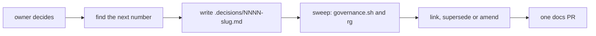
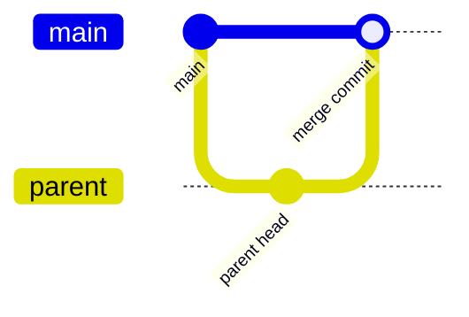
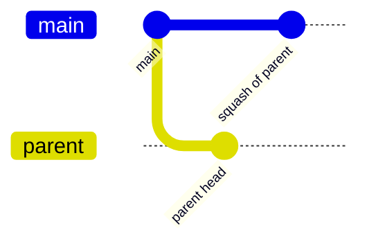

# adr

One decision, one file, one docs pull request. Write it the turn the owner settles something, even
if nobody asked: a ruling that is not written down gets decided again, differently, by the next
session. This skill holds the file's shape and the judgment around it.

Before you write one, ask "is this a setting?" A model, an effort level or a number a person may
change tomorrow is a setting, and gets no decision file and no pull request (owner, 2026-11-11,
[0069](../../../.decisions/0069-choices-are-settings.md)).



## 1. Find the next number

```sh
node .agents/skills/lead/scripts/records.ts next .decisions   # fetches, then reads origin/main
gh pr list --state open --search ".decisions in:files" --json number,headRefName
```

Take the larger of the command's number and the highest number in an open PR plus one. A number is not reserved until
your PR is open, so check again just before you open it. If another PR took it first, the one opened
first keeps it, and you renumber yours.

The slug is kebab-case, at most five words. The file is `NNNN-slug.md`, with the next free
four-digit number.

## 2. Write the decision

```markdown
---
id: 0002
title: <the decision in one clause, not the topic>
status: accepted
date: YYYY-MM-DD
tags: [a, few, words]
---

# 0002: <the same title>

**What this decides:** one plain sentence.

## Context

Why it came up. Link the note, ticket or pull request.

## Decision

**One bold sentence first.** Then the rules, as short bullets.

## Consequences

What changes, what it costs, what is not decided here.
```

- `status` is `accepted`, `superseded` or `amended`; step 4 says how an older file changes. Nobody
  deletes a decision.
- Keep it short. The long reasoning goes in a `docs/direction/` note.
- A decision moved in from elsewhere leaves only a one-line link behind
  ([0002](../../../.decisions/0002-moving-a-decision-removes-it-from-its-source.md)).

- **The `title` carries the decision, not the topic.** `Every gate fails closed on zero scope`, never
  `Gate scope handling`. One clause. Where it has a "not this" half, keep it inside the clause
  (`X, never Y`).
- The `# NNNN: <title>` heading repeats the title exactly.
- **A decision that has a shape opens with a picture**, right under the heading: a Mermaid diagram,
  then one small real code block with the shape, then the words
  ([0005](../../../.decisions/0005-patterns-and-decisions-are-visual.md)). A shape is a flow, a
  state machine, a type, a file layout, who calls whom. A decision with no shape (a direction, a
  yes or no, a name) skips the picture rather than drawing a box that says the sentence again. A
  decision that changes a shape uses the [before and after form](#before-and-after).
- `**What this decides:**` is one plain sentence for a reader who was not there.
- `## Decision` opens with one bold sentence. Where it limits later work, end with a short
  **Binding constraints** list.
- Link the `docs/direction/` note when one exists, and the ticket or PR it came from.
- Never quote what a person typed. Record the decision.

## 3. Sweep the decisions this one might contradict

Two accepted decisions that say opposite things are worse than an open question: each reads as the
rule, and neither points at the other. Write what this file settles **as questions** ("may a docs PR
merge without a review?"), then search for each:

```sh
sh .agents/skills/lead/scripts/governance.sh
rg -il '<word>' .decisions docs/direction .glossary
```

The script lists the decision files whose title, tags or slug words show up in your diff, and
every decision file the diff edits. For now it only lists and always exits 0; it blocks later, once
its false alarms are measured. An empty
list is not a clearance: two decisions that disagree about what a word means may share no words.
Read the area by hand too.

## 4. Supersede or amend

For each real conflict, pick one and edit only the older file's `status:` line:

| The new decision | Older file's `status:` becomes |
|---|---|
| replaces it outright | `superseded by [NNNN](NNNN-slug.md)` |
| changes part of it, the rest still holds | `amended-in-part by [NNNN](NNNN-slug.md)`, appended to any list already there, in number order |
| only refines your own earlier file's details | no status change; add a dated line under its `## Amendments` |

You may add a one-line pointer in the older file's body, linking yours and saying where its text
still holds. It adds no rule. Name the relationship in your own `## Context` as well.

If an amendment adds a subject the older title does not name, retitle the older file (frontmatter
`title` and heading together) so it names every rule it holds. Keep its number and file name, so
links still work.

## 5. Cite only live decisions

Before you link a decision, open it on `origin/main`:

```sh
git show origin/main:.decisions/<file> | sed -n '1,8p'
```

Cite it as a rule only when its status is `accepted` or `amended-in-part by ...`. A `superseded`
file is history. A file only in an open PR may never merge. Use the file name you just read, not one
you remember.

## 6. Words

If the decision coins or renames a word, add its row to [`.glossary/TERMS.md`](../../../.glossary/TERMS.md)
in the same PR, and name it in a closing `## Records` section.

## 7. Open the PR

One decision per PR. Run `pnpm format`, `pnpm lint` and the leak grep, commit with the step-commit
skill as `lead`, push, open it. It merges on green CI with a clean leak grep
([the lead skill](../lead/SKILL.md#decisions-land-at-once)). Report the file path and whether a
glossary row was added.

## Diagrams

The Mermaid rules, which diagram fits which idea and what breaks on GitHub are in
[the diagram reference](../write-pattern/references/diagrams.md). Read it before you draw.

### Before and after

A decision that changes a shape shows both, under `## Decision`, with the same node names in each so
the difference is what changed. Then the code, before and after, the same way:

````markdown
**Before:**



**After:**



```sh
# before
catchup.sh <pr> <ticket> --merge-method merge
# after
gh stack merge <pr> --squash
```
````

That is [0004](../../../.decisions/0004-squash-merges-and-native-stacks.md)'s change, drawn. One
line after the pair says what the reader should see move.
