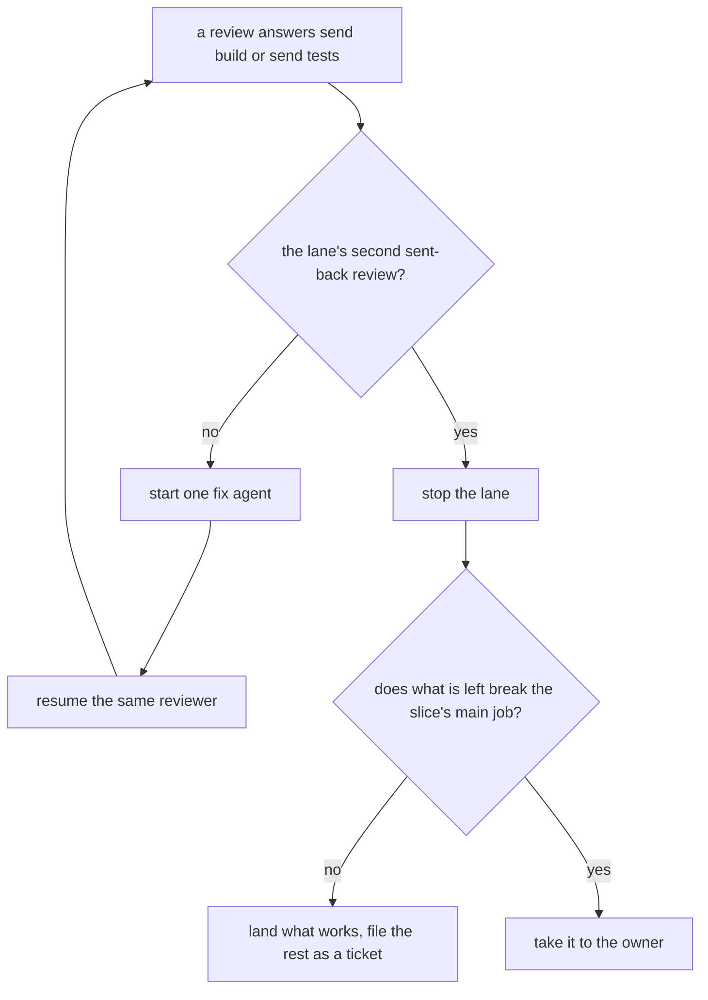

# The lead

Today's pipeline programs are paused, so the lead session runs each pull request's steps by hand:
plan, tests, build, one review, each by its own agent
([the steps](../../../docs/direction/next-is-a-pipeline-pre-run.md)). Mutation is no step of a pull
request: it runs hourly against main and files tickets
([0066](../../../.decisions/0066-mutation-runs-on-a-schedule.md)). The lead writes no step's
work. It starts each step, reads what comes back, and lands the result.

```text
plan (read-only) -> lead approves -> box -> tests -> build -> review
  -> fetch, read the diff, e2e -> push as the bot -> pull request -> merge rule -> merge queue
```

A step's brief is short. It names the skill and the ticket's facts, and nothing the skill holds:

```text
Use the build skill for ticket 277, door fixes, next/. Plan at ../door-PLAN.md.
Laws d1 to d3 are red. This round: make them green in door.ts, answer.ts and hello.ts.
```

A brief does not repeat what every agent reads in
[`AGENTS.md`, "Finish your task"](../../../AGENTS.md#finish-your-task): finish the whole task, the routine steps
that need no approval, and a report a reader with no context can follow.

When you answer an agent's ask, resume an agent or send work back, say exactly what to do: the file, the
fault, the input that shows it and what done looks like, as [the recheck message](#when-a-review-sends-back)
does. A bare "continue" or "go" makes the agent guess what you meant, and a wrong guess costs a round.

A brief never prints npm, pnpm or environment settings (owner, 2026-11-08), not even to show a
step where they come from. A run once printed a token to a local log that way. Name the setting
and say where it is set; never echo its value. `pnpm config list` and `env` stay out of briefs.

An agent's own worktree gets its own install: `pnpm install --offline
--frozen-lockfile` in it, about 3 s from the warm store, with no network and no lockfile change.
Never link `node_modules` to the main checkout's: pnpm 12 refuses a linked one in `pnpm -r`
(`ERR_PNPM_UNSAFE_TASK_RUN_STATE_PATH`), and a pnpm run in the worktree, an install included,
rewrites the main checkout's install state through the link. `pnpm typecheck` removes such a link
and runs that install itself before it checks; every other command still needs the real install.

For a stacked lane, put the parent and landing facts in the state file and the brief before the
first step:

```text
Parent: ticket <id>, branch <branch>, signed build head <sha>, or none.
Children: <ticket, branch and signed parent head for each child>, or none. Record before starting.
Start a child at its parent's signed build head. Keep the child's tests until it lands.
Land the stack with `gh stack merge <pr> --squash`, then `gh stack sync --prune`.
Return plans unsigned, including reviews and revisions. Only the lead session approves them.
```

The draft check checks the handoff format. Shared shell access cannot prove which session signed.
Do not add a marker, key or readable file as proof of session identity.

## Review brief template

Use this for the whole diff, including a re-review by a fresh reviewer. A recheck after a fix round
uses [the recheck message](#when-a-review-sends-back) instead:

```text
Use the review skill for the ticket below.
Ticket: <id and title>
Version: <today's tooling or next/>
Approved plan: <path, including amendments>
Parent base: <branch and full signed SHA, or origin/main and full SHA>
Reviewed head: <branch and full SHA>
Decided notes: <every decided note the PR builds>
Last fixes: <commit range and report, or none>
```

[The review skill](../review/SKILL.md#steps) holds what to check and how to answer, so the brief
repeats none of it.
Keep the four reason labels in the review skill. A missed case in a named class checks the law;
it does not reopen every test's merits.

## When a review sends back

A fix round is one agent and a recheck, and a lane stops at its second sent-back review
([0177](../../../.decisions/0177-fix-round-is-one-agent.md),
[0176](../../../.decisions/0176-second-send-back-stops-lane.md)).



1. **Count the lane's sent-back reviews.** The lane's state file has each step's outcome. `chain.ts`
   does not count them yet, so you do.
2. **On the first,** start one fix agent with the brief below. It writes the law and the fix
   together: no tests step and no build step. Then resume the same reviewer, with what it already
   read, and send it the recheck message below. Never start a fresh reviewer for a recheck.
3. **On the second,** stop the lane. Land what works, file the rest as a tracker ticket
   (`tracker_file`), and write the lane's field note in `field/notes/`. Take it to the owner only
   if what is left breaks the slice's main job.

A review that answers `send plan` is not a fix round: it goes back to the plan step, as today.
The first pass is unchanged: plan, tests, build and one review, each by its own fresh agent.

The fix agent's brief:

```text
Fix round for ticket <id>, <title>, <today's tooling or next/>.
You do the tests step and the build step together, for the faults below only. Use the tests skill
for how a law is written and the build skill for how product code is written.
Branch: fabrikalfa/<name>, in the worktree <path>. Approved plan: <path>. Reviewed head: <full SHA>.

Faults the review named:
1. <path:line>: <what is wrong>. Input that shows it: <the call, the Msgs or the value>.
2. <path:line>: <what is wrong>. Input that shows it: <the call, the Msgs or the value>.

Write the law and the fix together, as small as the fault. For each fault, write its law, or
extend the law that covers its class. See it fail on the reviewed head for that fault. Then fix
the product code until it passes. Change nothing these faults do not need.
Commit the law as the tests step and the fix as the build step, with the step-commit skill.

Laptop caps: tests on a narrow path only, as `nice -n 19 pnpm exec vitest run --maxWorkers=1 <path>`,
never the full suite. `pnpm lint` once. At most one `pnpm typecheck`, at the very end. One Electron
app at a time. Every wait or poll loop runs in the background.

Finish the whole round. An error, a timeout or a failing tool is an ordinary obstacle: work through
it yourself. Stop only for a real blocker, such as a fault that needs a new design call, and say
exactly what it is. End with each fault, its law at file:line, how you saw the law fail and then
pass, and the new head's full SHA. Do not end with a list of what is left or an offer to continue.
```

The recheck message, sent to the resumed reviewer:

```text
Recheck for ticket <id>. A fix round answered your review.
New head: <branch and full SHA>. The fix is <reviewed SHA>..<new SHA>.

Faults you named:
1. <path:line>: <the fault, in your words>
2. <path:line>: <the fault, in your words>

Check the fix for these faults and the new law's reach: read each line the fix changed and what
calls it, and plant a break, by reading or in a scratch copy, to see that the new law reaches the
fix. If you now think one of your findings was wrong, say so.
A new fault you notice outside the fix is a finding row or ticket text for the lead. It sends the
lane back only if it breaks the slice's main job.
End with exactly one answer: line, as the last line: `answer: done <why>`, or
`answer: send build <why>` (or `send tests`, `send plan`).
```

## Lane brief template

Use this when a lane agent runs a lane's steps for you. Its last act is `land.ts ready`; the lead
session lands (ticket 652):

```text
Run the lane for ticket <id>, <title>, <today's tooling or next/>.
Lane: <lane>. Branch: fabrikalfa/<name>, in the worktree <path>. State file: BOXES/state/<lane>.md.
Approved plan: <path, including amendments>. Lane brief: <path>.
Run each step through drive.ts or chain.ts, read its answer, and send fixes to the step that owns the file.
Commit a lead file (field rows, a plan row, a lockfile) unsigned, with
`stepcommit.sh --commit-only lead <ticket> <subject> <files>`, and keep its sha.
When the review says merge-ready: write the PR body file with the pr skill (its first line the title, and a
`fabrika close ticket <id>` line when the PR finishes the ticket), save loosening.sh's output as a
file, and end with
`node .agents/skills/lead/scripts/land.ts ready <lane> --tree <path> --body <file> --loosening <file> --plan <path> [--lead <sha>]...`.
Mid-lane, when only a lead commit must reach the next step (a lockfile, a merge of main), end with the same
command without the two PR files. Then stop and say "ready to land" with the state file's path.
```

## Who runs which step

Decided in [stage agents run on Codex](../../../docs/direction/agents-run-on-codex.md) (owner,
2026-11-08), which this section follows.

- **Codex in a box runs each step:** plan, tests, build and review, each its own agent.
- **Except Electron or socket work** (owner, 2026-11-08): a step whose laws or shots need the app
  running (a program's window, the desk, keys, the look) or need to bind a socket is run by a Claude
  agent instead. A Codex box can start neither, so a Codex build there would come back half checked.
  Still one agent per step.
- **A tool that needs ports, sockets or its own processes runs in a container with its own
  network** (owner, 2026-11-09,
  [0045](../../../.decisions/0045-test-steps-run-in-containers.md)), never behind a hole in a
  sandbox row. Mutation's Stryker run is the first: it runs through `mutbox.ts`, now in the hourly
  run against main (0066); a lane parked inside its mutation step before 0066 still finishes it,
  with `drive.ts` running `mutbox.ts` before that step's Claude agent starts (`drive.ts --agent claude`).
- **One fresh Claude agent per step, not one long driver per ticket** (owner, 2026-11-09). Each
  step gets a new agent with a short brief. It reads the lane's state file
  (`BOXES/state/<lane>.md`), does its one step, and writes the state file back for the next agent:
  the branch, the signed heads, what ran and what is next. Nothing is carried in an agent's
  memory. A PR still merges only after every step ran, each by its own agent (plan, tests, build,
  one review saying merge-ready), with CI green and the leak grep clean. No step is ever
  skipped. A fix round after a sent-back review is the one exception: one agent does the tests and
  build work, and the same reviewer is resumed ([above](#when-a-review-sends-back)). Only a new design call or an exam read that does not meet the bar (step 9) comes back to
  the lead. `chain.ts` (tracker ticket 341) chains the mechanical steps in code and starts an
  agent only where judgment is needed ([below](#run-a-whole-lane-with-chaints)). *It said (owner, 2026-11-08): one driver per ticket, start
  to finish. One driver ran for 11 hours, which was wasteful.*
- **A step agent never writes another step's code or tests** (owner, 2026-11-08), except the fix
  agent of a fix round (0177). The agent
  that hands work along fetches, reads the report, and runs what a Codex box cannot: e2e runs and
  screenshots.
- Plan every row as soon as its tier opens, and start each test writer when its plan is approved.
  Tests do not wait for the code under them; only builds wait in line.

## Scripts

All read `scripts/env.sh`, which finds the main checkout and keeps the boxes beside it (`BOXES`).
Each script's header comment says how it runs: its arguments, checks, exit codes and edge cases.
Read the header before you run one; this table only says what each is for.

| Script | What it is for |
|---|---|
| `box.sh new`, `run`, `fetch` | one box's start, Codex run and fetch; a lane's boxes are made by `drive.ts`, never by hand |
| `box.sh gc` | remove boxes and landed worktrees whose work is safe elsewhere (`gc.ts` says when); `gcloop.ts` runs it ([below](#box-cleanup-on-a-timer)) |
| `gcloop.ts` | the box cleanup's loop: a timer sweep, a sweep after each merge, and `status` ([0101](../../../.decisions/0101-box-cleanup-runs-on-a-timer.md)) |
| `drive.ts` | one step end to end, with no agent waiting ([below](#use-drivets-for-any-step)) |
| `chain.ts` | a whole lane end to end, to the merge queue ([below](#run-a-whole-lane-with-chaints)) |
| `lanes.ts` | what each lane is doing now, read-only |
| `flow/run.ts` | run one flow of typed steps with no agent holding the loop ([0064](../../../.decisions/0064-the-lead-drives-with-flows.md)); `flow/flows/land-decision.ts` lands a docs-only decision PR |
| `mutbox.ts` | the mutation run's Stryker sample in a container ([0045](../../../.decisions/0045-test-steps-run-in-containers.md), 0066) |
| `runplan.sh` | a read-only plan writer in the main checkout |
| `botpush.mjs` | push a branch and its step notes as the bot, in one atomic push |
| `publish.ts` | leak-check, push HEAD and open a draft PR when the branch has none ([0134](../../../.decisions/0134-no-code-stays-only-on-a-local-branch.md)); `stepcommit.sh` runs it |
| `unlisted.ts` | list each branch with commits not on main and no open PR, and each that is safe to delete |
| `land.ts ready` | a lane agent's last act: record "ready to land" |
| `land.ts run`, `queue`, `merged` | the lead session only: land a ready lane, add a pull request to the merge queue ([0162](../../../.decisions/0162-no-friction-before-a-merge.md)), and close its tickets after the merge |
| `governance.sh` | list the `.decisions/` files a diff touches; advice only |
| `sizecap.ts` | a diff's or a plan's size, as advice only ([0099](../../../.decisions/0099-no-number-caps-a-pull-request.md)); run `diff` by hand, since nothing prints it at landing |
| `fieldrow.py`, `clauderow.ts` | print one `field/runs/` row from a Codex run's events, or from a Claude subagent's transcript |
| `fieldfile.ts` | save each printed row as its own row file (0090) |

Cleanup is the tooling's job: never ask the owner to free disk
([0019](../../../.decisions/0019-nothing-stale.md)).

box.sh run and runplan.sh strip secret settings and redact saved output.
fetch --sign checks owners and signs missing notes in MAIN.
Review and mutation briefs say never to print npm, pnpm or env settings.
leakgrep.sh checks added text; private words stay outside the repo.

## Use drive.ts for any step

Every step goes through `drive.ts`, on a Codex box or a Claude agent; no box is made by hand. A
Claude agent in the lead session only reads its result and makes the judgment call. Start it in the
background and read the last line only:

```sh
node .agents/skills/lead/scripts/drive.ts <lane> <plan|tests|build|mutation|review> <brief.md> &
```

Its header says how: the flags, where a step starts, each check, the exit codes, the refusals and
what the line's `reason` means. What is yours to decide:

- **Which agent.** Codex is the default. Start a Claude step whose laws or shots run the app with
  `--agent claude --electron`; drive holds the one Electron lock for it, and the next such step
  waits.
- **The brief.** It names no file outside the box, and it writes a plain `node` and `pnpm`, never
  `volta run`.
- **A lockfile ask.** A box has no network, so it cannot refresh `pnpm-lock.yaml`. When a step's
  commits change a locked field of a workspace `package.json` (its name or dependencies) or `pnpm-workspace.yaml`
  and leave the lockfile alone, drive answers `ask` (`lockfile`, exit 20) whatever the step said,
  and still pushes `-wip`. The lead then, outside the box, runs `pnpm install --lockfile-only` on
  `-wip`, checks each new version is exact and named in the approved plan, and commits the lockfile
  with `stepcommit.sh --commit-only lead`; a lane agent then runs `land.ts ready` without PR files
  and stops, and the lead session runs `land.ts run`, which signs it and pushes it to `-wip`. The
  next step starts at that tip.
- **A stuck or kept box.** A stuck step keeps its box for you to look at. A check that cannot run
  is `stuck`, never a pass. drive never retries.
- **A mutation step** is only for a lane parked inside its mutation step before 0066. Its brief
  names the related tests on one line, `RELATED=<paths>`: tests only, and among them the base's
  test a moved or changed law came from. A `done` whose reason names `no_arm_a:<cause>` or
  `no_reach:old_sampler` has `narrowing: "unknown"`: hand-check the laws as for a loosening hit.
- **Not in the header yet:** a stop after the time limit takes the agent's whole process group
  with it. A refusal is not a step outcome, so the stuck count holds only steps an agent ran.

## Run a whole lane with chain.ts

`chain.ts` runs a lane's steps in code, through `drive.ts`'s pieces, and starts a fresh read-only
agent only where judgment is needed. Start it in the background, send its output to
`BOXES/<lane>-chain.out` and read the last line only:

```sh
node .agents/skills/lead/scripts/chain.ts <lane> BOXES/<lane>-CHAIN.md > BOXES/<lane>-chain.out &
```

Its header says how: the flags, each phase and move, the host step and a lane brief's `## host`
section, the retries and limits, the budget, the record and the pinned scripts. What is yours:

- **The lane brief** is one Markdown file. Its text before the first `## ` heading goes to every
  step (the ticket, its version, the approved plan, the decided notes). Then one section per step,
  `## tests`, `## build` and `## review`, written as a step brief is written today
  (the review one keeps the template above, minus the two head lines, which the chain fills in),
  and `## pr`: the pull request's description, its first line the title, with the
  `fabrika close ticket <N>` line when the PR finishes the ticket, written as
  [the pr skill](../pr/SKILL.md#a-lanes-description-is-written-twice) says. Every section is
  required. A lane has no `## mutation` section (0066).
- **Which steps need Claude:** `--claude` names the steps with Electron or socket work, and
  `--electron` the ones that run the app.
- **The lane's budget** ([0076](../../../.decisions/0076-a-lane-stops-at-its-budget.md)): when the
  chain ends `ask` with the counts, you answer redo, cut scope or drop. Put
  `Estimate: <n> steps, $<d>` in the plan or the lane brief, so the lane has a backstop. Never put
  these numbers in a step's brief.
  Since [0176](../../../.decisions/0176-second-send-back-stops-lane.md) a lane stops at its second
  sent-back review, whatever this window says. The chain does not count that yet, so
  [the lead does](#when-a-review-sends-back).
- **A parked lane** (`ask`, exit 20) is yours: a loosening hit for your hand check, a lockfile
  ask, a send to plan, or what the judgment agent parked. The why is in the line's `reason`.
- **Where it ends:** `queued`, not merged. Run `land.ts merged <pr>` later (step 10).
- **New scripts.** A lane keeps the scripts it started on. To take new ones, stop the lane and
  start it again with `--start <step>`.
- **Watching:** `node .agents/skills/lead/scripts/lanes.ts` prints one JSON line for each lane that
  has not landed. A `stuck` line means look at the lane now; a `waits` line is yours to
  answer. For one lane's moves, `tail -f BOXES/state/<lane>.md`. To stop a lane, stop the chain process: the
  running step's process group goes with it, and drive records that step as stuck. Start the chain
  again with `--start <step>` to go on from there: its rounds count on from the ones the chain
  record holds, so no earlier round's record, brief or judgment file is written over. Read the
  line's own `exit`, never the shell's: `volta run` answers 126 for any exit that is not 0.

## Box cleanup on a timer

`box.sh gc` runs on a launchd timer and once after each merge, never on a step's start
([0101](../../../.decisions/0101-box-cleanup-runs-on-a-timer.md)). `gcloop.ts`'s header says how to
install and remove the timer, once per laptop. At each check, read
`node .agents/skills/lead/scripts/gcloop.ts status`: a `LATE` line
means the timer is dead or every sweep was skipped behind a hung one. Fix the cause the same turn.

## Pushes and protected refs

Every commit leaves the laptop when it is made
([0134](../../../.decisions/0134-no-code-stays-only-on-a-local-branch.md)). `stepcommit.sh` (signed)
runs `publish.ts` itself, and a lane's box commit is pushed by drive's pushing phase, so neither
step nor lead pushes by hand. A commit step that cannot push exits 6 and names the command to run
where the push can. Run `node scripts/unlisted.ts` in the main checkout every round and fix each
line the same turn.

Keep the bot's explicit atomic push of notes plus branch. On a person's branch, notes-only as the
bot and branch-only as the person are two intended writes. A refusal stops the step.

When the session's permission check refuses a step agent its lead sign (`pnpm commits sign --step
lead` through the repo's scripts), its normal push (`botpush.mjs`, or a plain non-force push of its
own branch), or its merge of a passing test-only fix or a rows-only PR, the lead session runs that
same command itself, without asking the owner again
([0056](../../../.decisions/0056-lead-runs-a-refused-step-itself.md)). Only the script reads the key.
Report every other refused action to the owner with the exact command and worktree; never route
around it. A lane agent does not meet this for its landing: it stops at `land.ts ready` (step 8). A rows-only PR lands with `land.ts queue <pr>` on green CI with a clean leak grep; a test-only
fix still runs every step first.

`Cannot update this protected ref.` alone does not prove a push failed. Read the command's exit
status and the rule suite's overall result and named ref. In
[rule suite 4984058968](https://api.github.com/repos/usirin/tea-fabrika/rulesets/rule-suites/4984058968),
the update check named a person's branch, and the overall result was `bypass`: that push
succeeded through the owner's bypass. It did not show a refused notes ref. Keep real push failures
visible, and never weaken the rules to hide this message.

## Steps

1. **Plan.** Write a brief that names the ticket, its version, what to read and an older plan to copy
   the shape of. Run `runplan.sh` in the background. Save the answer as `BOXES/<name>-PLAN.md`.
2. **Check the unsigned plan.** Run `sh .agents/skills/plan/scripts/plancheck.sh --draft <plan>`.
   It checks sections, generators and file owners, and prints the whole body's hash.
   The exam listing is a total scan of the whole file, fences and link titles included.
   Read the list for paths the files-table parser may miss.
3. **Approve in the lead session only.** Read the whole plan, its laws and generators or labels,
   its decided notes and open questions. Plan writers and agents reviewing or revising a plan
   return it unsigned, with line one blank. The agent that wrote it sends it to the lead session for approval.
   After the read, fill line one with `Approved by the lead agent, builds <note>; body <sha256-12>`
   using the draft check's digest, then run `plancheck.sh --approved <plan>`. Any body edit,
   including an amendment, needs the same read and checks again. A new design call goes to the owner as one
   yes or no. Answer, in the plan, any open question a decided note already answers.
   A plan that patches or changes a package (tea, demlik, Manti, Effect, Alchemy) names what it
   read of that package's decisions, patterns and source; else send it back
   ([0054](../../../.decisions/0054-read-upstream-before-patching-it.md)).
4. **Start the lane** on a `fabrikalfa/<name>` branch through `drive.ts`, never `box.sh new` by
   hand. Use `origin/main` for an independent ticket. A stacked child starts at the parent's signed build head, before the
   parent merges, as [Tier 1](../../../docs/plan/tier-1.md#the-pull-requests-one-at-a-time) allows.
   Record the child, parent branch and signed head before starting it. Keep the child's tests
   when merging parent work in. Never replace them with the parent's older tests.
   box.sh new checks the approved plan, base and ticket.
5. **Run the steps in order,** in the background: tests, build, review (no mutation step, 0066). Each runs
   through `drive.ts`, except a step with Electron or socket work, which a Claude agent runs
   (above). No builder starts before tests that exist. Each brief names its skill.
   Never start a review while a host-only law the plan names has not passed on a real machine
   ([0178](../../../.decisions/0178-host-only-laws-run-first.md)). The build runs it, or you run it right after
   the build (step 7). On the owner's Mac it runs only after you have read every line it can reach
   that signals a process or calls launchd, and the owner has said yes (0178).
   box.sh run --step checks order and slots, and saves the run row.
6. **After each step:** read drive's last line, the report and the diff, and log the run the same day:
   one row file in `field/runs/` (`fieldrow.py` for Codex, `clauderow.ts` for a Claude agent, a
   driver included, once it has finished, or drive's `BOXES/<lane>-rows.jsonl`, each saved with
   `fieldfile.ts runs`), and one note file in `field/notes/` for anything that
   broke, cost too much, needed a person or worked well. Send a fix to the step that owns the file;
   when a review sent the lane back, follow [When a review sends back](#when-a-review-sends-back).
   A test that breaks on one machine or in a box leans on that machine: send it to tests to remove
   the dependency, never to catch the error ([0052](../../../.decisions/0052-tests-never-depend-on-the-machine.md)).
   Step-commit checks file owners.
   Each correction the owner makes, and each slip of the lead's own, gets a note too, with the code
   that would have caught it. Running the steps by hand is how `next/`'s pipeline learns.
7. **Run what the box cannot,** yourself: Electron e2e and screenshots. One Electron app at a time,
   each run with its own short `FABRIKA_HOME`, never `FABRIKA_FOREGROUND=1`. Look at every shot.
   A host-only law runs here before the first review, never at the end of the lane (0178). Before
   it runs on the owner's Mac, read every line it can reach that signals a process or calls
   launchd, and work out the worst target each could get: a pid or group of 0, 1 or -1 reaches
   every process the owner has, and so does `launchctl bootout` of a whole domain. Then ask the
   owner, and run it only on a yes. On the
   real machine a test touches only its own label, files and processes: its own temp home and its
   own test label under launchd, no focus taken, and nothing left behind.
8. **Ready to land.** A lane agent never signs as lead, pushes, opens the pull request or adds
   it to the merge queue: the permission check refuses a subagent the lead key, and the lane stops
   ([0056](../../../.decisions/0056-lead-runs-a-refused-step-itself.md), ticket 652). Its last act
   is `land.ts ready` ([the template](#lane-brief-template)). The PR body file says which parts were
   this repo's steps, what ran each one, and the dollars, in the order
   [the pr skill](../pr/SKILL.md) gives.
9. **Land it** by [the plan's rule](../../../docs/plan/README.md#how-a-change-lands): the review says
   `merge-ready`, CI is green (e2e included), and you read the diff and run the leak grep.
   [The tests skill](../tests/SKILL.md#new-and-changed-laws) says what a new or changed law must be.
   Zero hits from loosening.sh mean no owner read is needed.
   The lead records its output in the PR. A hit goes to the lead's hand check, with the hit list
   in the PR. Only real loosening waits on the owner.
   Did this PR change a row in docs/direction/follows/? It updates that row in the same PR ([0017](../../../.decisions/0017-each-model-we-follow-has-one-table.md)).
   Then the lead merges, product code included; a new design call is the only other wait ([0014](../../../.decisions/0014-the-lead-merges-when-every-step-passed.md)).
   Apply the labels rule and the zero-hit check together. These are proper property tests.
   Run `sh .agents/skills/lead/scripts/loosening.sh <base> <head> <mapping.md>` on the PR's exam
   diff. The PR writes a mapping table with `Removed` and `Replacement` columns for every renamed
   or replaced law, using exact test titles. Save that table as `mapping.md` for the command.
   A pure addition needs no replacement row. `loosening.sh`'s header says what counts as a hit;
   it fails closed, so every hit is yours to check by hand. A law narrowed with no changed
   `expect` is found by the hourly mutation run instead, as a ticket marked loosening ([0066](../../../.decisions/0066-mutation-runs-on-a-schedule.md)).
   Before this new check blocks anything, measure false alarms on the last 20 merged `next/`
   PRs and record the count. Do not claim that measure from generated tests alone.
   Never write "owner read" unless the owner did. Log each required owner read in a field note.
   An exam change that is all proper property tests merges without the owner's read (owner,
   2026-11-08). A change that loosens or removes a law still stays `ask owner exam_read`.
   Then the lead session adds the pull request to GitHub's merge queue
   ([0162](../../../.decisions/0162-no-friction-before-a-merge.md)). Main takes changes only
   through that queue. For a lane that ended at `land.ts ready`, run `land.ts run <lane> <ticket>`
   in the background: it merges main in, signs, pushes and opens or updates the PR, then queues it.
   For any other pull request, run `land.ts queue <pr>` once its checks
   are green. Both leak-check the change, each commit and the title and description, then add it to
   the queue with one squash pinned to the head; `land.ts`'s header says how.
   GitHub then tests the pull request on newest main and merges it. Nobody merges main in to catch
   up, and nobody runs the checks again on newest main by hand. The squash commit's title and
   message are the pull request's title and description, so write them to be read on main. Never
   pass `--admin` or `--auto`, and never run the merge on a head whose `ci-required` is not green:
   with a queue on, that arms auto-merge. A pull request the queue puts back out stays open: the
   lane merges main or fixes the red check, pushes, and it is queued again. A PR in a gh stack is
   refused by `gh pr merge`; land it with `gh stack merge <pr> --squash --yes` by hand.
   Every PR squash-merges, a stacked
   parent too ([0004](../../../.decisions/0004-squash-merges-and-native-stacks.md)). A stack is a
   GitHub stack ([its commands](https://docs.github.com/en/pull-requests/reference/stacked-prs-cli-commands)):
   `gh stack init <bottom> ... <top>` adopts the branches, `gh stack submit` opens the PRs,
   `gh stack merge <pr> --squash` lands bottom-up, and `gh stack sync --prune` rebases the rest
   onto main and pushes. Rebase by hand only locally (`gh stack rebase`, then `gh stack push`),
   never with the web "Rebase stack" button: it makes unsigned commits. The child's trees stay the
   same, so its links hold; if a tree changed, that child's steps sign again. A child keeps its own
   tests.
   After the merge, the lead closes the tickets the description names and starts one box cleanup sweep.
   `land.ts merged <pr>` does both (step 10).
   The sweep removes the lane's boxes and its clean, idle linked worktree. Never remove MAIN itself.
   Use git worktree remove without force. Keep dirty, locked, ambiguous or unreadable candidates
   and any box that fails its guard.
   Print one line per retained item and continue.
   Saved plans, reports, logs and state/ remain.
   A box is removed only when every commit and file it saved is somewhere MAIN keeps
   (`scripts/box/Remove.ts` says how it proves that). Remote-tracking refs and object presence do
   not count: fetch remote-only work into a retained MAIN ref first.
10. **After the merge:** GitHub's queue merges later than the command that queued, so this is its
    own act: `land.ts merged <pr>` reads the pull request once. When it has merged, it closes each
    ticket the description names on a line of its own, `fabrika close ticket <N>`, so put that line
    in when the PR finishes the ticket
    ([0015](../../../.decisions/0015-a-pr-phrase-closes-its-tickets.md)). Each close gets a comment
    naming the PR and its merge commit (`scripts/pr/Queue.ts`). When it has not merged yet, it says
    so and does nothing; run it again later. No row per merge is written: that measure is proposed
    ([M1](../../../docs/direction/autonomy-is-measured-trust.md#proposed-measures)). Then `git pull --ff-only origin main` and `pnpm install --frozen-lockfile` in the main checkout, plus any build the app needs to start. The owner runs the app from there and
    never pulls or installs first. If the pull refuses, because of local edits or another branch,
    leave them and tell the owner in one line.

## Tickets and tracker posts

Every ticket for this repo goes in the app's own tracker, through its `tracker_file`,
`tracker_comment` and `tracker_close` tools. Never open a GitHub issue on this repo. GitHub issues
are for other people's repos only.

- Every lane gets a ticket before its agent starts. File one if it is missing.
- Each brief names the ticket and a short writer name, such as `door-fix`.
- The agent posts when a real step starts, on a finding that matters, when blocked, when a pull
  request opens or is pushed, and when done. Not after every command.
- A post is 2 to 5 plain lines with full pull request URLs. No security holes, secrets or personal
  names: the tracker will be shared.

## Outside your task

Something wrong that your task does not cover is one finding row with proof, then keep going:
never a fix, a ticket or only a mention, and never a security hole.
Decision [0035](../../../.decisions/0035-outside-work-becomes-finding-rows.md) says why.
[A finding](../../../field/README.md#a-finding) has the fields, the closed `rule` list and what
counts as proof. The CI `field` job checks each added row's shape.

- **Every brief says it in one line,** for an agent that reads no skill: outside work is a finding
  row, see `field/README.md`.
- **A step hands its rows over** in its report or answer, one JSON line each. Save each unchanged
  as its own file the same day with `fieldfile.ts findings <rows>`, in the pull request it was found
  during or a rows-only one. Its id is its file name, the date and a short slug
  ([0090](../../../.decisions/0090-each-field-row-is-a-file.md)). Change only an `id` that is
  already taken or that is not that shape (an old `<date>-f<nn>` counter). Never drop a row because you disagree
  with it: a wrong one is rated `noise`.
- **Never rate a row.** A person does. When the owner rates one, write the `rated` row as their
  call, and for a `fix` file its ticket with `tracker_file` and put the number in that row.
- **A `flaky_test` does not wait** for its rating: it gets a ticket and a fix the same day
  ([0036](../../../.decisions/0036-a-flaky-test-is-fixed.md)).

## Lead tooling is fast-tracked

Skills, the lead scripts and the drive script run on our own laptop, so they are not product work
(owner, 2026-11-09). They skip the plan, tests and review steps. The lead or one agent
changes them directly, keeps each change small, and merges on green CI with a clean leak grep.
Product code (`next/` and today's app) keeps its steps.

## Decisions land at once

Decisions live in `.decisions/`, one file per decision
([0001](../../../.decisions/0001-decisions-live-in-the-repo.md), owner, 2026-11-09). The whole path:

```text
owner decides -> write .decisions/NNNN-slug.md -> its own docs PR -> merge on green
```

- **Write it the turn it is decided,** with a docs agent using [the adr skill](../adr/SKILL.md),
  in the shape the adr skill gives. Link its `docs/direction/` note when
  one exists.
- **One decision, one PR.** Never batch decisions, and never wait for a code PR or for the end of
  the day.
- **Merge on green.** A docs-only PR that writes down a decision is merged when CI is green and the
  leak grep is clean, with no plan, tests, review or field rows. Code PRs keep their steps.
- **Search before you ask.** Before the lead or any step asks the owner or writes a plan, it
  searches `.decisions/`, `.glossary/` and `docs/direction/` for the topic.
- **Ask in plain words, from the code.** Before a question to the owner, read the code it is about
  and that package's decisions, as [0054](../../../.decisions/0054-read-upstream-before-patching-it.md)
  asks of upstream. Then say what the code does, what breaks, each option with its cost, and your
  lean with how sure you are. An abstract question comes back to be asked again.
- **Read what a diff touches.** Before a review and before a merge, run
  `sh .agents/skills/lead/scripts/governance.sh` on the branch. It lists the decision files the
  diff's words touch. The review step and the lead read each one and say whether the diff walks it
  back. It only lists for now; it blocks later, once its false alarms are measured.

The lead owns the count of decisions still missing from the repo. Its status gives that count and
the open docs PRs carrying them. The owner does not keep the list. Code cannot count decisions
nobody recorded.

The leak check fails closed: any hit stops the push or merge for the lead's hand check. A later
commit does not clear a hit in an earlier one
([0048](../../../.decisions/0048-leak-check-reads-each-commit.md)); `leakgrep.sh`'s header says
what counts as a hit.

## Go easy on the machine

- One Electron test app and one Docker box at a time. Every wait or poll loop runs in the background.

## Never

- Write a step's work, run git inside a box, or reset a branch to take a step's work over.
- Rebase, force-push or `gh pr update-branch`, except a stacked child moved with `gh stack` (0004): a
  rewrite breaks every signed link and can drop a push another session made. Bring a branch up to date
  with a merge of main.
- Read, print or copy a key. Leave a box, a claim or a half-open pull request behind without saying so.

## When a run teaches something

Update the skill it teaches, in the same pull request as the field note. A rule that lives only in
one brief is lost with that brief.
