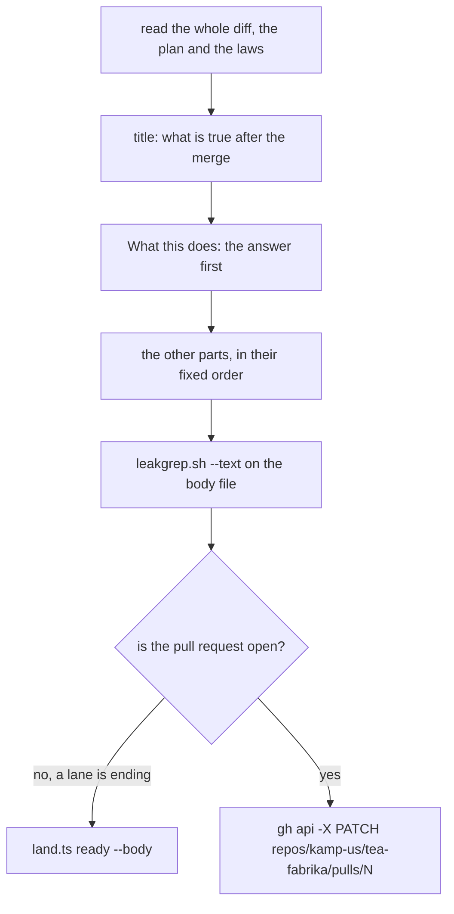

# pr

A description answers one question first: **what can a person, a program or an agent do after this
merge that it could not do before?** A reader who stops after the first part still knows what
landed. The steps table and the dollars come last: they say how the work was done, never what it is.

Write it **after the review, from the diff**. A sentence taken from the plan is a promise, so check
that the diff kept it. Read the description again after every fix round and every merge of main: the
change moves, and the words must move with it.



## One real example

The top of [pull request 1074](https://github.com/kamp-us/tea-fabrika/pull/1074), cut short. Its
whole description is the model.

````markdown
P39 slice 2: a granted hands key takes and finishes saved jobs, in next/ (ticket 714)

## What this does

All of it is in `next/`. Today's version is not touched.

- A person can grant a separate key the rank `hands`. Before, a grant was `window` or `agent` only.
- A window or agent key cannot call the job methods. A hands key cannot call anything else.
- No command runs yet. Requests still come only from trusted code through `Jobs.request`, and there
  is no `jobs.request` on the wire.

## Why this change

Ticket 714, the thin slice of hands: this is slice 2 of 5, so the ticket stays open and there is no
closing phrase. Plan row
[P39](https://github.com/kamp-us/tea-fabrika/blob/main/docs/plan/tier-1.md#the-pull-requests-one-at-a-time).

## How it works

- `gateway/JobAccess.ts`, new and pure: `owns` checks the process, the named key, the executor and
  the execution.
- `jobs/Jobs.ts`: the service gains `forProcess(process)`, a stream of the jobs whose saved request
  names that process.

```ts
// gateway/Gateway.ts: a job call checks the grant again inside the write turn.
if (method.startsWith("jobs.")) {
  ...
}
```

Read these files first, in this order:

1. `gateway/Jobs.ts`
2. `gateway/JobAccess.ts`
````

Three of its six bullets, two of its seven lines of shape and two of its six files are shown.

## The parts, in order

| Part | Holds |
|---|---|
| Title | What the change does, in one plain clause, with its plan row or ticket, and `in next/` when it is |
| `## What this does` | 3 to 6 short bullets: what works after this merge that did not before, and in which version |
| `## Why this change` | The ticket, the plan row, and the decision or note it builds. One or two lines |
| `## How it works` | The shape in code, for a reader about to open the diff |
| `## What a reader should know` | What other code or stored data will feel |
| `## Laws and checks` | The laws by name, what ran, and the loosening check |
| `## Not in this pull request` | What waits for a later slice, and what was found and left |
| `## How it looks` | Only for a change to a program's window: the shots |
| `## Steps` | The tooling's table, unchanged |
| The closing phrase | `fabrika close ticket <N>`, only when this pull request finishes the ticket |

Drop a part only when it truly has nothing. Never leave a heading with nothing under it. A docs
pull request that records one decision is often just the title, What this does, Why this change and
one line of checks.

## What each part needs

- **Title.** Say what is true after the merge: `a process keeps its watchers across its object's
  sleep`. Never the step's name, never the draft's `the lane's steps are running`, never a note on
  what to write. At the squash it becomes main's commit subject, where nobody sees the body.
- **What this does.** The answer first. Each bullet is something a person, a program or an agent can
  now do, or a fault that is gone. A list of files is not an answer. When nothing can be reached yet
  (a contract with no caller, a route no client speaks), say so in a bullet: it is the line a reader
  needs most. The test: could the owner read only this part and tell someone what landed?
- **Why this change.** Links, not an argument: the decision already holds the reasons. A ticket
  lives in the tracker, so name it by number. Say which slice this is, and whether the ticket stays
  open.
- **How it works.** Name each new or changed service, layer, machine, schema and command, one line
  each. Add one small code block copied from the diff that shows the whole idea, then "Read these
  files first", numbered. A reader should know where to start before opening the diff.
- **What a reader should know.** New or removed public exports, settings, a stored shape (a fact
  recorded from now on, and whether older rows still read), and anything that makes other code
  change. When there is none, say "Nothing." in one line.
- **Laws and checks.** Each law by its exact test title, with what it protects in a few words. Then
  what ran, at which head, and what ran it. Say what could not run and why, and what is not known
  yet: a check nobody ran is said as plainly as a green one. Then `loosening.sh`'s output and, when
  it had hits, the lead's hand check of each.
- **Not in this pull request.** What the next slices add, by slice. Each finding row written or
  handed over. Never defend the size: no number caps a pull request
  ([0099](../../../.decisions/0099-no-number-caps-a-pull-request.md)).
- **How it looks.** List each shot by state and layout, link the comment that holds them, and name
  the head they were taken at. Say what looks broken, empty or wrong in each. The shots are attached
  with `gh`'s `--attach` and never committed
  ([0160](../../../.decisions/0160-pr-shots-are-never-committed.md), and "Show it running" and
  "Shoot more than one layout" in [AGENTS.md](../../../AGENTS.md#changing-the-product)).
- **Steps.** Keep the table the tooling wrote: step, box, outcome, list dollars, total. One line
  above it says which parts were the pipeline's steps and which were the lead's. Work done by hand
  after the last step (a type fix, a merge of main) gets its own honest line there.
- **The closing phrase** stands on a line of its own, and only when the merge finishes the ticket
  ([0015](../../../.decisions/0015-a-pr-phrase-closes-its-tickets.md)). A slice that leaves its
  ticket open leaves the phrase out and says so under Why this change.

## A lane's description is written twice

A lane brief needs its `## pr` section before any code exists, and `chain.ts` posts it word for
word: the first line as the title, the rest as the description, then its own `## Steps`
(`.agents/skills/lead/scripts/chain.ts:1444`). So:

- **At the start,** write only what the plan already settles, in final words: the title, What this
  does as the plan promises it, Why this change, Not in this pull request. Never a note on what to
  say later. Pull request 1074 opened with such a note as its title and nothing above its steps.
- **When the review says merge-ready,** read the diff and rewrite the whole description with this
  skill. Keep the tooling's Steps part as it is.
- **Every heading has two words or more,** on purpose. In a lane brief a one-word `## ` heading
  starts a new brief section (`chain.ts:384`), so a `## Why` would cut the description short there.

## Words

[AGENTS.md](../../../AGENTS.md#how-to-write-here) holds the rules, in "How to write here" and "This
repo is public". The ones a description breaks most:

- Plain everyday words and short sentences. American English.
- A pull request or an issue is a full URL. A decision or a note is a full URL too: a relative link
  does not resolve in a description.
- No personal names, no account names, no machine paths, and nothing a person typed in a chat.
- No credit line, no "generated with" footer and no session link. The agent never names itself
  ([0401](../../../.decisions/0401-agents-commit-as-the-fabrikalfa-bot.md)).

## Send it

```sh
sh .agents/skills/lead/scripts/leakgrep.sh --text <file>
gh api -X PATCH repos/kamp-us/tea-fabrika/pulls/<n> -f title='<title>' -F body=@<file>
```

Check the body file before it is sent, every time. `gh pr edit` fails in this repo, so an open pull
request is changed with the second line. A lane agent does not send: its body file's first line is
the title, and it ends with `land.ts ready --body <file>`
([the lead skill](../lead/SKILL.md#lane-brief-template)). `land.ts run` then adds `loosening.sh`'s
output as its own last section, so do not paste it twice.

## The known way

- [Google's engineering practices](https://google.github.io/eng-practices/review/developer/cl-descriptions.html):
  the first line is a short summary of what is being done and stands alone in the history, the body
  says what and why, "Fix bug" is not a description, and the description is read again before the
  merge. We keep all four. Google writes the first line as an order. Here it is a statement, as
  main's titles already are.
- Effect: [its template](https://github.com/Effect-TS/.github/blob/main/.github/PULL_REQUEST_TEMPLATE.md)
  asks for a type, a description and related issues, and its own merged pull requests open with
  summary bullets and end with the commands that were run
  ([one of them](https://github.com/Effect-TS/effect-smol/pull/2613)). A change to runtime behavior
  or an exported type also gets a changeset, a short note for people who use the package
  ([its AGENTS.md](https://github.com/Effect-TS/effect-smol/blob/main/AGENTS.md#changesets)). Our
  What this does, Laws and checks and What a reader should know are those three.

## Could become a check

Each of these is a rule code could hold. It stays here until its check lands
([0408](../../../.decisions/0408-skills-keep-only-judgment.md)).

- The title is one clause: not empty, not the draft's placeholder, no second sentence.
- `## What this does` is there, with 3 to 6 bullets, before a lane's pull request is marked ready or
  `land.ts ready` takes a body file.
- No heading has nothing under it, and the headings keep this order.
- No relative link, no bare `#<n>`, no credit footer and no session link.
- `leakgrep.sh --text` on the title and the description wherever a tool sends them. `land.ts run`
  does it today.
- Every file path named in the description is in the diff, and every law title is in one of its
  test files.
- A closing phrase that is not on a line of its own, or a `Closes #<n>`, is named: neither closes
  anything.
