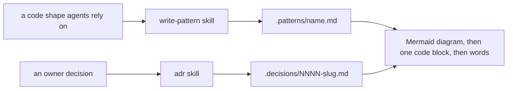
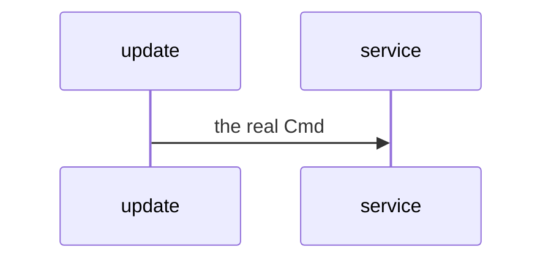

# 0005: Code shapes are written to .patterns/ with the write-pattern skill, and every pattern doc and every decision with a shape opens with a Mermaid diagram, then code, then words



````markdown
# <title>



```ts
// one small real code block, with its path:line
```

The words, pointing at real files with path:line.
````

**What this decides:** how the code is shaped gets its own folder and skill, and both that folder
and `.decisions/` lead with a picture.

## Context

The repo had a place for why ([`.decisions/`](./) and
[`docs/direction/`](../docs/direction/README.md)), for words
([`.glossary/`](../.glossary/TERMS.md)) and for measurements ([`experiments/`](../experiments/README.md)),
but not for how the code is shaped now. Agents learned a shape by reading code each session, or
from a direction note that had drifted. Fabrika's write-pattern skill already held the judgment for
this; its steps ran through fabrika's own command line, which this repo does not use. AGENTS.md
already asks every design document to show it in code; this decision adds the picture before the
code.

## Decision

**`.patterns/<name>.md` holds how the code is shaped, written with the
[write-pattern skill](../.agents/skills/write-pattern/SKILL.md), and every pattern doc and every
decision that has a shape opens with a Mermaid diagram, then one small real code block, then the
words.**

- The write-pattern skill keeps fabrika's judgment (when a shape earns a doc, re-grounding a doc
  against the source when it drifts, pointing at real files with `path:line`), with every fabrika
  command replaced by plain file and git steps.
- Diagrams are Mermaid wherever possible. Only when Mermaid really cannot express the thing may a
  doc use ASCII art or another form, and then it says in one line why Mermaid could not.
- A diagram shows the real mechanism, with real names from the code. No decorative boxes. No
  hard-coded colors, so it reads in dark mode.
- A decision that changes a shape shows it before and after, with the same names in both.
- A decision with no shape (a direction, a yes or no, a name) has no diagram.

**Binding constraints.**

- A pattern doc says how; it links the decision for why and never argues it again.
- When a pattern doc and the source disagree, the doc is wrong and is re-grounded.
- At most one table per section, as AGENTS.md already says.

## Consequences

- The [adr skill](../.agents/skills/adr/SKILL.md) gains the diagram step and a Mermaid
  cheat sheet; the write-pattern skill carries the same cheat sheet.
- Decisions 0001 to 0004 are not redrawn by this decision.
- `.patterns/` starts empty. Which shapes get the first docs is not decided here.
