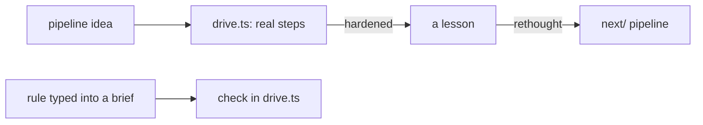

# 0007: drive.ts is the lab where pipeline ideas are tried and hardened on real steps, and `next/` is the formal version, rethought from what drive teaches, never imported

**What this decides:** `.agents/skills/lead/scripts/drive.ts` is where we try pipeline ideas on real
steps; `next/`'s pipeline is the proper, formal version of what drive proves.

## Context

Drive runs real tickets through the hand-run steps today, on our own laptop. `next/` builds the same
pipeline as code, with a plan, tests and review
([the steps](../docs/direction/next-is-a-pipeline-pre-run.md)). Lead tooling is already
fast-tracked ([AGENTS.md](../AGENTS.md#how-a-change-lands), "Lead tooling is fast-tracked too"). This says what drive is
for, and which way lessons travel.

## Decision

**drive.ts is the pipeline lab: ideas are tried and hardened there on real steps, and `next/` is the
formal version of what drive proves.**

- drive stays lead tooling: fast-tracked, no plan, tests or review steps, changed directly in small
  changes, merged on green CI with a clean leak grep.
- What a drive run teaches goes into `next/` as a lesson, rethought. `next/` never imports drive and
  never copies it ([rethink, do not port](../docs/direction/rethink-do-not-port.md) still holds).
- A rule we find ourselves typing into an agent's brief becomes a check in drive first.

**Binding constraints.**

- No `next/` file imports from `.agents/`.
- A drive check is not a `next/` law until `next/` rebuilds it by its own steps.

## Consequences

- Drive may be rough where `next/` may not; a failure there is a finding, not a defect.
- A lesson is written up (experiment, field note or direction note) before `next/` uses it.
- Not decided here: which drive checks `next/` rebuilds first.
