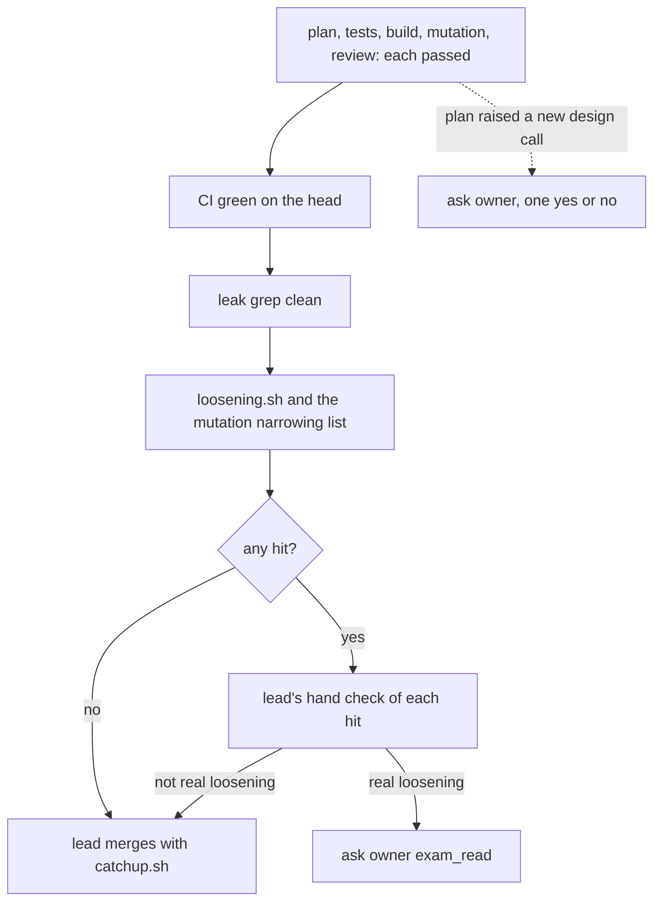

# 0014: The lead merges any pull request, product code included, once every step passed, never waiting on the owner except for real loosening or a new design call

**What this decides:** who merges a pull request, and the only two things that still wait on the
owner.



```text
merge-ready review + green CI + clean leak grep + no real loosening  ->  catchup.sh <pr> <ticket>
```

## Context

[Autonomy is measured trust](../docs/direction/autonomy-is-measured-trust.md) already said a merge
never waits on the owner. But [the steps](../docs/direction/next-is-a-pipeline-pre-run.md#how-a-change-lands)
still gave the owner every exam pull request, the read of every exam path a pull request touches,
and each edge comment a build adds. Since 2026-11-08 the lead's checks (law labels,
`loosening.sh`, the mutation arm-a vs arm-b list) already cleared exam changes that loosen nothing,
and the lead fast-track (2026-11-09) covered skills and scripts. Product code still read as the
owner's to merge. Tracker ticket 401 records this decision.

This amends, in part: [the steps](../docs/direction/next-is-a-pipeline-pre-run.md) (its "How a
change lands"), [a unit of work is a commit](../docs/direction/a-unit-of-work-is-a-commit.md) (the
owner's read of exam paths) and [no Promises](../docs/direction/no-promises.md) (the owner's read of
each new edge). No file in `.decisions/` said otherwise.

## Decision

**The lead merges any pull request, product code included, with `catchup.sh`, once every step has
passed, CI is green, the leak grep is clean and `loosening.sh` shows no real loosening after the
lead's hand check (owner, 2026-11-09).**

- "Every step" is plan, tests, build, mutation and one review saying merge-ready, each by its own
  agent. No step is skipped. Lead tooling and docs-only decision PRs keep their shorter path.
- A hit from `loosening.sh` or the mutation narrowing list goes to the lead's hand check. The PR
  lists every hit and what the lead found. A hit that is not real loosening (a rename the mapping
  missed, a parser false alarm) does not hold the merge.
- An exam pull request, or a pull request that touches an exam path, merges like any other when
  it passes those checks. The owner's read is not needed.
- A new edge comment (`fabrika/no-promises -- edge: <why>`) is read by the lead at merge and
  added to [no Promises](../docs/direction/no-promises.md)' edge table. A new kind of edge, one
  that is not a one-line call the platform demands, is a new design call.
- **Only two things wait on the owner:** real loosening or removal of a law (`ask owner
  exam_read`), and a new design call (one yes or no).
- The lead never writes "owner read" unless the owner did.

**Binding constraints**

- No step's check is dropped to reach a merge. A check that cannot run is `stuck`, never a pass.
- The leak check still fails closed.

## Consequences

- Product pull requests stop queueing for the owner. The owner reads the design through the
  decided notes, not through each diff.
- The cost: the owner's read of exam paths was what covered the shared-key gap in
  [a unit of work is a commit](../docs/direction/a-unit-of-work-is-a-commit.md#what-it-cannot-tell-us)
  (a builder with a shell could sign as the test writer). Until each step runs in its own box
  (Tier 5), the lead's hand check and `loosening.sh` hold that gap instead. A mistake there is
  fixed forward and counted as a break, per autonomy is measured trust.
- Not decided here: when `loosening.sh` blocks in code. Its false alarms on the last 20 merged
  `next/` pull requests are still to be measured.
- Not decided here: whether `next/`'s commit check, which sketches `ask owner exam_read` for any
  exam path ([a unit of work is a commit](../docs/direction/a-unit-of-work-is-a-commit.md)), asks
  the lead first and the owner only on real loosening. The plan that builds it settles that.
- The owner still says yes after `alchemy plan` for a Cloudflare deploy; that is not a merge.
