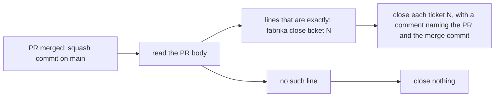

# 0015: A merge closes only the tickets its pull request names with our own phrase, never by GitHub keywords or trailers

**What this decides:** which tickets a merged pull request closes, and how code reads that.



```text
fabrika close ticket 410
fabrika close ticket 411
```

## Context

[What a ticket shows](../docs/direction/what-a-ticket-shows.md#5-what-done-means-and-who-can-say-it)
says a merge, not an agent, makes a ticket done, and that code reads it. Until now the lead closed a
ticket by hand after each merge, and which tickets a pull request finished was never written
anywhere code could read. Some pull requests touch a ticket without finishing it, such as a
pull request that only adds field rows. Ticket 409 records this decision; ticket 410 builds it in
the lead's `catchup.sh`.

## Decision

**A ticket closes on merge only when the pull request's description has a line in our own phrase,
`fabrika close ticket <N>` (owner, 2026-11-09).**

- The line holds the phrase and the ticket number and nothing else. Spaces around it are allowed.
- One line per ticket. A pull request may close several tickets, one line each.
- A pull request without the phrase closes nothing.
- A pull request that touches a ticket without finishing it leaves the phrase out.
- Closing is never inferred from commit trailers, from the ticket number a step signs, or from
  the branch or title.
- GitHub's own keywords (`Closes`, `Fixes`, `Resolves` and the rest) are never used for this. A
  line such as `Closes #5` closes nothing.
- Code reads the phrase only after the merge is confirmed. A pull request that did not merge
  closes nothing.

**Binding constraints**

- The phrase is read from the description at merge, by code. No agent decides at merge time which
  tickets are done.
- The phrase's shape is the one above. A new spelling needs a new decision.

## Consequences

- In today's version, `catchup.sh` closes the named tickets through the tracker's `post` command
  after the squash lands, with a comment naming the pull request and its merge commit. An already
  closed ticket is reported and skipped.
- Whoever writes a pull request's description now says, on purpose, which tickets it finishes.
- Not decided here: how `next/`'s watcher reads the phrase from the `pr` fact, and whether a
  phrase inside a fenced code block in the description should count.
