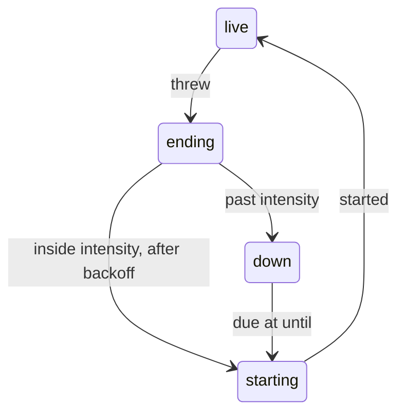
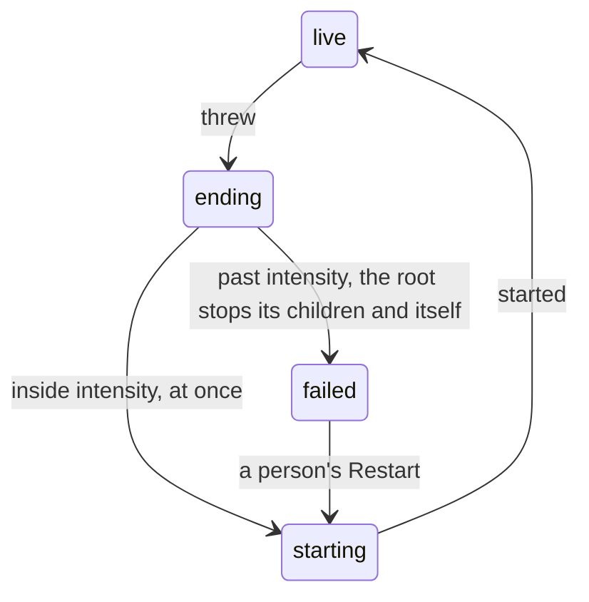

# 0016: Tier 1 supervision is OTP's top-level supervisor, and each difference from OTP is written with its reason

**What this decides:** in `next/`'s Tier 1, a crashed program is restarted the way OTP's
top-level supervisor restarts a child, and past its limit it stops and waits for a person, never
for a timer.

**Before** (P34, as built):



**After:**



The `down` to `starting` edge on a timer is gone. Past the limit, only a person starts it again.

```ts
// Sketch, next/. One root supervisor per brain. Its children are the brain's named programs.
const root = {strategy: "one_for_one", intensity: 1, periodMs: 5_000}; // OTP's defaults
const child = {name: "counter:1", program: "counter", restart: "permanent", shutdown: "brutal_kill"};
// More than `intensity` restarts in `periodMs`: every child exits, the root stops, and the brain
// writes `failed` on the log and raises an ask to the person.
```

> Amended in part by [0018](0018-one-application-per-program.md): there is no single root per
> brain. Each program is its own application with its own top-level supervisor, so one program past
> its intensity stops alone. The rest of this file holds, read per program.

## Context

[Experiment 239](../experiments/239-supervision-vs-otp.md)
([PR 636](https://github.com/usirin/tea-fabrika/pull/636)) checked P34's supervision
([PR 535](https://github.com/usirin/tea-fabrika/pull/535)) against OTP's own docs. P34 built a
one-child supervisor inside each program's own object. Past its brake it writes `down` with an
`until`, then tries again at `until`, forever: about 86,000 restarts and 276,000 ledger entries a
day for one name that always throws, with no escalation. OTP gives up there and lets the level
above decide ([supervisor behaviour](https://www.erlang.org/doc/system/sup_princ.html)). The
experiment's lean for tracker ticket 404 was a wait that grows, as Kubernetes does. The owner
picked OTP's shape instead, so the design stays one a person can learn from OTP's own docs.

This amends four places in the notes and the plan, each marked where it stands:

- [C4 in the five layers](../docs/direction/a-local-first-sync-engine.md#layer-3-coordination-decided-2026-10-31):
  no Kubernetes-style backoff; the top of the tree is a person, not a timer; restart types come in
  Tier 1 for the root's children.
- C5 in the same note: the first of its five written differences, the supervisor inside the
  program's own object, is walked back. The root lives in the brain.
- [p80](../docs/plan/tier-1-detail.md) (and p25's wake rule that points at it): a restart inside
  intensity is at once, and past it the name is `failed`, with no `until`.
- P34's as-built shape, in [Tier 1's table](../docs/plan/tier-1.md#the-pull-requests-one-at-a-time)
  and C4's "as built" paragraph. A new row, P34c, turns it into OTP's root.

No accepted decision file governed this before; the owner's calls of 2026-11-07 (`down` gains
`until`) and 2026-11-08 (a saved-letter crash restarts "with backoff") live in those notes and are
amended there.

## Decision

**In Tier 1, `next/`'s supervision is OTP's top-level supervisor, followed as closely as possible
(owner, 2026-11-09).**

- One root supervisor per brain. Its children are the brain's named programs. Its strategy is
  `one_for_one`.
- Each child has a child spec with OTP's restart types: `permanent`, `transient` or `temporary`.
- Restart intensity and period are OTP's defaults, 1 in 5 s, unless a reason is written.
- A restart inside intensity happens at once, as in OTP. There is no backoff.
- Past intensity, the root stops its children and then itself. At the top, that is the
  application stopping: the brain marks the name `failed`, writes it to the log, and raises it to
  the person as an ask. A person restarts it. Nothing restarts it on a clock.
- Shutdown follows OTP's child spec: `brutal_kill`, a timeout or `infinity`, with children stopped
  in reverse start order, unless a reason is written.
- Where we cannot follow OTP, the difference is written down with its reason, in a place the owner
  sees: the opening table of P34c's plan, and C5's list in the five layers note. A reason comes
  from Durable Objects or from [a browser is always a client](../docs/direction/a-browser-is-always-a-client.md).
  Code already written, its size or convenience is not a reason.

**Binding constraints**

- No supervisor in `next/` restarts a name past its intensity, on any clock.
- No difference from OTP's supervisor lands without its reason in both places above.
- P34c's plan goes to the owner to read before it is approved.

## Consequences

- P34's backoff, its `down {until}`, the `due` wake that retries it, and the crash-count reset go
  away when P34c lands. The `[Restart]` act stays: it is how a person starts a `failed` name.
- The supervisor moves from each program's object to the brain, where the process tree lives.
  The per-letter receipts and dead letters (C2) stay in the program's object.
- A name that always throws now costs a few ledger entries and one ask, not 276,000 entries a day.
- Restart types arrive in Tier 1, so `exited` needs a reason a restart type can read: normal or
  not. That pulls part of tracker ticket 406 into P34c.
- Not decided here: the exact numbers, and how wide one root's restart count reaches. P34c's plan
  proposes them, and the owner reads it. Sibling strategies, nested supervisors, links and trap
  exit still wait for Tier 4 ([Tier 1](../docs/plan/tier-1.md)).
