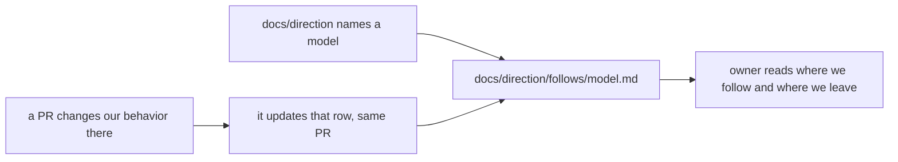

# 0017: Each outside system we follow gets one living side-by-side table, and a pull request that changes our behavior updates its row

**What this decides:** where the owner reads how `next/` follows or leaves the systems it models,
and who keeps that true.



```text
| Behavior | What OTP does                     | What we do                                  | Same or differs                                |
| demonitor | keeps a queued DOWN unless flush ([erl]) | always drops it (`coordination/process.ts:423-429`) | differs, because a canceled watch's DOWN serves nobody |
```

## Context

The owner learns the design by reading where we follow a model and where we leave it.
Step-by-step walks hid drift: [experiment 239](../experiments/239-supervision-vs-otp.md) found six
differences from OTP with no written reason, and P34's restart-forever behavior was only seen
there. [C5](../docs/direction/a-local-first-sync-engine.md#layer-3-coordination-decided-2026-10-31)
already asked for a written reason for each difference from OTP; this gives every model one place
for them. It works like [0013](./0013-plan-docs-change-with-the-work.md) does for plan rows. Tracker ticket
413 records this decision.

## Decision

**Each outside system that `docs/direction/` names as the model for a part of `next/` gets one
living table under `docs/direction/follows/`, and a pull request that changes our behavior in that
area updates its row in the same pull request (owner, 2026-11-09).**

- One file per system: [OTP](../docs/direction/follows/otp.md) for coordination,
  [Elm](../docs/direction/follows/elm.md) for tea and windows,
  [Kubernetes](../docs/direction/follows/kubernetes.md) where we take its backoff, leases or
  conventions. Their index is [follows/README.md](../docs/direction/follows/README.md).
- One row per behavior, with four columns: the behavior; what the system does, with a source link;
  what we do in `next/`, with `path:line`, or "not built" with its plan row or tier; and "same" or
  "differs, because ...".
- A row that differs gives its reason, or says no reason is written yet and names the ticket.
- A new model gets its table in the pull request that first builds its part in `next/`.
- The lead checks each pull request for a changed row before it merges.

## Consequences

- Seeded in the same pull request: OTP 25 rows (18 differ), Elm 12 rows (6 differ), Kubernetes 11
  rows (10 differ).
- A builder whose diff changes a modeled behavior touches one more file. A row's `path:line` can go
  stale when nearby code moves; the lead reads it at merge until a check exists.
- Not decided here: a check in code that every cited `path:line` still holds, and tables for DDD,
  Linear, tmux and i3.
