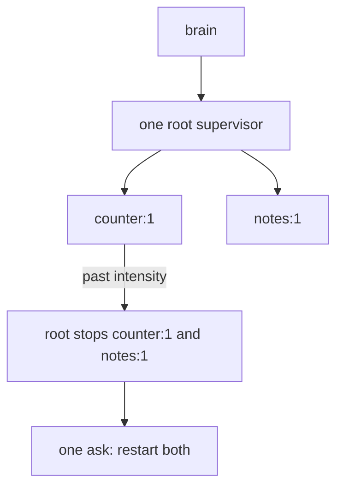
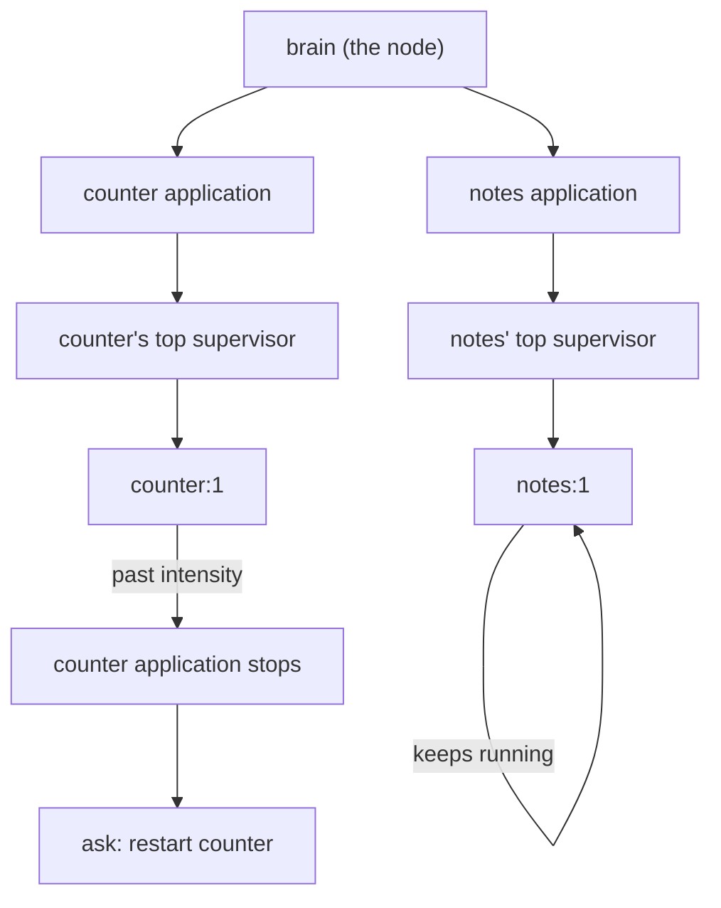

# 0018: Each program in next/ is its own OTP application, so one program past its restart limit stops alone, never the others

**What this decides:** in `next/`, every program gets its own top-level supervisor, as an OTP
application does, so a program that keeps crashing stops only itself and asks the person, while
every other program keeps running.

**Before** ([0016](0016-tier-1-supervision-is-otps-top-level-supervisor.md), as written):



**After:**



The single root is gone. A crash loop in `counter` stops `counter` and nothing else.

```ts
// Sketch, next/. One application per program, under the brain.
const counter = {
	application: "counter",
	type: "temporary", // OTP's default type: its stop is reported, no other application ends
	supervisor: {strategy: "one_for_one", intensity: 1, periodMs: 5_000}, // numbers are P34c's
	children: [{name: "counter:1", restart: "permanent", shutdown: "brutal_kill"}],
};
// counter:1 crashes past intensity:
//   counter's supervisor stops its children, then itself
//   the brain writes `failed` for counter:1 and one ask {who: "person", for: "restart"}
//   notes:1 sees nothing; its supervisor's restart count is its own
```

## Context

[0016](0016-tier-1-supervision-is-otps-top-level-supervisor.md) put one root supervisor per brain,
with every named program as its child. P34c's draft plan (tracker ticket 404) asked, as its first
open question, whether one broken program past the brake should stop all of them. Its doubt was
the blast radius: a broken counter should not stop a person's notes. The owner picked one
application per program.

This is still OTP. A node runs many applications, and each has its own top-level supervisor
([supervisor behaviour](https://www.erlang.org/doc/system/sup_princ.html), "Applications"). When a
`temporary` application stops, OTP's default type, "this is reported but no other applications are
terminated" ([`application`](https://www.erlang.org/doc/apps/kernel/application.html)). A
`permanent` one takes the node down with it, and so does a `transient` one that ends abnormally,
which a supervisor giving up does. Here the brain is the node.

This amends part of 0016: its "one root supervisor per brain, its children the brain's named
programs" and "the root stops its children and then itself" now read per program. The rest of
0016 holds: `one_for_one`, child specs with restart types, a restart at once with no backoff,
`failed` with no `until`, only a person's `[Restart]`, and every difference from OTP written with
its reason.

## Decision

**Each program in `next/` is its own OTP application, with its own top-level supervisor, under the
brain (owner, 2026-11-09).**

- The brain is the node. It runs one application per program and has no supervisor of its own
  over them whose failure stops every program.
- A program's top-level supervisor has 0016's shape: `one_for_one`, child specs with
  `permanent`, `transient` or `temporary`, intensity and period, a restart at once.
- Its children are the names that program runs. Its restart count is its own; another program's
  crashes never count toward it.
- Past intensity, that supervisor stops its own children in reverse start order, then itself. That
  is its application stopping. The brain marks those names `failed`, writes it on the log and
  raises one ask to the person. A person's `[Restart]` starts that application again.
- Every program's application is `temporary` in OTP's terms: its stop is reported and ends no other
  application.

**Binding constraints**

- **Fault isolation per program is required from the first version.** No program's failure,
  crash loop or stop may block, slow to a stop, or stop any other program (owner, 2026-11-09).
- No supervisor, count, lock or queue in `next/` is shared across programs in a way that lets one
  program's failure reach another. A shared piece that could needs a written reason the owner reads.
- No later slice adds isolation. A version without it is not a smaller first slice; it is the
  wrong design.

## Consequences

- P34c's plan changes from one root per brain to one top-level supervisor per program. Its open
  question 1 is answered. Its traced story ends with `counter` stopped and `notes:1` still running,
  and its laws gain one: a program past its brake leaves every other program's state and count
  untouched.
- Where this sits against AGENTS.md's "the first slice works, later slices harden": isolation is
  not hardening. That rule lets a first slice skip defenses against a person's own agents, not
  the shape that keeps one program's failure in its own box. We are building a system like an
  operating system, with agents in it, on decades of known practice (OTP and others), so it starts
  from the best known design, not a cut-down one.
- One program's broken build now costs that program and one ask. The person's other windows keep
  working.
- Not decided here: where each program's supervisor lives (the project object, as 0016 says for
  the root, or elsewhere), so long as one program's failure cannot reach another; whether two
  names of one program share one application or get one each; the numbers. P34c's plan proposes
  them.
- [`docs/direction/follows/otp.md`](../docs/direction/follows/otp.md) gains an "Applications"
  row ([0017](0017-each-model-we-follow-has-one-table.md)).

## Records

- `.glossary/TERMS.md`: `application (supervision)` is added; `root supervisor` and
  `failed (process)` now say one per program.
