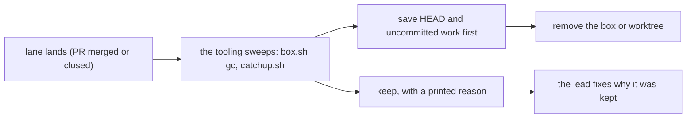

# 0019: The tooling removes a lane's boxes and worktrees when the lane lands, and never asks the owner to free disk

**What this decides:** cleanup of working copies is the tooling's job, so nothing stale piles up
and nobody is asked to make space.

## Context

On 2026-11-09 the disk reached 98 to 99 percent and drive refused five lanes for under 20 GB free.
About 59 GB sat in the boxes folder and about 14 GB in linked worktrees of merged pull requests.
The cause was a tooling bug: `box.sh gc`'s own git reads reset every box's idle clock, and it printed
no keep line, so it removed nothing for a day and nobody saw it. No tool removed a lead's or
agent's linked worktree after its PR landed. Field note 2026-11-09-254 and ticket 418 record it;
[PR 649](https://github.com/usirin/tea-fabrika/pull/649) fixes it.

## Decision

**Nothing stale: the tooling removes a lane's boxes and worktrees when the lane lands, and the lead
never asks the owner to remove them or to free disk (owner, 2026-11-09).**

- A box or worktree of a landed lane goes through the repo's own tools (`box.sh gc`, `box.sh rm`,
  `catchup.sh`), which save its HEAD first and never drop uncommitted files unsaved.
- What the tooling keeps, it prints with its reason. A kept copy of a landed lane is a tooling bug:
  the lead finds the cause and fixes it in code.
- A full disk is handled by the tooling first: drive runs gc and refuses only when gc cannot free
  enough, naming what it kept and why.
- The owner authorized removing the boxes and worktrees of lanes whose PR has merged.

**Binding constraints**

- `next/`'s pipeline removes every workspace a step ran in (box, worktree, container) when its lane
  lands, as code, with a law; no person cleans up after it.

## Consequences

- gc now runs read-only git, also sweeps linked worktrees of landed lanes, and prints its keeps
  (PR 649).
- `next/`'s pipeline notes carry this as a requirement:
  [pipeline guidelines P6](../docs/direction/pipeline-guidelines.md#p6-every-stop-saves-what-a-resume-needs)
  and [programs run in a box](../docs/direction/programs-run-in-a-box.md).
- Not decided here: how long an idle box of an unlanded lane may sit (gc's 2 h and 24 h stay).
