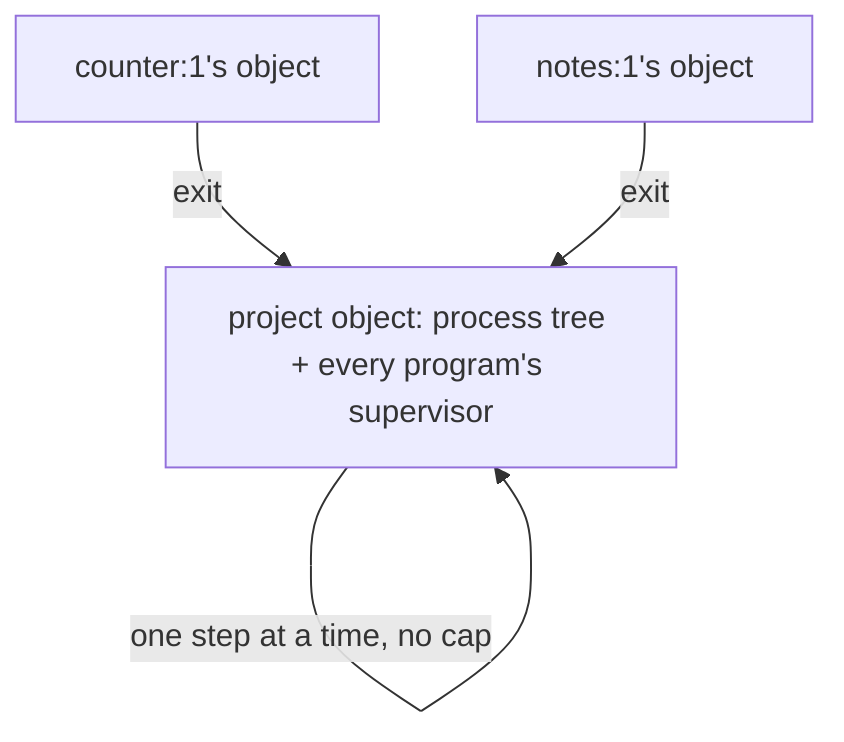
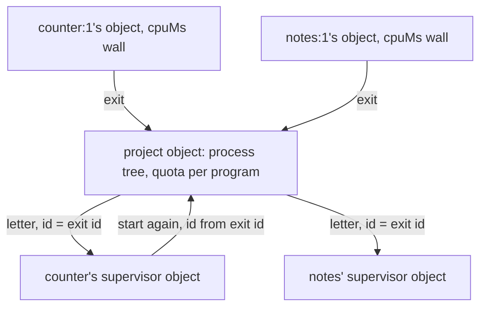

# 0020: Each program in next/ gets hard walls, never code alone, with quotas, its own supervisor object and a CPU limit per isolate

**What this decides:** in `next/`, one program's failure is kept from the others by three walls the
platform or a hard count enforces (quotas, a supervisor object of its own, a CPU limit), on top of
the code and laws 0018 asked for.

**Before** ([0018](0018-one-application-per-program.md), as P34c's plan leaned):



**After:**



Each program's supervisor is out of the shared object, each program's writes are capped, and each
step's CPU is capped.

```ts
// Sketch, next/. The numbers are P34c's, from measurement.
const quota = {writesPerMinute: 600, storageBytes: 1e9, stepMs: 1_000}; // per program; guesses
// project object, inside exit's own transaction:
//   write `exited {process, reason}` with id exited:<process>
//   write an outbox row: letter to `supervisor:<program>`, id exited:<process>
// the outbox delivers at least once, until the supervisor object answers `received`
// supervisor object: receipt keyed by exited:<process>; a second copy is a no-op
//   restart -> start again, id restart:<process>; the project object refuses a second one
// a program over its quota: `refused {reason: "quota"}`; every other program's writes land
```

## Context

[0018](0018-one-application-per-program.md) made each program its own OTP application and required
fault isolation from the first version. P34c's draft plan leaned to keep every program's
supervisor as a fold inside the shared project object, with isolation resting on code and laws
(tracker ticket 404). The owner wants walls, not only code: a runaway program must not starve the
shared project object, and a spinning step must not stall the others.

The pieces exist. `next/` already runs one Worker Loader isolate per process
(`next/packages/libfabrika/src/workers/index.ts`, `globalOutbound: null`,
[experiment 173](../experiments/173-worker-loader.md)). Experiment 173 also found that a 300 ms spin
in one program stalls every process in a local workerd, and that Miniflare does not enforce
`limits.cpuMs`; [Tier 1's detail](../docs/plan/tier-1-detail.md) left `cpuMs` unset for lack of a
measured number. [Experiment 145](../experiments/145-many-objects.md) split the process tree across
objects and broke 11 of 27 ledger laws, which is why the plan kept the supervisor inside the project
object.

This is still OTP's shape. An OTP supervisor is a process of its own, and it learns of a child's
death by message, its `EXIT` signal ([supervisor behaviour](https://www.erlang.org/doc/system/sup_princ.html)).
Quotas and CPU limits follow Kubernetes' `ResourceQuota` and container `limits`
([resources](https://kubernetes.io/docs/concepts/configuration/manage-resources-containers/),
[quotas](https://kubernetes.io/docs/concepts/policy/resource-quotas/)).

This amends part of 0018: its supervisor location, left open there, is now decided, and its
isolation now needs walls, not only code. The rest of 0018 holds.

## Decision

**Program isolation in `next/` has hard walls on top of code and laws, all three built in P34c
(owner, 2026-11-09).**

- **Quotas per program** (a `resource quota`, Kubernetes' word). Caps on ledger writes per minute, on storage (the planned 1 GB cap of
  [bounded objects](../docs/direction/design-for-bounded-objects.md)) and on time per step, so a
  runaway cannot starve the shared project object. A write over its program's quota is refused with
  a reason; the other programs' writes still land.
- **Each program's supervisor lives in its own object,** not as a record in the project object. A
  crash reaches it as a letter whose id is the exit's id, as OTP's supervisor learns of a death by
  message. Delivery is at least once, and the supervisor's receipt is idempotent: a second copy of
  the same exit changes nothing, and its restart request carries an id the project object refuses
  twice. So a cut between the two objects can neither lose a restart nor double one, which is what
  broke experiment 145's split. The extra restart latency is measured.
- **A CPU wall per isolate.** Measure a step's CPU and set `limits.cpuMs` from that number. On the
  local stage, where `cpuMs` is not enforced and a spin stalls every process, P34c proposes a fix,
  such as a step watchdog, marked a guess until it is measured.

**Binding constraints**

- No program's isolation rests on code alone where a wall can hold it.
- No number in a wall is a default or a guess once P34c lands: each comes from a measurement or a
  written source, as AGENTS.md asks of every number in a rule.
- A message between a program's supervisor object and the project object is at least once and
  idempotent at both ends; a design where one cut loses or doubles a restart is wrong.

## Consequences

- P34c's plan changes: its lean 1 (the supervisor as a fold in the project object) is replaced. It
  gains laws for each wall: a program over its write quota is refused while the others land; a
  spinning step in one isolate does not delay another's step past a bound; a duplicated or lost
  exit letter neither doubles nor loses a restart.
- Restarts cost one more hop. That latency is measured, not assumed.
- The plan's leans 2 (names of one program share one application) and 3 (3 restarts in 5 s) stay
  leans for the owner's read.
- [`follows/otp.md`](../docs/direction/follows/otp.md) and
  [`follows/kubernetes.md`](../docs/direction/follows/kubernetes.md) gain rows for a busy process
  and for quotas ([0017](0017-each-model-we-follow-has-one-table.md)).
- Not decided here: the numbers, the watchdog's shape, and the supervisor object's name. P34c's
  plan proposes them.

## Records

- `.glossary/TERMS.md`: `resource quota` and `supervisor object` are added; `root supervisor`
  says where it lives.
