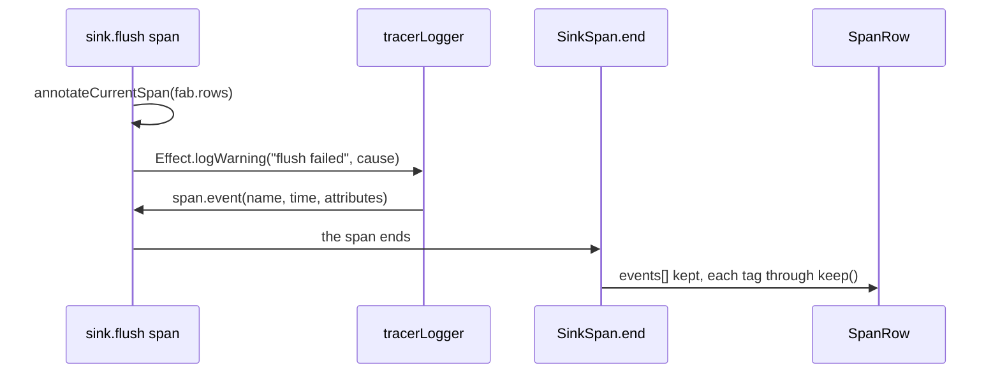

# 0024: next/ records with spans plus log lines, and a log line lands on its span as an event

**What this decides:** in `next/`, code may record with `Effect.log*` as well as with span tags,
because Effect writes each log line onto the span it runs in, so both end up in one trace.



```ts
import {Effect, Redacted} from "effect";

const flush = Effect.fn("sink.flush")(function* (rows: number) {
	yield* Effect.annotateCurrentSpan({"fab.rows": rows});
	yield* write(rows).pipe(
		Effect.catchCause((cause) =>
			Effect.logWarning("flush failed", cause).pipe(
				Effect.annotateLogs({"fab.rows": rows, token: Redacted.make(key)}),
			),
		),
	);
});

// The span event, as effect@4.1.2 wrote it on 2026-11-09 (a run with a collecting tracer):
// ["flush failed", <bigint nanos>, {
//   "fab.rows": 3,
//   "token": Redacted,                 // the sink keeps it as "<redacted>"
//   "effect.fiberId": 1,
//   "effect.logLevel": "WARN",
//   "effect.cause": "Error: disk full\n    at ..."   // the pretty cause, with its stack
// }]
// A log line with no span around it ("no span here") printed to the console and wrote no event.
```

## Context

Ticket 444 asked the owner whether `next/` records with spans only, or with spans plus log lines,
before it sweeps the bare `Effect.ignore` calls
([a failure we swallow still leaves a trace](../.patterns/effect-swallowed-failures-leave-a-trace.md)).
No decision said either. The owner picked spans plus log lines on 2026-11-09. It fits "record wide,
read later" (AGENTS.md, the industry's wide events), and it is how clanka, an agent by an Effect core
maintainer, records a failure it skips
([`McpServers.ts:523-526`](https://github.com/Effectful-Tech/clanka/blob/44eb97a4eff8ae00bcf18750b387fe5a98cd191c/src/McpServers.ts#L523-L526)).

Checked against the installed `effect@4.1.2`, no extra wiring needed:

- `CurrentLoggers` defaults to `[defaultLogger, tracerLogger]`
  (`node_modules/effect/src/internal/effect.ts`, `CurrentLoggers`).
- `tracerLogger` calls `span.event(message, now, attributes)` on the fiber's current span. Its
  attributes are the log annotations plus `effect.fiberId`, `effect.logLevel` and, when there is one,
  `effect.cause` (the pretty cause). It writes nothing when there is no span, when the span is an
  `ExternalSpan`, or when the span has ended.
- `next/` has no OpenTelemetry SDK. Its tracer is the span sink
  (`next/packages/libfabrika/src/data/sink.ts`): `SinkSpan` extends `Tracer.NativeSpan`, and
  `ended()` keeps `span.events` in the row, each attribute through `keep()`. So the event reaches the
  JobRecord with the span.
- No product code in `next/` calls `Logger.layer`; only two tests do. Effect's
  `Effect.ignore({log: "Warn"})` logs through the same loggers, so it lands the same way.

## Decision

**`next/` records with spans plus log lines: an `Effect.log*` call inside a span is that span's
event, one record, not a second system.**

- A log line runs inside a span: inside an `Effect.fn("piece.verb")` body, or under
  `Effect.withSpan`. That span is where the line is kept.
- A tag on the span stays the place for a fact about the whole call (`ok`, `error.type`, a count).
  A log line is for something that happened at one moment in it, such as a failure that was dropped.
- `Effect.ignore({log: "Warn"})` is a fine way to record, then drop
  ([the pattern](../.patterns/effect-swallowed-failures-leave-a-trace.md)).
- A log line keeps the content rules. A secret goes in as `Redacted`, never as text
  ([secrets are Redacted](../docs/direction/secrets-are-redacted.md)); the sink's `keep()` writes
  it as `"<redacted>"`. Never build a log message string out of a secret's value.

**Binding constraints**

- A `Logger.layer` in `next/` keeps `tracerLogger`: pass `{mergeWithExisting: true}`, or list
  `Logger.tracerLogger` in it. A layer without it cuts every log line off its span, silently.
- A loose log line (no span around it) is not recorded anywhere a person debugging will look. A lint
  rule flags `Effect.log*` and `Effect.ignore({log})` outside an `Effect.fn` body or a `withSpan`. It
  starts as advice only. It blocks only once its false alarms are measured at about 0% on real calls
  (Google, CACM 2018). Today there is nothing to measure: `next/` product code has 0 `Effect.log*`
  calls. Tracker ticket 453 builds it and measures it once the 444 sweep adds calls.

## Consequences

- Ticket 444's sweep may use either form: the span tags in the pattern, or
  `Effect.ignore({log: "Warn"})` / `Effect.catchCause(Effect.logWarning)` inside the function's span.
- **Gap, not decided here:** `effect.cause` is the pretty cause, error text and stack included. That
  puts an error's message in a tag, which `next/packages/libfabrika/src/data/ledger.ts:15` keeps out
  ("it rides in the span's failure, never in a tag"), and a stack can carry a machine's absolute
  paths into the shared, never-deleted JobRecord. `keep()` cuts it to 128 characters but does not
  drop it. Tracker ticket 454 decides what the sink keeps of `effect.cause` (the error class only is
  the lean), before the 444 sweep adds log lines with a cause.
- The console line from `defaultLogger` stays; it prints `Redacted` as `<redacted>`.
- A bump past `effect@4.1.2` re-checks the default loggers and `tracerLogger`.
