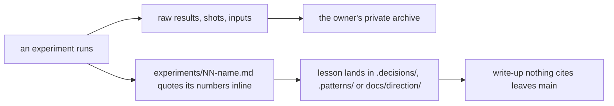

# 0025: Experiment results and assets live in the owner's private archive, and write-ups quote their numbers inline

**What this decides:** `experiments/` on main keeps only the write-ups and their index; every raw
result and asset lives in the owner's private archive, and git history keeps them too.

## Context

By 2026-11-09 `experiments/` held 612 files besides the write-ups: `results/`, the `NN-name/`
folders, `failures/`, screenshots, JSON and patches, about 42 MB. Nothing in the daily work reads
them, and they make every search and clone heavier. The owner still wants to read them. The
write-ups stay for now, since direction notes cite them about 426 times. Ticket 458.

## Decision

**Experiment results and assets leave the public repo for the owner's private archive, and a
write-up quotes the numbers it uses inline (owner, 2026-11-09).**

- Every tracked file under `experiments/` that is not a top-level `experiments/*.md` moves to the
  private archive at the same path. Git history keeps every file: the last commit that holds them
  all is `423fb9cf`.
- A file that code reads stays until that code changes through its own steps. Two do today:
  `experiments/results/86b-plans.json` and `experiments/177-themes/schemes/radix-colors-3.0.0.json`.
- A link to a moved file points at that file at commit `423fb9cf` in this repo's history.
- New raw results and assets go to the private archive, never into git. A script writes raw
  samples under `runs/` or to a path a flag names, as before.
- The public repo never names the private archive repo; it says "the owner's private archive".
- The write-ups shrink over time: a write-up nothing cites leaves main once its lesson is in
  `.decisions/`, `.patterns/` or `docs/direction/` (cited or captured).

## Consequences

- `AGENTS.md`'s experiments row and `experiments/README.md` say the new rule. The old one ("saved
  answers go in `experiments/results/`, which keeps a small summary") is gone.
- `node-kinds.json` went with the saved builder output it named; `pnpm lint:dead` runs without it.
- A write-up that cites a moved path in prose, not a link, is read through `git show
  423fb9cf:<path>` or the archive.
- Not decided here: when the first write-ups leave, and how a write-up's lesson is checked as
  captured.
