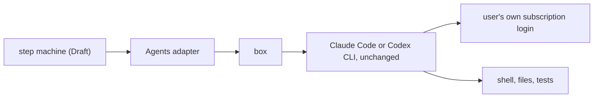

# 0026: fabrika never owns the agent loop, and a step runs the user's own harness on their own login

**What this decides:** a step runs the agent harness people already use, such as Claude Code or
Codex CLI, unchanged and on the user's own subscription login, and fabrika builds on top of that
harness's loop instead of writing its own.

## Context

[Experiment 243](../experiments/243-what-clanka-teaches-the-pipeline.md) read clanka, a coding agent
built on Effect that runs its own agent loop and model calls outside its executor. It left two
questions for the Tier 5 walk:

- Q1: should the box hold only the hands, with the loop, the model call and the login outside?
- Q2: should the Claude adapter drive the harness one model step at a time and own the history,
  so a restart resends our kept history to a new process instead of resuming the harness's own
  session?

The owner answered both with no, for two reasons:

- **Meet users where they are.** People already pay for Claude Code or Codex on a subscription.
  A subscription login works only through the maker's own harness. Owning the loop would mean an
  API key per user, so no subscriptions.
- **Each lab trains its models on its own harness.** Anthropic trains on Claude Code and OpenAI on
  Codex. A loop of ours would not match how the model was trained, so it would do worse. We do not
  compete with the harness; we use its loop and build on top of it. That is the core idea of
  fabrika.

## Decision

**fabrika never owns the agent loop: a step runs the unmodified harness on the user's own
subscription login, and fabrika builds around it.**

- Q1 is no. The harness, its loop and its login run in the box, as
  [programs run in a box](../docs/direction/programs-run-in-a-box.md) already says (the subscription
  login goes in the box, changed 2026-10-25). That note stands.
- Q2 is no. The adapter does not drive the harness one model step at a time and does not own the
  history. When hands restart, they resume the harness's own session, the Tier 5 law in
  [tiers](../docs/plan/tiers.md). That law stands.
- Agents stay behind one service with swappable providers, as
  [agents sit behind one service](../docs/direction/agents-behind-one-service.md) says. That note
  stands.

**Binding constraints:**

- No step replaces a harness's loop with a loop of ours, or calls the model past the harness.
- A provider adapter wraps the maker's harness as it ships. It does not patch or fork it.

## Consequences

- **The login sits in the box, so the box is the protection.** Safety comes from what the box can
  reach (its network, its files) and from short-lived or scoped tokens where the harness allows
  them, not from moving the loop out. Any hardening of the box must keep the harness working
  unchanged.
- Steering, stops, retries and budget checks happen at the edges the harness gives us (its
  session, its events, its process), not between model steps.
- **Not decided here.** Three of clanka's borrows do not need our own loop and stay open leads for
  the Tier 5 walk: history changes as events read from the harness's transcript, one named retry
  `Schedule` with a typed out-of-tries error, and the box's state as a stored Schema value.

## Amendments

- 2026-11-09: the three borrows under "Not decided here" were decided in
  [0030](0030-copy-clankas-shapes-where-better.md).
