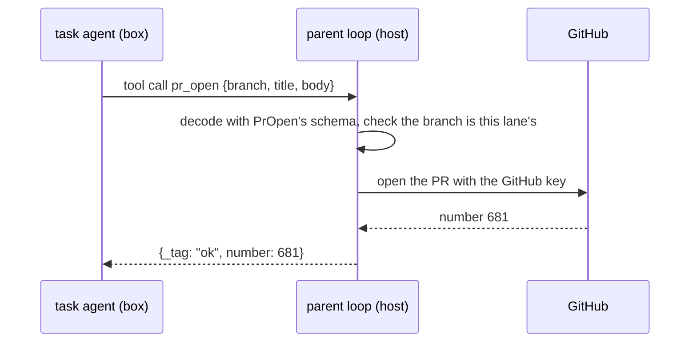

# 0028: The parent loop holds every right, and a task agent in a box holds only its own model login

**What this decides:** a task agent (Claude Code or Codex, unchanged, in a box) keeps only its own
model login, and every other action it needs is a tool call back to the parent loop, which checks
the call against its schema and does it with keys the box never sees.



```ts
// Sketch, next/. One right, one tool: its schema is the whole check.
const PrOpen = Schema.Struct({
	branch: Schema.TemplateLiteral(["fabrikalfa/", Schema.String]),
	title: Schema.String,
	body: Schema.String,
});

// In the parent. The box sends JSON; the parent holds the key.
const prOpen = (input: unknown) =>
	Effect.gen(function* () {
		const call = yield* Schema.decodeUnknown(PrOpen)(input); // a bad call ends here
		yield* lane.ownsBranch(call.branch); // only this lane's own branch
		const pr = yield* GitHub.openPr(call); // the key lives in this service, never in the box
		return { _tag: "ok", number: pr.number } as const;
	});

// The answer the agent reads back:
// { _tag: "ok", number: 681 }
// { _tag: "refused", reason: "branch_not_this_lane" }
```

## Context

[A ticket runs from the app](../docs/direction/a-ticket-runs-from-the-app.md#5-agents-and-boxes)
already settled one case: the GitHub key never goes in a box, push and merge Cmds are marked
`outside`, and the host checks each with the Cmd's own schema. The model login goes in the box
(ruled 2026-10-26), and [0026](0026-fabrika-never-owns-the-agent-loop.md) keeps the user's own
harness and login there. The owner, on 2026-11-09, made the GitHub rule the rule for every right.

Today's lead scripts already lean this way: a box's commit is signed outside it (`stepcommit.sh`,
`box.sh fetch --sign`), and Codex's `workspace-write` sandbox keeps `.git` read-only. A box still
makes its own commit in its own clone today
([agents run on Codex](../docs/direction/agents-run-on-codex.md)); under this decision that commit
becomes a tool call too.

The industry's name is privilege separation, as in OpenSSH's privsep: a small parent with the
rights, a child with none that asks. The Elm answer is the same shape: the child asks with a Cmd,
and the parent runs it.

## Decision

**The parent loop holds every right; a task agent holds only its own model login, and does
everything else by a tool call the parent checks and runs.**

- The parent (the host or operator) holds the GitHub key, the signing keys, the ledger and the
  tracker.
- The box holds the agent's own model login and nothing else that grants a right.
- Commit, sign, push, open a PR, file or comment on a ticket, and write a field row are each a tool
  call to the parent.
- The parent decodes each call with that tool's Effect schema, checks it against the lane (its own
  branch, its own ticket), does it, and sends the answer back. A call that fails the check gets a
  `refused` answer with a `reason`, never a partial action.
- This widens the `outside` rule from the GitHub key to every right except the model login.

**Binding constraints**

- No key, token or write handle to the ledger or tracker is placed in a box, except the model
  login.
- A new right enters a box only as a new tool with its schema and its test.
- It applies to `next/`, and it is the target for `drive.ts`'s step boxes. Nothing in today's app
  changes by this file alone.

## Consequences

- **Each new right costs one tool** to write and test in the parent. That is the price of the
  check.
- **The agent keeps typing what it knows; the lean, not decided.** Models are trained on raw `git`
  and `gh`. For push, the lean is a git proxy (below): the agent runs plain `git push` and nothing
  to steal sits in the box, which beats a shim. For the read-only `gh` calls, the lean is a thin
  `gh` shim that forwards the ones the parent allows. Which commands each forwards is for the plan
  that builds it.
- **A little latency per call,** one round trip to the parent. Not measured yet.
- **No new paid service.**
- An env dump in a box still finds the model login, as accepted on 2026-10-26. It finds nothing
  else.
- Not decided here: the tool list for each step, the shim's and the proxy's shape, and how
  `drive.ts` moves its boxes over.

## Known patterns

A production agent platform the owner knows runs this way. These are its patterns, as leads for
the plans that build this decision:

- **A git proxy in front of GitHub.** The parent mints a short-lived token and the proxy adds it
  to each request, so the box never holds a git credential. The proxy also refuses a push to
  `main` and holds the branch prefix.
- **Opening and updating a PR is a tool call to the parent,** never done with a token in the box.
- **A tool's secrets are added inside the parent's handler,** never placed in the model's context.
- **The parent records each commit sha the box pushed in the ledger and gates on that,** never on
  a trailer the box wrote in the commit.
- **An egress proxy can add credentials on the way out.** Whether that could also keep the
  subscription login out of the box is an open question to test, not decided.
