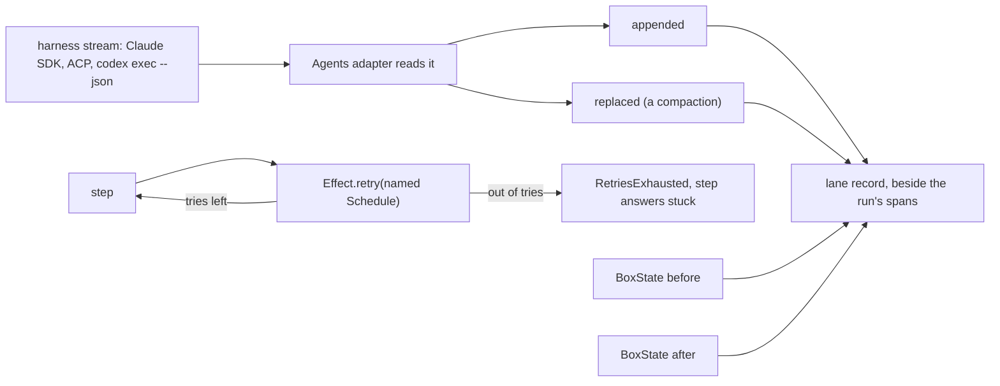

# 0030: Where clanka does it better we copy its shape, so history changes are events, retries are named Schedules, and box state is stored data

**What this decides:** `next/` and the new `drive.ts` take three shapes from clanka: each change
to an agent's history is a typed event read from the harness's own stream, each retry is one named
Effect `Schedule` with its limits as overridable references, and each box step's state is a Schema
value the parent stores in the lane's record.



```ts
// Sketch, next/, Effect 4.1.2. Names may change in the plan that builds it.
import { Context, Effect, Schedule, Schema } from "effect";

// 1. History as events, read from the harness, never from a loop we own.
const Appended = Schema.TaggedStruct("appended", { run: RunId, messages: Schema.Array(Message) });
const Replaced = Schema.TaggedStruct("replaced", {
	run: RunId,
	messages: Schema.Array(Message), // the whole new history
	trigger: Schema.Literals(["auto", "manual"]),
	tokensBefore: Schema.Number,
});
const HistoryEvent = Schema.Union([Appended, Replaced]);

// 2. One named Schedule per retry, limits as references, a typed end.
export const PushRetries = Context.Reference<number>("fabrika/PushRetries", {
	defaultValue: () => 3, // a placeholder: the plan sets it from field rows
});
const pushSchedule = Schedule.exponential("1 second", 2).pipe(Schedule.jittered);

class RetriesExhausted extends Schema.TaggedError<RetriesExhausted>()("RetriesExhausted", {
	what: Schema.String, // "push", "box_start", "step_rerun", "model_call"
	tries: Schema.Number,
	last: Schema.String, // the last error, kept
}) {}

const push = (branch: Branch) =>
	Effect.gen(function* () {
		const times = yield* PushRetries;
		return yield* git.push(branch).pipe(
			Effect.retry(pushSchedule.pipe(Schedule.upTo({ times }))),
			Effect.mapError((e) => new RetriesExhausted({ what: "push", tries: times, last: String(e) })),
		);
	});
// The step maps RetriesExhausted to { _tag: "stuck", reason: "retries_exhausted" }.
// A test overrides one line: Effect.provideService(PushRetries, 0).

// 3. Box state as data the parent stores, so a resume needs nothing in memory.
const BoxState = Schema.Struct({
	files: Schema.Array(Schema.String), // changed paths in the box
	commit: Sha, // the box's HEAD
	session: Schema.String, // the harness's own session id, where the agent was
	cwd: Schema.String,
});
// lane record: { step: "build", before: BoxState, after: BoxState, ... }
```

## Context

[Experiment 243](../experiments/243-what-clanka-teaches-the-pipeline.md) read clanka, a coding agent
on Effect by one of Effect's core maintainers. Its borrows 1 and 2 would have made fabrika own the
agent loop, and [0026](0026-fabrika-never-owns-the-agent-loop.md) said no to both. It left borrows 3
to 5 open, since none needs our own loop. The owner walked them on 2026-11-09 and took all three.
The rule behind it: where clanka does it better, we copy its shape, rethought for our pieces
([rethink, do not port](../docs/direction/rethink-do-not-port.md)).

The three fit decisions already made. [0028](0028-the-parent-holds-every-right.md) puts every right
in the parent, so the parent is where the history events, the retries and the box state live.
[Pipeline guidelines P6](../docs/direction/pipeline-guidelines.md#p6-every-stop-saves-what-a-resume-needs)
says every stop saves what a resume needs. [0024](0024-next-records-with-spans-and-log-lines.md)
says how a run records beside its spans. The compaction rule follows "record wide": a compaction
is a fact that exists only at the moment it happens.

## Decision

**Where clanka does it better, we copy its shape: history changes are typed events from the
harness, each retry is one named `Schedule` with references for its limits, and each box step's
state is a stored Schema value.**

### 1. History as events

- Each change to an agent's history is a typed event, `appended` or `replaced`.
- The adapter reads them from the harness's own stream, never from a loop of ours (0026): the
  Claude Agent SDK's messages, ACP's `session/update`, and `codex exec --json`.
- A compaction is a `replaced`. It is recorded the moment it happens, beside the run's spans, even
  before anything reads it.
- Where each harness says so today, read from the installed versions:

| Harness | `appended` from | `replaced` from |
|---|---|---|
| Claude Agent SDK 0.3.316 | `assistant` and `user` messages | `system` message, subtype `compact_boundary`, with `trigger` and `pre_tokens` |
| ACP SDK 2.2.0 | message and tool call updates | `compaction_update` in `session/update` |
| Codex CLI 0.167.0, `exec --json` | `item.completed` items | the session rollout's `compacted` line, since `exec --json` drops it (see Amendments; "none: an open gap" was wrong) |

- This decides only the events and the compaction record. Content masking and deletion stay with
  [an agent run keeps its content](../docs/direction/an-agent-run-keeps-its-content.md) (proposed,
  walked in Tier 5).

### 2. Retries and limits

- Every retry in `next/` and in the new `drive.ts` (a step rerun, a box start, a push, a model
  call's rate limit) is one named Effect `Schedule`, used through `Effect.retry`.
- Every limit (tries, timeouts, output caps) is a `Context.Reference` with a default. A caller or a
  test overrides it with one `provideService` line.
- Running out is a typed `RetriesExhausted` that keeps the last error. The step reports it as
  `stuck` with `reason: "retries_exhausted"`.
- clanka's numbers (20 retries, 5 minutes, a 5 s cap) are not taken. Ours come from field rows, and
  each default names its source.

### 3. Box state as data

- Each box step's state (its files, its commit, where the agent was) is a Schema value.
- The parent stores it in the lane's record before and after the step. A resume reads it from
  there and needs nothing in memory, in the box or in a long driver.
- "Where the agent was" is the harness's own session id, so a restart resumes the harness's own
  session, as the Tier 5 law and 0026 say.
- The new `drive.ts` uses it from day one.

**Binding constraints:**

- No retry is a hand-written loop, a counter or a `sleep`. It is a named `Schedule`.
- No limit is a bare number in code. It is a `Context.Reference` with a default and its source.
- No history event comes from a loop we own. If a harness does not report a change, we record the
  gap, not a guess.
- A box step's state is never kept only in the box or in a process's memory.

## Consequences

- **Wrong in part, see Amendments (2026-11-09):** the item list below misses two types, and "lost
  today" and the open gap were wrong, since each run's rollout file records the compaction. Kept as
  written:
  **Codex does not report compactions in `exec --json`.** Codex CLI 0.167.0 compacts (its binary
  holds `ContextCompacted`, and its app server has a `thread/compacted` notice), but the item types
  `exec --json` writes are only `agent_message`, `reasoning`, `command_execution`, `file_change`,
  `mcp_tool_call`, `web_search` and `todo_list`. None of our saved Codex runs has a compaction
  event. So a Codex step's `replaced` is lost today. What would settle it: run a step through the
  Codex app server instead of `exec`, or file the ask upstream (its own ticket). Until then a Codex
  run's record says `compaction: unreported`.
- drive.ts today "never retries" ([0007](0007-drive-is-the-pipeline-lab.md), its header). The new
  `drive.ts` may retry only through a named `Schedule`. A step that could not run still starts at
  most twice per key
  ([pipeline guidelines P8](../docs/direction/pipeline-guidelines.md#p8-retries-are-bounded-at-one-level-with-a-source-for-each-bound)), so that is its default.
- `next/` has one `Context.Reference` and no `Schedule` today. Each row that adds a retry or a limit
  adds its Schedule or reference in its own pull request.
- Box state adds one value per step to the lane's record. Small.
- Not decided here: the exact fields of `BoxState`, each default number, and how the record is
  stored in `next/`'s ledger. Each plan that builds one of these decides it.

## Records

- Glossary rows added in [`.glossary/TERMS.md`](../.glossary/TERMS.md), Pipeline: box state,
  history event, RetriesExhausted.

## Amendments

- 2026-11-09: Codex CLI 0.167.0 reports each compaction in two places, and `codex exec --json` is
  not one of them. Read at tag `rust-v0.167.0`:
  - `exec --json` writes nine item types: the seven above plus `collab_tool_call` and `error`
    (`codex-rs/exec/src/exec_events.rs:107-133`). Its mapper drops every other item, the
    `contextCompaction` item included (`codex-rs/exec/src/event_processor_with_jsonl_output.rs:323`),
    and every other notice, `thread/compacted` included (same file, `:600`).
  - The app server sends a `contextCompaction` thread item
    (`codex-rs/app-server-protocol/src/protocol/v2/item.rs:493`, from core's `ContextCompactionItem`,
    `codex-rs/protocol/src/items.rs:81` and `:518`) and the older `thread/compacted` notice, marked
    deprecated (`codex-rs/app-server-protocol/src/protocol/common.rs:2088-2089`). Core's own event
    is `EventMsg::ContextCompacted` (`codex-rs/protocol/src/protocol.rs:1559-1560`).
  - The session rollout, `~/.codex/sessions/YYYY/MM/DD/rollout-*.jsonl`, writes a
    `{"type":"compacted"}` line (`codex-rs/history/src/lib.rs:228`, serialized in
    `codex-rs/history/src/rollout_payload.rs:32-52`). `exec` writes this file unless `--ephemeral`
    (`codex-rs/exec/src/cli.rs:40-42`). Seven `codex exec` rollouts from 2026-11-08 have one.

  So a Codex step's `replaced` comes from the rollout's `compacted` line, read by the adapter after
  or during the run, until a step runs through the app server, where the `contextCompaction` item is
  the source. It is not lost, and a Codex run's record does not say `compaction: unreported`. The
  binary's `PreCompact` and `PostCompact` hooks (`codex-rs/protocol/src/protocol.rs:1790-1791`) are
  not used: repo tooling adds no hooks.
