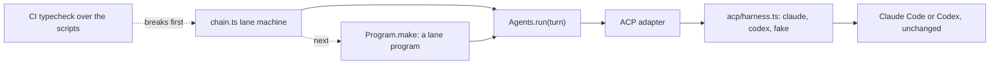

# 0031: The lead's lane tooling runs on fabrika's own primitives, the Agent interface over ACP now and Program.make next, never a bare CLI call

**What this decides:** `chain.ts` and the lane runner after it are built from the same pieces
fabrika gives everyone, so the lead's own tooling is fabrika's first outside client and the first to
hit its rough edges.



```ts
// Sketch. A step is one Agent-interface turn inside a Program. Names may change in the plan
// that builds it; today's Agents service is `@kampus/fabrika-old`'s, from experiment 156.
import {Program} from "@kampus/libfabrika";
import {Agents} from "@kampus/fabrika-old";

const Answer = Schema.TaggedUnion({
	done: {head: Schema.String},
	send: {to: StepName, reason: Schema.String},
	ask: {who: Schema.Literal("lead"), reason: Schema.String},
	skip: {reason: Schema.String},
	stuck: {reason: Schema.String},
});

// One step: one turn, through the same service `summon claude as <name>` uses.
const runStep = (lane: Lane, step: StepName) =>
	Effect.gen(function* () {
		const agents = yield* Agents;
		const turn = {
			provider: lane.agentFor(step), // "claude" | "codex" | "fake", the ACP harness rows
			session: `${lane.name}-${step}`,
			folder: lane.box,
			prompt: lane.briefFor(step),
			system: {_tag: "preset", name: "claude_code"},
			answer: readsOf(Answer), // the last message is read by the step's own schema
			model: lane.model,
			effort: null,
			limits: lane.limits,
		};
		return yield* agents.run(turn).pipe(lastEnded); // Stream of Heard<Answer> to its Ended
	});

// The lane as a program: the machine moves on the five verbs, the step is a Cmd.
export const lane = Program.make({
	name: "lane",
	machine: laneMachine, // stepping, judging, opening, landing, over
	state: {v: 1, upgrades: []},
	view: (model) => ({step: model.step, round: model.round}),
	refuse: () => null,
	inputs: {start: "Start the lane", resume: "Resume from a step"},
	outputs: {},
	writes: {},
	wake: () => null,
});
```

## Context

`chain.ts` (`.agents/skills/lead/scripts/chain.ts`, PRs
[671](https://github.com/usirin/tea-fabrika/pull/671) and
[680](https://github.com/usirin/tea-fabrika/pull/680)) runs a lane end to end as a tea machine. Today
it reaches each step through `drive.ts` and its judgment agent through a bare `claude -p`, spawned
with `node:child_process`. fabrika already has a typed way to run an agent: the Agent interface
(`packages/fabrika/src/agents/agent`, [experiment 156](../experiments/156-own-agent-interface.md),
shapes from ACP), which `summon claude as <name>` uses through `summon/manager.ts` and the ACP
harness (`acp/harness.ts`, `AGENTS = ["claude", "codex", "fake"]`). And `next/`'s libfabrika has
`Program.make` (ticket 280, [PR 522](https://github.com/usirin/tea-fabrika/pull/522)).

The owner, on 2026-11-09, decided the tooling uses these instead of its own wiring. It builds on:

- [0026](0026-fabrika-never-owns-the-agent-loop.md): a step runs the user's unmodified harness. The
  ACP harness rows run Claude Code and Codex unchanged, so this holds.
- [0028](0028-the-parent-holds-every-right.md): the chain still holds every right; the agent behind
  the turn holds only its model login.
- [0030](0030-copy-clankas-shapes-where-better.md): history events and named Schedules are read from
  the harness's stream, which the Agent interface already gives.
- [Why libfabrika exists](../docs/direction/where-each-piece-lives.md#why-libfabrika-exists-decided-2026-11-08):
  anyone can build a client from scratch on libfabrika. The lane tooling is that client.
- The lead-tooling fast track in [AGENTS.md](../AGENTS.md#two-versions-side-by-side): these changes
  are tooling, so they skip the plan, tests, mutation and review steps.

## Decision

**The lead's lane tooling dogfoods fabrika's own primitives: every agent it starts goes through the
Agent interface over the ACP harness, and the lane runner becomes `next/` programs built with
`Program.make`.**

- **Agents.** `chain.ts` runs every step agent and its judgment agent as an `Agents.run` turn over
  the ACP adapter, the way `summon` does. Never a bare `claude -p` or `codex exec`, and never
  `packages/pipeline`.
- **Programs.** Next, the lane runner is built as programs with `Program.make`, not bare tea
  machines. That shows a program works as a unit of work on its own, outside fabrika's app.
- **Breakage is the point.** When `Program.make` or the Agent interface changes and the tooling
  breaks, that is a finding about the library, not a cost of the tooling. CI's typecheck over the
  scripts is what shows it first. Fix the library or the tooling in the open; never fork a private
  copy of the interface into the scripts to stop the breakage.
- **Order.** First swap chain's agents onto the Agent interface over ACP and run one real lane on
  it. Only then move the runner onto `Program.make`.

**Binding constraints:**

- No new `spawn` of `claude` or `codex` in the lead scripts. An agent starts through `Agents`.
- The scripts stay inside `pnpm typecheck`, so a change to either primitive fails CI there.
- The lane tooling stays lead tooling: fast-tracked, small changes, merged on green CI with a
  clean leak grep.

## Consequences

- `drive.ts`'s own Codex and Claude start paths go away step by step, as each moves onto `Agents`.
  Where `drive.ts` does a box job (start, fetch, sign), that stays code the chain calls.
- The Agent interface lives in today's package (`@kampus/fabrika-old`), and `Program.make` in
  `next/`. A lane program outside `next/` may use both. `next/` code still never imports today's
  code; when `next/` has its own Agent interface, the lane program moves to it.
- A rough edge the tooling finds goes in as a ticket against the library, with the break that
  showed it.
- Not decided here: the `Answer` shape's exact names, which ACP rows a lane may pick per step, and
  whether the judgment agent becomes its own program.
