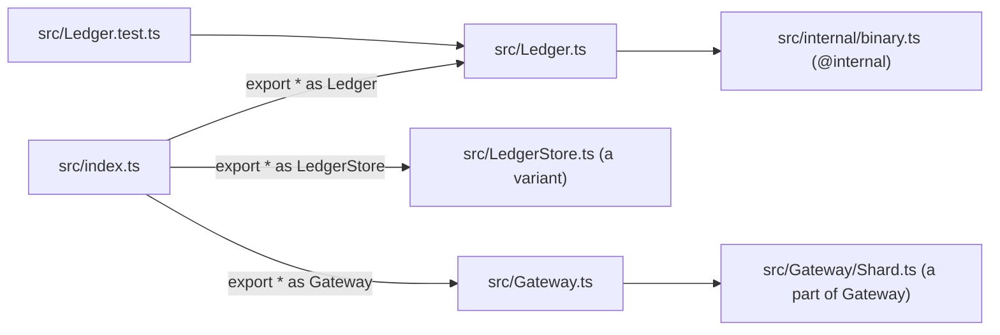

# 0032: next/'s libraries take Effect's file layout, a flat src/ of PascalCase modules with prefixed variants, internal/ for private parts and a namespace index, never folders by area or kind

**What this decides:** `libfabrika` and every other library package in `next/` lays out its files
the way Effect and its core team's own libraries do: one PascalCase file per concept in a flat
`src/`, and an `index.ts` that re-exports each one as a namespace.

[0034](0034-libfabrika-folders-are-bounded-contexts.md) replaces the one flat `src/` with one folder
per bounded context. The rest of this record still holds, inside each folder.



```ts
// src/index.ts, as clanka's and Effect's are written
/**
 * @since 0.0.0
 */
export * as Ledger from "./Ledger.ts"

// a caller
import { Ledger } from "@kampus/libfabrika"
const ledger = yield* Ledger.Ledger
```

## Context

[0023](0023-next-follows-effects-code-style.md) said `next/` follows Effect's style and listed
"PascalCase module files plus `internal/` and the namespace barrel" as items to follow, each in its
own sweep. This record settles how. It reads the code itself, not a summary:

- `effect/packages/effect/src` at `effect@4.1.2`: flat PascalCase modules (`Deferred.ts`,
  `Schedule.ts`), private code in `src/internal/` in camelCase with `/** @internal */`, and
  `index.ts` as `export * as X from "./X.ts"` with a doc block on each.
- clanka (a library by an Effect core maintainer): flat `src/` of PascalCase files, tests beside
  them (`Compaction.test.ts`, `CompactionTokens.test.ts`), variants as prefixed siblings
  (`Codex.ts`, `CodexAuth.ts`), a folder only beside its same-name file (`SemanticSearch.ts` +
  `SemanticSearch/`), and a namespace `index.ts` with `@since` tags.
- dfx (the same maintainer): the same, with a concept's parts in a folder beside its file (a gateway
  module and its shard folder). dfx also has `utils/` and `Helpers/` folders; that is the part we do
  not copy.
- cheffect (the same maintainer, an app): feature folders, each beside its same-name module
  (`Recipes.ts` + `Recipes/`), plus `components/`, `lib/` and `services/`.

[0029](0029-format-and-names-follow-effect.md) already allows `Module.of(...)` read through a
namespace import, which this layout makes the normal way in.

## Decision

**A library in `next/` has a flat `src/` of PascalCase module files, one concept each, and an
`index.ts` that re-exports each module as a namespace.**

- **One concept per file, PascalCase:** `Ledger.ts`, `Mailbox.ts`. The test sits beside it:
  `Ledger.test.ts`. A second test file for the same module is a prefixed sibling:
  `LedgerSpans.test.ts`. The repo's test infixes stay: `.laws.test.ts`, `.types.test.ts`,
  `.test-support.ts`, `.fixture.ts`.
- **A variant is a prefixed sibling, not a folder:** `LedgerStore.ts`, `LedgerTransaction.ts`. A
  platform's version of a piece is a variant too: `NodeStage.ts`, `WorkersGateway.ts`, as Effect's
  platform packages name `NodeFileSystem` and `BrowserHttpClient`.
- **A folder only for a concept's parts,** beside the file of the same name: `Gateway.ts` +
  `Gateway/Shard.ts`.
- **Private code goes in `src/internal/`,** camelCase, with every export marked `/** @internal */`.
  Nothing outside the package imports it, and `package.json` exports none of it.
- **No folders by area or kind:** no `data/`, `coordination/`, `transport/`, no `services/`,
  `types/`, `utils/` or `helpers/`.
- **`index.ts` re-exports each public module as a namespace with a doc tag:**
  `/** @since 0.0.0 */ export * as Ledger from "./Ledger.ts"`. Callers write `Ledger.make(...)` and
  `Ledger.Ledger`. `package.json` maps `"./*"` to `"./src/*.ts"`, as Effect's does, so a caller can
  also import one module by its path (`@kampus/libfabrika/NodeStage`).
- **The top level still names no platform** (AGENTS.md): `index.ts` re-exports no `Node*` or
  `Workers*` module. Those are reached only by their own path.

**Before** (libfabrika on main, 2026-11-09; lowercase folders by area):

```text
next/packages/libfabrika/src/
  index.ts  id.ts  testing.ts
  app/           brain-event.ts  brain-life.ts  entry.ts  execution.ts  patch.ts
                 program.ts  runner.ts  state.ts  supervisor.ts
  coordination/  index.ts  client-manager.ts  mailbox.ts  members.ts  process.ts
                 process-manager.ts  process-store.ts  recovery.ts  session-manager.ts  ...
  data/          index.ts  ledger.ts  ledger-store.ts  ledger-transaction.ts  log.ts
                 records.ts  referee.ts  sink.ts  sqlite.ts  trace.ts  ...
  door/          index.ts  door.ts  nonce.ts  store.ts
  transport/     index.ts  binary.ts  gateway.ts  hello.ts  sshsig.ts  webauthn.ts  wire.ts  ...
  workers/       index.ts  box.ts  gateway.ts  runtime.ts  platform.ts  ...
  node/          build.ts  local-stage.ts  stage.ts  stage-recording.ts
```

**After** (one flat `src/`; same files, new names):

```text
next/packages/libfabrika/src/
  index.ts                     export * as Ledger from "./Ledger.ts", one per public module
  Id.ts  Testing.ts
  BrainEvent.ts  BrainLife.ts  Entry.ts  Execution.ts  Patch.ts  Program.ts  Runner.ts  State.ts
  ClientManager.ts  Mailbox.ts  Members.ts  Process.ts  ProcessManager.ts  ProcessStore.ts  ...
  Ledger.ts  LedgerTransaction.ts  Log.ts  Records.ts  Referee.ts  Sink.ts  Sqlite.ts  Trace.ts  ...
  Door.ts  DoorNonce.ts  DoorStore.ts
  Gateway.ts  Hello.ts  Sshsig.ts  Webauthn.ts  Wire.ts  ...
  Workers.ts  WorkersBox.ts  WorkersGateway.ts  WorkersRuntime.ts  ...
  NodeBuild.ts  NodeLocalStage.ts  NodeStage.ts  NodeStageRecording.ts
  internal/                    binary.ts  ledgerStore.ts  platform.ts  ...  each export @internal
  Ledger.test.ts  Mailbox.test.ts  NodeStage.laws.test.ts  ...  each test beside its module
```

The folders by area are gone; the layer each file belongs to now lives only in `layer-rules.json`.
The move plan holds the full old-to-new table.

**Apps are not decided here.** The lean for `next/apps/fabrika` is cheffect's shape: feature
folders, each beside a same-name module (`Door.ts` + `Door/`). The owner has not decided it.

Binding constraints:

- A new file in a `next/` library follows this layout from today, even before the move lands.
- The move is `git mv` only, with import lines rewritten, and changes no law. The five layers keep
  their import order: `layer-rules.json` lists each layer's files, so `pnpm lint:layers` checks
  exactly what it checked before.
- The move starts only after the Effect format sweep (0029, ticket 466, after the braces sweep in
  PR 681) has merged, so the two big diffs do not collide.

## Consequences

- One move, split into small pull requests that each land whole, per its plan. It touches every
  file in `libfabrika`, every import of it in `next/apps/fabrika` and `next/programs/counter`, the
  path-bearing configs (`layer-rules.json`, `exam-paths.json`, `fixtures/next/p10`) and the lint
  rules that name a libfabrika path.
- Callers move from named imports (`import {Ledger} from "@kampus/libfabrika/data"`) to namespaces
  (`Ledger.Ledger`). Longer at each use; one way in for every module.
- The folder no longer shows a file's layer. A reader learns it from `layer-rules.json` or the
  lint error. That is the cost of the flat tree.
- 0023's "PascalCase module files plus `internal/` and the namespace barrel" item is closed by this
  record. The `@since` value stays `0.0.0` while `libfabrika` is `0.0.0`.
- Not decided here: the app's layout (a lean above), and better names than the mechanical ones the
  move picks (`State.ts` holds `Saved`): a rename after the move is its own change.
