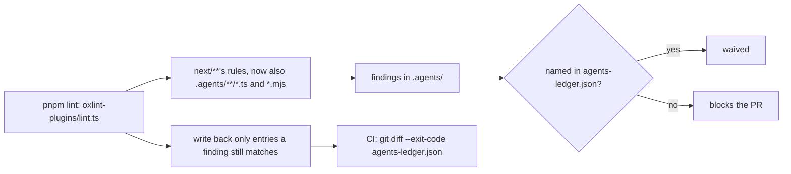

# 0033: Lead tooling under .agents/ follows next/'s code rules, with a ledger of old breaks that only shrinks

**What this decides:** the code in `.agents/` is linted with the same rules as `next/`, and what
already breaks them is listed in a ledger that can only get shorter.



```json
{
	"entries": [
		{
			"file": ".agents/skills/lead/scripts/botpush.mjs",
			"rule": "fabrika(no-node-imports)",
			"code": "import {execFileSync} from \"node:child_process\";"
		}
	]
}
```

## Context

Agents read `.agents/` (the lead scripts, `drive.ts`, `chain.ts`) and copy its habits into the code
they write. On 2026-11-09 the owner decided that lead tooling follows `next/`'s code conventions for
that reason: tooling that breaks them teaches every agent that reads it to break them too.

The fast track in [AGENTS.md](../AGENTS.md#two-versions-side-by-side) stays: lead tooling skips the
plan, tests, mutation and review steps. This decision is about how the code reads, not how it lands.
It builds on [0023](0023-next-follows-effects-code-style.md) (next/ follows Effect's code style),
[no Promises](../docs/direction/no-promises.md), and [0031](0031-lane-tooling-dogfoods-fabrikas-primitives.md),
whose move of `chain.ts` onto `Program.make` is where most of the ledger goes (that move waits, by
[0070](0070-flow-runner-stays-a-machine.md)). The ledger works like
`unreachable-ledger.json` ([0006](0006-no-unused-exports.md)).

At the start, `.agents/` held about 17k lines: 21 `.ts` files, 1 `.mjs`, 12 `.sh` and 3 `.py`.

## Decision

**Code under `.agents/` is held to `next/`'s lint rules from today; what already breaks them is in a
ledger that only shrinks, and new code passes from day one.**

- **Same rules.** `.oxlintrc.json`'s `next/**` override also covers `.agents/**/*.ts` and
  `.agents/**/*.mjs`, and its test override `.agents/**/*.test.ts`. A rule that checks its own path
  checks `.agents/` too.
- **The ledger.** `agents-ledger.json` names each old break by file, rule and the line's code, never
  a line number, so moving code keeps its entry and changing the line drops it. `pnpm lint` waives
  only what it names. A run over the whole repo writes back only the entries a finding still
  matched, and CI fails until that pruned file is committed.
- **Adding an entry is the owner's call,** in a change of its own. This decision authorizes the
  first ledger, written the day the rules turned on. An entry outside `.agents/` is refused.
- **Edges** use the same comment as `next/`:
  `// oxlint-disable-next-line <rule> -- edge: <why>`, one line each.
- **Shell and Python move to TypeScript and Effect when next touched,** one script at a time, never
  in one big rewrite.
- **The first big burn-down** is `chain.ts` moving onto `Program.make` under
  [0031](0031-lane-tooling-dogfoods-fabrikas-primitives.md). For now it waits: the runner stays a
  tea machine ([0070](0070-flow-runner-stays-a-machine.md)).

**Binding constraints:**

- No new entry in `agents-ledger.json` without the owner.
- No override that turns a `next/` rule off for a non-test `.agents/` file.
- A change that touches a ledgered line fixes it rather than rewriting the entry.

**Rejected:** hiding `.agents/` from agents' searches. It hides the bad habits; it does not fix them,
and the lead's own agents still need to read the scripts.

## Consequences

- On the first day, 112 findings in 7 files went into the ledger (counted in the lint PR).
- A shell or Python script keeps working until someone next changes it; then it moves.
- Some scripts may need real edges (a `node:` import Effect has no module for, a Promise a platform
  demands); each is one marked line, read at merge.
- Not decided here: when the shell scripts must all be gone, and lint rules for Python or shell.

## Amendments

- 2026-11-10: **the 12 `agents-ledger.json` entries that `fabrika/no-why-key` needs are allowed,
  once, for this rule** (owner). Tracker ticket 535, for
  [PR 664](https://github.com/usirin/tea-fabrika/pull/664) (ticket 337).
  - **What they are.** 12 lines under `.agents/` that keep the key `why`, because they read or
    write a shape today's version owns: outcome values in today's `@kampus/pipeline` shape and the
    lane state file's saved key in `drive.ts`, and test fixtures for `exam-paths.json` and field
    rows.
  - **Why they stay.** Today's code keeps `why` until that code is deleted
    ([AGENTS.md](../AGENTS.md#before-you-design-anything), "Data keys are short everyday words").
    Each entry leaves with that code.
  - **Why not an edge comment.** oxlint reads those files a second time through the skills links
    and reports the inline disable comment as unused (finding `2026-11-10-f01`, in PR 664's field
    rows).
  - **What it does not change.** The ledger still only shrinks otherwise. Any other new entry
    stays the owner's call, in a change of its own.
