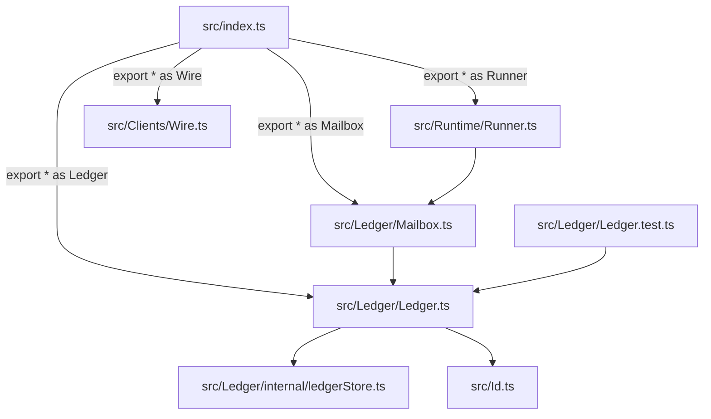
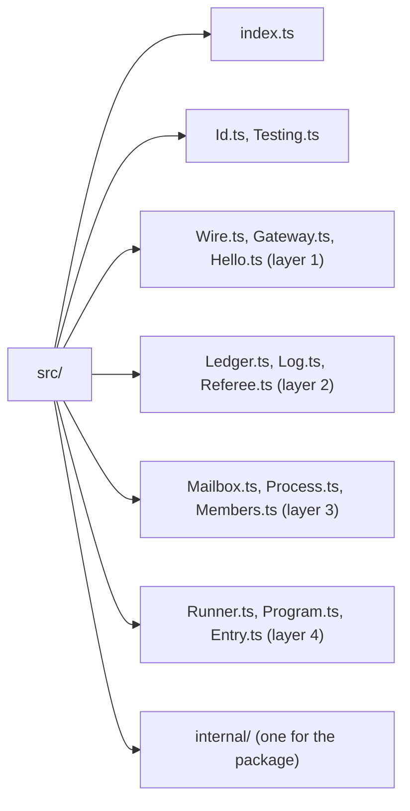
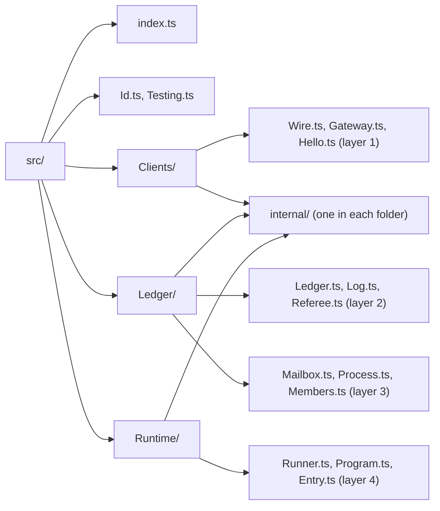

# 0034: A next/ library's src/ has one folder per bounded context, with Effect's flat PascalCase modules and an internal/ inside each, never one flat src/

**What this decides:** `libfabrika`'s files sit in one folder per bounded context (`Clients/`,
`Ledger/`, `Runtime/`), and inside each folder the layout is the one
[0032](0032-libraries-take-effects-file-layout.md) already gave.



```ts
// src/index.ts: still one namespace per module, as 0032 says. Only the path gains a folder.
/**
 * @since 0.0.0
 */
export * as Ledger from "./Ledger/Ledger.ts"

// a caller: unchanged from 0032
import { Ledger } from "@kampus/libfabrika"
const ledger = yield* Ledger.Ledger
```

## Context

[0032](0032-libraries-take-effects-file-layout.md) put every module in one flat `src/` and said
"no folders by area". The same day the owner changed one part of it: a flat `src/` of about 140
files hides which bounded context a file belongs to, and
[we follow DDD](../docs/direction/we-follow-ddd.md) already says a reader learns the context from
the path. That note's path table maps `next/`'s layers to contexts: layer 1 is clients, layers 2
and 3 are ledger, layer 4 is runtime
([the five layers](../docs/direction/a-local-first-sync-engine.md)).

This amends 0032 in part. Everything in 0032 still holds inside a folder: PascalCase modules, tests
beside them, variants as prefixed siblings, a folder for a concept's parts, `internal/`, the
namespace index, and no platform at the top level. Only "one flat `src/`" and "no folders by area"
are replaced. Tracker ticket 480.

Read from the code on main for this record, not from a summary:

- `@demlik/code-graph@0.15.0`, the installed version, gives a file to the layer row whose pattern
  is the most specific. A pattern may hold `*`. Two equally specific patterns that claim one file
  are an error. So one folder can hold two layer rows. A planted tree with the rows below was run
  through `code-graph --layers`: it passed clean, and each of five planted upward imports failed.
- In `layer-rules.json`, `next-coordination` sits above `next-data`. The exam
  (`next/apps/fabrika/src/exam/layers.test.ts`) also says data imports only `id`, and the app layer
  imports coordination but not data. No non-test file in `app/` imports `data/` on main.
- `door/door.ts` imports the app layer, coordination, data, transport and `id`. Only `index.ts`
  imports the door. Nothing else in the library imports transport except `workers/`.

## Decision

**A library in `next/` has one folder per bounded context under `src/`, named as the glossary
names the context, and inside each folder the files follow 0032.**

**Before** (0032, one flat `src/`):



**After** (this record):



```text
# before (0032)
next/packages/libfabrika/src/
  index.ts  Id.ts  Testing.ts
  Wire.ts  Gateway.ts  Hello.ts  Sshsig.ts  ...
  Ledger.ts  Log.ts  Referee.ts  Sink.ts  ...
  Mailbox.ts  Process.ts  ProcessManager.ts  Members.ts  ...
  Runner.ts  Program.ts  Entry.ts  State.ts  ...
  internal/  binary.ts  ledgerStore.ts  processMail.ts  supervisor.ts

# after (this record)
next/packages/libfabrika/src/
  index.ts  Id.ts  Testing.ts
  Clients/   Wire.ts  Gateway.ts  Hello.ts  Sshsig.ts  ...       internal/binary.ts
  Ledger/    Ledger.ts  Log.ts  Referee.ts  Sink.ts  ...         internal/ledgerStore.ts
             Mailbox.ts  Process.ts  ProcessManager.ts  Members.ts  ...  internal/processMail.ts
  Runtime/   Runner.ts  Program.ts  Entry.ts  State.ts  ...      internal/supervisor.ts
```

The same files and the same names move: each one gains its context's folder, and the one
`internal/` splits into one per folder.

- **Three folders in `libfabrika`:** `Clients/` holds layer 1 (transport), `Ledger/` holds layers 2
  and 3 (data and coordination), `Runtime/` holds layer 4 (the app layer). A folder's name is the
  context's name in [the glossary](../.glossary/TERMS.md), in PascalCase.
- **The top of `src/` holds only what belongs to no one context:** `index.ts`, `Id.ts` (the
  glossary's shared names) and `Testing.ts`, with their tests and test support beside them.
- **Inside a folder, 0032 as written:** flat PascalCase modules, one concept each, the test beside
  its module, a variant as a prefixed sibling, a folder only for a concept's parts beside the file
  of the same name.
- **Each folder has its own `internal/`,** camelCase, every export marked `/** @internal */`. It
  keeps 0032's meaning: nothing outside the package imports it and `package.json` exports none of
  it.
- **One index, at `src/index.ts`.** No folder has an index of its own. Since the index is one flat
  list of namespaces, a module name is used once in the whole package, not once per folder.
- **A folder is a context, not a layer.** `layer-rules.json` keeps every row it has, by name and in
  the same order. `Ledger/` holds two rows, so data still sits below coordination:

  ```json
  { "name": "next-coordination", "paths": [
    "next/packages/libfabrika/src/Ledger/Mailbox*",
    "next/packages/libfabrika/src/Ledger/Process*",
    "next/packages/libfabrika/src/Ledger/internal/processMail.ts"
  ] },
  { "name": "next-data", "paths": ["next/packages/libfabrika/src/Ledger"] }
  ```

  The folder is the lower row, data. A coordination file is named in the upper row by its
  concept's prefix, and the more specific pattern wins. A new file that nobody names lands in data,
  where an import of coordination fails `pnpm lint:layers`. It fails closed.
- **No folders by kind,** as in 0032: no `services/`, `types/`, `utils/` or `helpers/`. A folder
  by area that is not a bounded context (`data/`, `coordination/`, `transport/`, `app/`) is gone
  too.
- **Later, not now:** two platform packages, `@kampus/libfabrika-node` and
  `@kampus/libfabrika-workers`, take the Node and Workers code out of `libfabrika`. Each is its own
  change with its own plan.

Binding constraints:

- A new file in a `next/` library goes in its context's folder from today, even before the move
  lands.
- The move is `git mv` only, with import lines rewritten, and changes no law. Every layer row keeps
  its name, its place in the order and its files. Merging the two `Ledger/` rows into one would
  drop the check that data never imports coordination. That loosens a law, so it is not part of
  this move and would wait on the owner.
- The exam's table keeps every part and every allowed import it has today, including "the app
  layer imports coordination, not data".
- The move still starts only after the Effect format sweep (0029, ticket 466) has merged.

## Consequences

- The move plan is rewritten for this layout. It was written for 0032's flat `src/` and no file has
  moved, so nothing is undone.
- The path now shows a file's context. It does not show its layer inside `Ledger/`: a reader
  learns that from `layer-rules.json` or the lint error, as 0032 said for the whole tree.
- `package.json` cannot map every folder with one `"./*"` line and still hide each `internal/`, so
  it gains a pair of lines per folder. The plan holds them.
- Where a glossary row puts a word in one context and the code's layer puts its file in another
  (a record service the glossary lists under Runtime whose file sits in the data layer, for
  example), the layer picks the folder in the move, since the move changes no import. Each such
  glossary row is fixed in its own change.
- Not decided here:
  - **Where the door goes.** It is a Clients word in the glossary, but it imports all four layers,
    so it cannot sit in the layer 1 row. The lean is `Clients/Door.ts` with its variants, kept in
    its own `next-door` row above `Runtime/` by the pattern `src/Clients/Door*`. The plan carries
    the choice and what each answer costs.
  - **Where `node/` and `workers/` sit until the platform packages exist.** The plan carries a
    lean.
  - **Whether one context may import another context's `internal/`.** Today the app layer imports
    a coordination file the move would make internal. This record adds no rule about it.
  - The app's layout, as in 0032.
