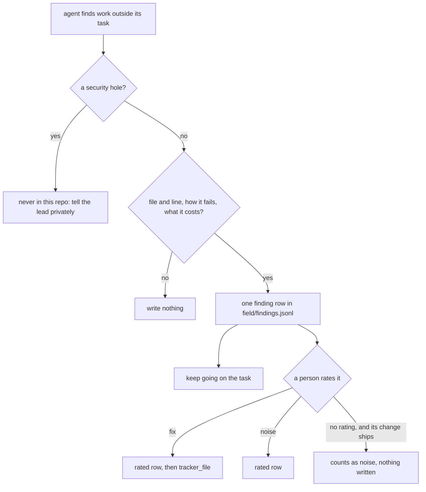

# 0035: An agent that finds work outside its task writes one finding row and keeps going, never a fix, a ticket or only a mention

**What this decides:** when an agent meets something wrong that its task does not cover, it writes
one row in `field/findings.jsonl` with proof and goes back to its task; a person rates the row
later, and only a `fix` becomes a ticket.



```ts
// A sketch of the two rows. The values are made up; field/README.md holds the fields table.
{_tag: "finding", id: "2026-11-09-f01", date: "2026-11-09",
 by: "build", model: null, rule: "dead_code",                    // who found it, and which rule from the closed list
 location: {path: "next/apps/fabrika/src/stage.ts", line: 41},   // the file and line it is about
 says: "`state` is written by transition and never read",        // what is wrong, in a sentence
 proof: "rg finds one write and no read; lint:dead misses it because the field is not exported",
 cost: "a reader takes it for live state and keeps it in step by hand",
 head: "9e02a1c…",                                               // the commit it was seen on, full sha
 ticket: "usirin/tea-fabrika#229", pr: null}                     // the work it was found during

{_tag: "rated", finding: "2026-11-09-f01", says: "fix",          // or "noise"
 by: "owner", date: "2026-11-12", ticket: "usirin/tea-fabrika#501"} // the ticket a fix became; null for noise
```

## Context

Every earlier form of "agents file tickets" over-reported, and triage became the filter. Field note
`2026-10-10-25` in [`field/notes.jsonl`](../field/notes.jsonl) is the plain case: a reviewer's
non-blocking note was filed as an issue, a triager built the code and ran it, and there was nothing
to fix, because the note came from reading one function and no run backed it.

[Every finding is rated](../docs/direction/every-finding-is-rated.md) already decided how a finding
counts: a person rates it `fix` or `noise`, and one never rated counts as noise once its change
ships. That gives a noise rate per source and rule, the count Google calls an effective false
positive (Sadowski et al., "Lessons from Building Static Analysis Tools at Google", CACM 2018, as
that note cites it). The rest of that note, the shared `Finding` shape and the ledger rows, is
proposed and is walked when Tier 6 starts. Until then there was nowhere to write a finding down, so
it went into a ticket, a fix nobody asked for, or one line of a report.

This decision changes one older rule. [Hand-run review, cleanup and saved waits](../docs/direction/hand-run-review-and-cleanup.md)
(owner, 2026-11-08) says a review's other actionable findings become tracker tickets and that every
agent may file. From today those findings are rows. The rest of that note stands. Tracker ticket
481.

## Decision

**An agent that finds work outside its task writes one finding row and keeps going. It does not fix
it, does not file a ticket, and does not only mention it in its report.**

- **Where.** Until `next/`'s ledger holds findings (Tier 6), rows go in `field/findings.jsonl`, one
  JSON object per line, append-only. The fields are in
  [`field/README.md`](../field/README.md#a-finding).
- **The shape is the note's proposed `Finding`,** so a row moves into the ledger later with nothing
  lost: `id`, `by`, `rule`, the place, `says` and `head`, plus `date`, and the `ticket` and `pr` it
  was found during. One key differs from the note's sketch: the place is `location`, not `at`.
  AGENTS.md keeps `at` for a time and gives a place its own word, and `location` is SARIF's word
  too.
- **A finding needs proof to be written at all:** the file and line (`location`), how it fails or
  what is wrong (`proof`), and what it costs if left (`cost`). A hunch from reading, with none of
  the three, is not written.
- **`rule` comes from this closed list.** An open rule makes the count say nothing.

  | `rule` | What it is |
  |---|---|
  | `bug` | code does the wrong thing, and a run or a call shows it |
  | `dead_code` | code nothing reaches or reads |
  | `duplicate` | one rule written in two places, which can disagree |
  | `missing_test` | a behavior or a law that no test checks |
  | `flaky_test` | a test that passes on some runs and fails on others |
  | `doc_drift` | a doc and the source disagree |
  | `rule_break` | code that breaks AGENTS.md, a decision or a pattern doc |

  A `flaky_test` row does not wait for its rating: the test is fixed that day, with a ticket
  ([0036](0036-a-flaky-test-is-fixed.md)). The rest of this file still holds for it.

  A finding that fits none is not forced into one. The agent says so in one line of its report, and
  a new rule is added here by amendment.
- **A person rates each row `fix` or `noise`.** The rating is a row of its own, `_tag: "rated"`,
  naming the finding's `id`. It is written by a person's tool: by hand, or by the lead session
  writing down the owner's call, until a window exists. The agent that found it never writes it,
  and no agent rates.
- **A `fix` becomes a tracker ticket,** filed with `tracker_file` by whoever writes the rating, and
  the rated row keeps its number.
- **A row never rated counts as noise once its change ships,** as the note decided. Its change is
  the pull request it was found during. Nothing is written for that; it is worked out when the
  count is made.
- **Never a security hole.** Those stay out of this public repo.

**Binding constraints:**

- No agent files a ticket, opens a pull request or changes code for work outside its task.
- No agent writes or edits a `rated` row for a finding it wrote.
- A finding row is never edited or deleted after it lands. A wrong one is rated `noise`.
- `rule` and the row's keys change only by an amendment here.

## Consequences

- A good finding waits in a file until a person rates it. Rating is by hand until a window exists.
- The reporting bar is tuned against a number: noise per `by` and per `rule`. A source or a rule
  that is mostly noise gets a stricter brief or is dropped.
- A reviewer still blocks on what its task covers: a broken decision, lost data or a broken law.
  Only its other findings change, from tickets to rows.
- **Still saying the old rule,** and changed next as lead tooling: the answer format in
  [the review skill](../.agents/skills/review/SKILL.md) and the standing review brief in
  [the lead skill](../.agents/skills/lead/SKILL.md), which count filed tickets. Until that lands,
  this decision wins where they disagree.
- A step whose owner list does not allow `field/` hands the finished row to the lead in its report,
  as one JSON line, and the lead adds it unchanged the same day, as
  [0013](0013-plan-docs-change-with-the-work.md) does for plan rows.
- Two pull requests can pick the same `id` on the same day. The one that lands second renumbers its
  rows before it lands; no rating exists yet, so nothing points at them.
- CI checks only that each added row is a JSON object, and advises that the file has no detailed
  schema ([field/README.md](../field/README.md#what-ci-checks)).
- Not decided here: a detailed schema check for these rows, the window that shows and rates them,
  how the same finding is matched when two agents write it, and how many ratings a rule needs
  before its count is trusted. The note lists the last two as open.

## Amendments

- 2026-11-10, tracker ticket 523: the review skill, the lead skill's standing review brief and the
  step skills now say this rule, and `skillscheck.sh` holds the clause. CI's `field` job now checks
  a row's core: its keys, the closed `rule` list, `location` and never `at`, and `says`, `proof`
  and `cost` not empty ([field/README.md](../field/README.md#what-ci-checks)). The two lines under
  Consequences that say otherwise describe the day this was decided.

## Records

- [`.glossary/TERMS.md`](../.glossary/TERMS.md): the `finding` row now also names an agent's find
  outside its task, and where the rows live until Tier 6.
