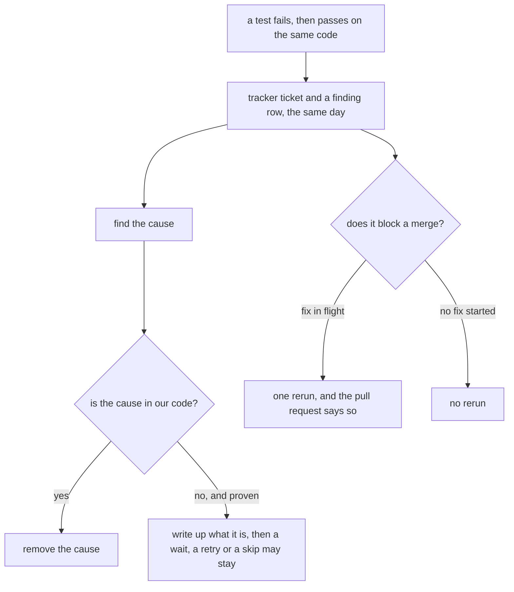

# 0036: A flaky test is fixed the day it is seen, never rerun until green and left

**What this decides:** when a test passes on one run and fails on another with the same code,
whoever sees it finds the cause and fixes it, or starts that fix the same day; nobody reruns it
until it is green and moves on.

## Context

Every merge here leans on the checks: the lead merges on green CI
([0014](0014-the-lead-merges-when-every-step-passed.md)). A check that is rerun until it passes is
a check nobody trusts any more, and a red run that might be "just the flaky one" hides a real
failure behind it.

It came up on [pull request 697](https://github.com/usirin/tea-fabrika/pull/697), a docs-only
change whose `next` job failed in `next/apps/fabrika/src/stage-wire.test.ts`: the test server could
not bind its port, because another process had taken it. Tracker ticket 491 holds that fix.
Tracker ticket 490 is this decision.

**The known way.** Martin Fowler's
["Eradicating Non-Determinism in Tests"](https://martinfowler.com/articles/nonDeterminism.html)
(2011) names the usual causes: tests that are not isolated from each other, async waits, remote
services, time and leaked resources. He says to fix the cause, and to move a flaky test into
quarantine until it is fixed. Google reruns and quarantines at its scale
([Micco, "Flaky Tests at Google and How We Mitigate Them"](https://testing.googleblog.com/2016/05/flaky-tests-at-google-and-how-we.html),
2016). We take the first half and not the second: this repo is small enough that a fix the same
day is cheaper than a quarantine list somebody has to keep.

**How this fits three older texts.**

- [0035](0035-outside-work-becomes-finding-rows.md) is amended in part. Its closed rule list has
  `flaky_test` as a finding row that waits for a person's rating, and its binding constraints say
  no agent files a ticket for work outside its task. A flaky test no longer waits and does get a
  ticket. The rest of 0035 stands, for `flaky_test` rows too.
- [Done is per criterion](../docs/direction/done-is-per-criterion.md#a-stuck-task) says a crash or
  a flaky run is retried by the pipeline's code first, and counts toward "stuck" only if it keeps
  happening. That does not clash. The retry there answers one question: is this task stuck? It
  keeps a run moving. It does not make the test trusted. A flaky run the code retried is still a
  flaky test that was seen, so it gets its ticket and its fix that day.

- [Ship stage rules](../docs/direction/ship-stage-rules.md) (2026-10-11) has today's ship step run
  red checks again once per head before it calls the builder, with no fix in flight. That is close
  to a clash, and this decision does not settle it: the rule is code in today's paused pipeline, it
  runs on any target repo, and it is not changed here. What this decision adds is what happens
  after: a check that went green on that rerun, in this repo, is a flaky test that was seen.

## Decision

**A flaky test is fixed the day it is seen. Nobody reruns it and moves on.**

- **Who.** Whoever sees it, in CI or locally, a person or an agent. They find the cause and fix it,
  or start the fix that day, before or beside the work it blocked.
- **A ticket, the same day.** They file one with `tracker_file`, with the test's name, the failing
  run and the error line. An agent whose step cannot change the test still files the ticket, and
  tells the lead in its report; the lead starts the fix that day.
- **A rerun unblocks a merge only once the fix is in flight,** and the pull request that was rerun
  says so, with the ticket.
- **The fix removes the cause:** a shared port, a clock, an order between tests, a shared file. It
  never widens a timeout, adds a retry around the assertion or skips the test.
- **One exception: a cause proven to be outside our code.** Then a wait, a retry or a skip may
  stay, and the write-up says what the cause is and how it was proven.
- **The fix shows its proof:** the test run many times in a row with the count in the pull request,
  and the other tests that share the cause, fixed there or listed on a ticket.
- **The finding row is still written.** `flaky_test` stays in 0035's list, so the count per source
  keeps working. The row does not wait: the lead writes its `rated` row as `fix`, with the ticket,
  the same day. That is this decision written down, not a new call.

**Binding constraints:**

- No pull request merges on a rerun of a test that failed and has no fix in flight.
- No fix for a flaky test is a wider timeout, a retry around the assertion or a skip, unless the
  cause is proven to be outside our code and the write-up says what it is.
- A fix for a flaky test may not weaken a law: `loosening.sh` runs on it like any exam change.

## Consequences

- The work a flaky test blocked waits a little, or runs beside the fix. That is the cost.
- 0035's status becomes `amended-in-part by` this file, and its body and
  [`field/README.md`](../field/README.md#a-finding) each get a one-line pointer.
- An open flaky ticket from before today is covered too: tracker ticket 421, a second flaky law in
  the same file, starts now.
- AGENTS.md's Checks section gets one line.
- Not decided here: whether the ship step's one rerun per head stays when `next/` rebuilds that
  step, whether the pipeline's code in `next/` files the ticket itself when it retries
  a flaky run, how a flaky test is told from a real failure by code, and what happens when a cause
  cannot be found in a day.
