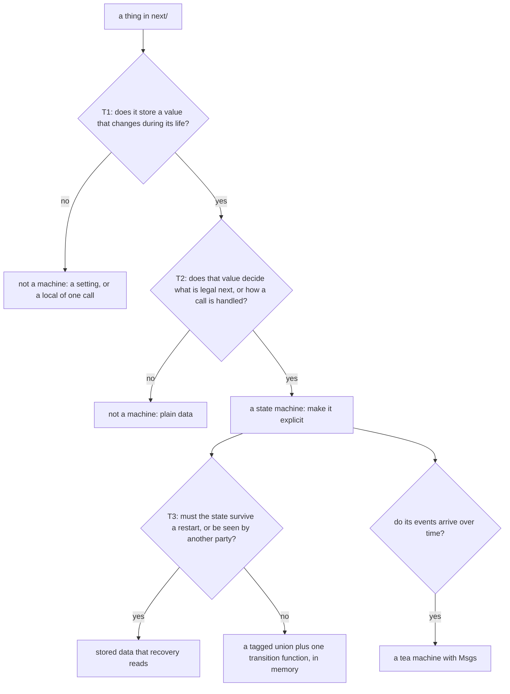

# 0037: Every implicit state machine in next/ is made explicit, one named type with its transitions in one place, never flags, a position in code or an order two parties assume

**What this decides:** in `next/`, anything that passes two yes-or-no tests is a state machine, and
every one of them is written as one named type with its transitions in one place; a third test
picks which form it takes.



```ts
// A sketch, from experiment 246's machine 1. Implicit: a flag, flipped inside the step.
let ready = false
sql.transaction(() => { if (!ready) makeTables(); ready = true; return step() })
// step() throws -> the tables roll back, `ready` stays true -> every later write fails.

// Explicit: one named type, one transition, in one place.
type Tables = "cold" | "ready"
const next = (state: Tables, committed: boolean): Tables => (committed ? "ready" : state)
```

*Amended 2026-11-09 by [0043](0043-one-tea-machine-per-file.md): the form is always a tea machine. The "tagged union plus one transition function" form below no longer holds; everything else here does.*

## Context

[Experiment 246](../experiments/246-implicit-state-machines-in-next.md) swept `next/` on main for
state machines nobody had named. It found 13, and one of them has a bug its probe reproduces: the
flag in the sketch above. It also holds the definition this record uses, with its sources (Harel's
statecharts paper for the transition, the UML tradition for control state against extended state).
That experiment is the rule's first test on real code. Tracker ticket 493.

The owner decided the rule on 2026-11-09. One reason is recorded on purpose. "Which things count as
a state machine" can sound like a matter of taste. When a rule is called subjective, the answer is
a sharper definition, never a weaker rule. So the rule is "everything that passes both tests", and
the tests are yes or no.

It does not contradict two notes it sits beside:

- [Elm first](../docs/direction/elm-first.md) says a window's state lives in a tea machine. This
  record covers state outside a window too, and it keeps tea as the form for events that arrive
  over time.
- [Where we follow OTP](../docs/direction/follows/otp.md) lists coordination's behaviors. Where
  `next/` follows OTP, the explicit form is OTP's shape: a supervisor that learns of a death by
  message, or `gen_statem`'s one transition per state and event. No row of that table changes here.

## Decision

**In `next/`, everything that passes T1 and T2 is a state machine, and every state machine is made
explicit.**

- **The definition.** A thing has a state machine when both hold:
  1. it stores a value that changes during its life, in response to events or calls (T1);
  2. that value decides which events or calls are legal next, or how the same one is handled (T2).
- **That value is control state,** as against plain data. A setting that never changes fails T1. A
  number nobody branches on fails T2. Neither is a machine, and neither is touched.
- **A machine is implicit** when its control state is not one named type with its transitions in
  one place.
- **It hides in three places:**
  - flags: booleans, nullable fields or `let`s on one thing;
  - position: which step a long function has reached;
  - between two parties: a protocol whose order each side only assumes.
- **The third test picks the form, never whether.** T3: must the state survive a restart of the
  process, or be seen by another party?
  - Yes: stored data that the recovery path reads. Never a position in code, never memory only.
  - No: a tagged union plus one transition function, in memory.
  - Either way, when its events arrive over time it is a tea machine with Msgs
    ([Elm first](../docs/direction/elm-first.md)).
- **A plan asks of new code: what are its states?** The answer is a named type, or "none, and here
  is the test it fails".

Why it pays twice:

- **Property tests come nearly for free.** A tea machine runs `@demlik/tea/pbt` as it is: drawn Msg
  lists, an invariant checked on every step, a predicate over the whole trace, and a check that
  every list ends in a terminal state. A plain tagged union needs only a small fast-check wrapper.
  The experiment's totals for the 13: about 15 properties gained, about 65 of today's example tests
  whose transition part they could cover (a rough read of test titles), and 23 invariants still to
  write.
- **A stored machine gets the replay law:** the state rebuilt from what is stored equals the state
  in memory. `next/` has it for tea machines already, as `syncTest`.

**Binding constraints:**

- New code in `next/` that passes T1 and T2 lands explicit. A flag, a nullable field or a call
  order is not accepted as its control state.
- "It is small" or "no wrong state is reachable today" is no reason to leave a machine implicit. A
  disagreement is written down as one, with its reason, and goes to the owner.
- Making a machine explicit may not weaken a law. Where the type now forbids a wrong state, the
  test for that state goes only when the type really cannot write it.

## Consequences

- **The 13 machines the experiment found become work.** This record does not order them, with two
  exceptions below.
- **The supervision record (machine 2) is done inside P34c,** tracker ticket 404, which rewrites
  that machine anyway
  ([0016](0016-tier-1-supervision-is-otps-top-level-supervisor.md)).
- **The runner and the door are split first.** Each becomes a short front file plus `internal/`
  files, cut along its machines and its jobs. That is a move-only change and lands before the
  machine fixes, so each fix is read in a small file. The split rides with the library layout move,
  which is its own coming decision.
- **The cost** is the work itself: the experiment sizes each machine in files and lines, from about
  30 lines (the table latch) to about 200 with saved rows to migrate (the supervision record).
- Records: the glossary gains `control state`, `explicit machine` and `implicit machine`, and its
  `machine` row says a tea machine is one form of an explicit machine. AGENTS.md gets one line.
  [Elm first](../docs/direction/elm-first.md) gets a one-line pointer.
- Not decided here:
  - **The order of the other 12 machines.** The experiment ranks three; the lead and the plan pick.
  - **Machine 13, the span sink's hold.** The experiment says it should wait, since making it
    explicit removes no wrong state. That is the one stated disagreement with this rule, and it
    stays open for the owner.
  - **Whether a lint rule can catch a new implicit machine.** Nobody has tried. Until one exists,
    the plan's question and the review are the check.
  - **Today's version.** The rule is about `next/`.

## Records

- [`.glossary/TERMS.md`](../.glossary/TERMS.md): `control state`, `explicit machine`,
  `implicit machine` (new rows, Runtime), and `machine` (its Not column).
