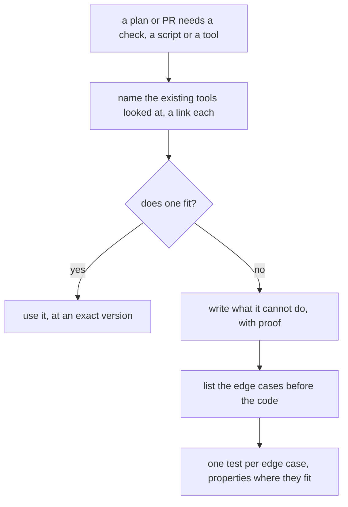

# 0040: Before we hand-write a check or a tool we try an existing, widely used one, and say in writing why when we do not use it

**What this decides:** a plan or pull request that adds a check, a script or a tool first names the
existing tools it looked at, and either uses one or gives a proven reason it does not fit; a
hand-written check that stays lists its edge cases before its code, each with a test.

## Context

Every merge here leans on the checks: the lead merges on green CI and a clean leak grep
([0014](0014-the-lead-merges-when-every-step-passed.md)). So the tooling has to be solid and
trusted. A hand-written check that gets one small patch each time an edge case shows up is not.

It came up on 2026-11-09, from today's lead tooling and `next/`'s tests in one night:

- The repo's hand-written leak check, `.agents/skills/lead/scripts/leakgrep.sh`, blocked a
  format-only sweep. It read old lines with new spacing as new text.
- A helper that picks a port for a test, a CI step with no time limit and two tests were found
  unreliable: [0036](0036-a-flaky-test-is-fixed.md), and pull requests
  [701](https://github.com/usirin/tea-fabrika/pull/701),
  [702](https://github.com/usirin/tea-fabrika/pull/702) and
  [703](https://github.com/usirin/tea-fabrika/pull/703).
- An experiment in flight compares the leak check with existing tools
  ([gitleaks](https://github.com/gitleaks/gitleaks) and its peers). Its answer is not in yet.

**The known way.** A widely used tool has already met the edge cases we have not thought of, and
its users keep finding the rest. Dan McKinley's
["Choose Boring Technology"](https://mcfunley.com/choose-boring-technology) (2015) makes the case:
a well-known tool's failures are known, and a new one's are not. This repo already works this way in
three places:

- [Property tests, not our own search engine](../docs/direction/property-tests-not-our-own-search.md):
  we use the industry's test tools and do not grow our own.
- [oxlint and oxfmt](../docs/direction/oxlint-and-oxfmt.md), and AGENTS.md's rule that a check on
  the shape of code is oxlint's own rule where one exists.
- [0030](0030-copy-clankas-shapes-where-better.md): where another project does it better, we copy
  its shape.

**How this fits older texts.** The sweep found no decision this one contradicts.

- AGENTS.md's "Lead with the known way" covers designs. This extends it to tooling.
- [0033](0033-agents-code-follows-next-rules.md) says how lead tooling's code reads, and that shell
  and Python scripts move to TypeScript when next touched. This adds a question before that move:
  does an existing tool do the job?
- [0031](0031-lane-tooling-dogfoods-fabrikas-primitives.md) stands. The lane runner is fabrika's
  own product used on itself, so it is built on fabrika's pieces on purpose. A check or helper
  beside it, such as a leak scan, is not the product, and gets this question.
- [0011](0011-leak-check-allows-plain-tmp-paths.md) stands. It is a rule the hand-written leak
  check holds today, and it stays until an experiment says what replaces that check, if anything.
- [0035](0035-outside-work-becomes-finding-rows.md) stands. An agent that meets a weak hand-written
  check outside its task still writes one finding row and keeps going.
- [0036](0036-a-flaky-test-is-fixed.md) stands. It says what to do when a test is flaky; this says
  what to ask before the next helper is written.
- [Nobody writes their own exam](../docs/direction/nobody-writes-their-own-exam.md) stands. A
  check is part of the exam, so swapping a hand-written check for an existing tool is an exam
  change and lands by that note's rules.
- [Five steps for every check](../docs/direction/five-steps-for-every-check.md) stands. It is
  about formal checks on a promise the code makes; an existing tool that is picked still follows it.

## Decision

**Before we hand-write a check, a script or a tool, we try an existing, widely used one first. If
we do not use it, we say why in writing.**

- **Name what was looked at.** A plan or pull request that adds a check, a script or a tool names
  the existing tools it looked at, with a link each.
- **Use one, or give the reason it does not fit:** what it cannot do, with proof (a run, its docs
  or its source). "We could write it quickly" is not a reason.
- **A hand-written check that is kept or written lists its edge cases before the code,** and each
  edge case has a test, a property where one fits.
- **It extends "Lead with the known way" from designs to tooling.** It replaces none of these: a
  check that can block needs its false alarms measured first, exact versions only, no new paid
  accounts, and never wait on upstream.
- **It covers both versions and the lead tooling.** The fast track for lead tooling stays; this
  question is asked on that track too.

**Binding constraints:**

- No plan or pull request adds a hand-written check, script or tool without the list of existing
  tools it looked at.
- No reason for skipping an existing tool rests on how fast ours is to write.
- No hand-written check lands without its edge cases listed and a test for each.

## Consequences

- A plan that adds tooling gets a little longer, and its writer spends time reading other tools'
  docs first. That is the cost.
- An existing tool brings a dependency, pinned to an exact version, and sometimes a patch
  ([patch upstream locally](../docs/direction/patch-upstream-locally.md)).
- A hand-written check may still be the right answer. Then the reason is written down once, where
  the next reader finds it, and the edge cases are tests, not later patches.
- AGENTS.md gets one bullet under "Before you design anything".
- Not decided here: which existing checks get replaced. Each is its own experiment, and the leak
  check's is the one in flight. Also not decided: how many users make a tool "widely used", and
  whether code checks that a plan carries the list.
