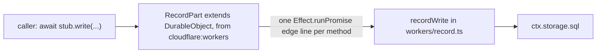
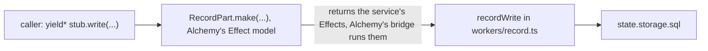

# 0041: In next/, a Durable Object class is written with Alchemy's Effect Durable Object model in its modular form, never as a plain cloudflare:workers class

**What this decides:** in `next/`, everything is written in Effect where it can be, and that
includes the Durable Object classes themselves: each is an Alchemy Effect Durable Object, a class
that only names it plus a `.make()` Layer, and the logic stays in the plain services it already
hands off to.

## Context

`next/apps/fabrika/src/brain.ts` holds four plain classes, `Project`, `Process`, `Gateway` and
`RecordPart`. Each `extends DurableObject` from `cloudflare:workers`, and each method is one line
that runs an Effect and returns a Promise, about 50 edge comments in all.
[An object class stays thin](../docs/direction/object-classes-stay-thin.md) (decided 2026-10-31)
set that shape.

Alchemy ships an Effect model for the class itself. kamp-us/phoenix moved to it in
[its decision 0028](https://github.com/kamp-us/phoenix/blob/main/.decisions/0028-effect-durable-object-model.md),
took the modular form in
[0032](https://github.com/kamp-us/phoenix/blob/main/.decisions/0032-alchemy-beta45-and-dev-model.md),
and found the sibling rule in
[0033](https://github.com/kamp-us/phoenix/blob/main/.decisions/0033-mutual-do-layer-cycle-per-call-resolution.md)
(that rule failed when run here and is replaced, see [Amendments](#amendments)).
Its [pattern doc](https://github.com/kamp-us/phoenix/blob/main/.patterns/alchemy-durable-objects.md)
shows the shape as it runs there.

The owner decided on 2026-11-09 to do the same here. "The library is a beta" is not a reason to
hand-write what it offers: `next/` already runs its whole stack on it, and a break is patched
locally ([patch upstream locally](../docs/direction/patch-upstream-locally.md)).

This amends [an object class stays thin](../docs/direction/object-classes-stay-thin.md) on one
point only, what the class is made of. Its rule, that the logic is plain code behind a service
that also runs on Node in tests, stands. It is a direction note with no decision file, so no
`status:` line changes. Nothing is built yet: tracker ticket 502's plan starts with a
spike.

## Decision

**A Durable Object class in `next/` is an Alchemy Effect Durable Object in the modular form: a
class that is only its name and contract, and a Layer from `.make()` that returns the methods of a
plain service.**

**Before:**



**After:**



```ts
// before: next/apps/fabrika/src/brain.ts, as on main
export class RecordPart extends DurableObject<Env> {
	write(chain: Chain, at: number, rows: Rows) {
		// oxlint-disable-next-line fabrika/no-effect-run-outside-edge -- edge: Durable Object RPC returns a Promise
		return Effect.runPromise(
			settings(this.env).pipe(
				Effect.flatMap((s) => recordWrite(this.ctx, s.limits?.recordBytes, chain, at, rows)),
			),
		);
	}
}

// after: a sketch, not built. The names are from @alchemy.run/cloudflare 2.0.0-beta.84.
export class RecordPart extends Cloudflare.DurableObject<RecordPart, RecordShape>()("RecordPart") {}

export const RecordPartLive = RecordPart.make(
	Effect.gen(function* () {
		const state = yield* Cloudflare.DurableObjectState; // outer: the state reference only

		return Effect.gen(function* () {
			const record = yield* Record.make(state); // the plain service, as it runs on Node in tests
			return {write: record.write, read: record.read, content: record.content};
		});
	}),
);
```

The service box does not move. What changes is the class around it: the edge lines go, the
caller's stub answers with an Effect, and Alchemy's bridge is the one place a Promise is made.

- **The modular form.** The class is `Cloudflare.DurableObject<Self, Shape>()("Name")` with an
  empty body. The implementation is a separate `Live` Layer from `Self.make(impl)`. Never the
  inline form, where the implementation is the class's second argument: an object that imports
  another's class must not pull in its code.
- **The logic stays in plain services.** `.make()`'s body picks up what the platform gives
  (`Cloudflare.DurableObjectState`, the environment) and returns the methods of a service from
  `next/packages/libfabrika/src/workers/`. It decides nothing. A law still runs that service on
  Node, so the mutation step still reaches it.
- **A sibling object is taken in the Layer's init with `Sibling.from(Host)`.** An object that
  calls another takes that other's namespace once, in `.make()`'s outer Effect, by the host
  Worker's class, and its methods use that value. It is never looked up per call. The host Worker
  class names the objects it hosts. Our four objects call each other, so the rule applies here.
  *Replaced on 2026-11-10, see [Amendments](#amendments). It said: sibling objects are resolved
  per call. An object that calls another resolves that other's namespace inside the method that
  needs it, never in `.make()`'s outer Effect. In phoenix, an eager pair ran the build out of
  memory on the inline form, and on the modular form two Layers that each need the other do not
  compose (its 0033).*
- **A gap in Alchemy is patched locally,** with `pnpm patch`, and the upstream issue is filed the
  same day. It is never a reason to go back to a plain class.

**Binding constraints**

- No new `class ... extends DurableObject` from `cloudflare:workers` in `next/`. The four in
  `brain.ts` stay until ticket 502's pull requests replace them, one object at a time.
- An existing law is ported before the object under it changes shape.
- A claim that a platform feature works on this model comes from a run on the installed version,
  not from this file or from phoenix's notes. phoenix wrote its notes on beta.44 to beta.59.

## What the installed version has

Read on 2026-11-09 in `@alchemy.run/cloudflare` 2.0.0-beta.84, under `src/Workers/`. Reading the
source shows a name exists. It does not show that it works for our objects.

| Asked | In beta.84's source |
|---|---|
| Modular form | Yes. `DurableObject<Self, Shape>()("Name")` has static `make` and `from` (`DurableObject.ts`). phoenix called it `DurableObjectNamespace`; that name is gone |
| Addressing | `getByName`, `idFromName`, `idFromString`, `get`, `newUniqueId` and `jurisdiction` are all on the namespace. phoenix had only `getByName` |
| WebSocket hibernation | `webSocketMessage`, `webSocketClose` and `webSocketError` slots, `Cloudflare.upgrade()`, and `acceptWebSocket`, `getWebSockets`, `getTags` and `setWebSocketAutoResponse` on the state |
| Alarms | An `alarm` slot, and `getAlarm`, `setAlarm` and `deleteAlarm` on `state.storage` |
| Storage SQL | `state.storage.sql.exec`, `databaseSize` and an Effect `transaction`. No `transactionSync`: the raw state is at `state.raw` |
| Abort | `state.abort(reason, options)` |

## Consequences

- **The edge lines in `brain.ts` go.** A Durable Object method is no longer an edge we write, so
  [no Promises](../docs/direction/no-promises.md) loses its largest group of edges once the port
  lands.
- **Calls between objects are typed Effects.** Whether the hand-written clients in
  `workers/platform.ts` shrink or go is the plan's to answer.
- **The host Worker changes too.** `.make()` registers the class through the host Worker's
  `export`, and Alchemy's source says a Worker with `bundle: false` does not get those exports.
  Our stack sets `bundle: false` today and bundles the brain itself, with the React Compiler
  plugin and the program table. So the port touches `alchemy.run.ts` and `build.ts`.
- **Cost:** the object classes join Alchemy's resource graph, a beta's breaking change can reach
  the brain's core, and one more library sits between a platform event and our service.

**Unknown, settled by ticket 502's spike on beta.84:**

- Whether Alchemy's own bundling can carry our compiler plugin and program table.
- How a per-call sibling lookup types and resolves in beta.84. *Answered: it does not resolve,
  see [Amendments](#amendments).*
- Whether our alarm use holds: the bridge runs its own alarm callbacks before the `alarm` slot.
- Whether the Gateway's hibernation laws hold: each event gets a new wrapper around the raw socket.
- Whether a failed call between objects shows in the stub's error type. At run time it is an
  `RpcCallError`; phoenix found the declared type hid it.
- Whether the local stage and the exam twin (`exam/twin.ts`, which reads the stack's Alchemy
  imports) work unchanged.

**Not decided here:** `Control`, the `WorkerEntrypoint` class, and the Worker's default `fetch`;
whether calls between objects use the plain typed stub or `Cloudflare.RpcDurableObject` with a
schema; and merging objects into one, as phoenix later did. No table under
`docs/direction/follows/` covers this, so none changes.

*Pointer, 2026-11-09:* [0042](0042-platform-pieces-go-through-alchemy.md) extends this file to
every platform piece, `Control`, the `WorkerEntrypoint` class and the Worker's default `fetch`
included. Every rule above still holds.

*Pointer, 2026-11-10:* `Control` and the default `fetch` are now decided for the brain, and so is
the stack's `bundle: false`: see the second line under [Amendments](#amendments).

## Amendments

- 2026-11-10: **a sibling object is taken in the Layer's init with `Sibling.from(Host)`, Alchemy's
  documented way. It is not resolved per call.** Tracker ticket 530.

  ```ts
  // The shape that ran, on throwaway probe objects. Not product code.
  // 1. The host Worker class names the objects it hosts.
  export class Spike extends Cloudflare.Worker<Spike, {}, Ping | Pong>()("Spike") {}

  export const PingLive = Ping.make(
  	Effect.gen(function* () {
  		const pongs = yield* Pong.from(Spike); // 2. init: the sibling's namespace, once, by its host
  		return Effect.gen(function* () {
  			return {
  				hit: (n: number) => pongs.getByName("one").back(n + 1), // 3. a method needs nothing
  			};
  		});
  	}),
  );
  ```

  - **Where the old rule came from.** The per-call rule was phoenix's 0033, taken here by reading.
    Its commit checked only health and registration, not a call between two objects. That is the
    binding constraint above, met late: a claim comes from a run on the installed version.
  - **What ran here.** On `@alchemy.run/cloudflare` 2.0.0-beta.84 and beta.85, unpatched, in local
    workerd, with our `bundle: false` build and with Alchemy's own bundling: a bare `yield* Pong`
    inside a method failed every time with `Service not found: Pong`. With `Pong.from(Spike)` in
    init, `Ping.hit -> Pong.back -> Ping.leaf` returned
    `{"path":["ping.hit","pong.back","ping.leaf"],"n":3}` every time
    ([experiment 248, Correction](../experiments/248-effect-object-spike.md#correction-2026-11-10)).
  - **Why it composes.** `Sibling.from(Host)` needs only `Worker`, never the sibling's Layer, so
    two Layers that take each other make no cycle. The source says so in `DurableObject.ts`, under
    "Using `.from(Self)` Inside the Host".
  - **No patch and no upstream issue.** Experiment 248 first called the failed per-call lookup an
    Alchemy bug and patched it. It is not a bug we can show: the documented way works.
  - **Not run:** a real deploy, where the host Worker binds its own objects by its own name, and a
    type check of the new shape.
- 2026-11-10: **the port ends with no plain platform class in the brain, and with Alchemy bundling
  it.** The owner decided this on 2026-11-10. Tracker ticket 533. Tickets 526 and 527 are folded
  into the port (tracker ticket 502) as its last two pull requests, PR 7 and PR 8.

  ```ts
  // A sketch, not run. The names are from @alchemy.run/cloudflare 2.0.0-beta.84, Workers/Worker.ts.
  export default Brain.make(
    { main: import.meta.url },
    Effect.gen(function* () {
      const ctx = yield* Cloudflare.WorkerExecutionContext; // init
      return {
        fetch: Effect.gen(function* () {
          const props = yield* ctx.props; // an empty object for a request from outside
          // ... the door, or the control branch when the caller's binding carried a token
        }),
      };
    }),
  );
  ```

  - **PR 7: the Worker's default `fetch` and `Control` move into the Effect Worker.** `fetch` is
    an Effect that the Worker's `.make()` returns. `Control` stops being a named
    `WorkerEntrypoint` class. It is a second `fetch` that reads a token from `ctx.props`, and an
    Effect Worker reads those with `yield* ctx.props` on `Cloudflare.WorkerExecutionContext`. So
    it becomes a branch of the one Effect `fetch`, or a small Effect Worker of its own. The plan
    picks, after a spike of both in local workerd.
  - **Then the stack drops `bundle: false`.** Once no plain class is left, Alchemy bundles the
    brain. `brain.ts`'s `cloudflare:workers` import and the hand-written bridge lines go. The
    `bundle: false` build with a hand-exported bridge class is a staging step of the port, not
    where it ends.
  - **PR 8: the object services read storage through Alchemy's `state.storage`,** with its Effect
    `transaction`, not through `state.raw`.
  - **Why.** Alchemy has an Effect form for each of these. What the port's earlier plan called
    gaps were our staging choices: they kept each pull request small, and they were never a limit
    of the library.
  - **What was read, in beta.84's source.** `Workers/Worker.ts`: "Effect Workers" and "Worker
    Layer" show `fetch` as an Effect returned from the implementation, and "Self Entrypoints &
    ctx.props" shows `yield* ctx.props`. `Workers/WorkerEntrypoint.ts`: a binding with no
    entrypoint name targets the default export and can carry `props`. `Workers/DurableObjectStorage.ts`:
    `transaction` takes an Effect, and a typed failure, a defect or an interruption rolls it back.
    It runs the platform's `transaction`, not `transactionSync`.
  - **Not run, so not known.** Nobody here has run an Effect `fetch` or `ctx.props` this way.
    Alchemy's source says `props` on a service binding are delivered locally and dropped on a real
    deploy for now (the `props` option's comment in `Workers/WorkerEntrypoint.ts`). Whether
    Alchemy's bundler can carry our React Compiler plugin and the program table is still the
    first unknown above. The ledger's laws have not run on the Effect `transaction`, and
    `state.storage`'s methods need Alchemy's `RuntimeContext`, which a law on Node has to supply.
    Each gets a spike before its pull request. The binding constraint above holds: a claim comes
    from a run.
  - **Not covered:** `ProgramBox`, the `WorkerEntrypoint` class a loaded program exports
    (`workers/box.ts`). It is not in the brain's own module, and it keeps its own ticket.
