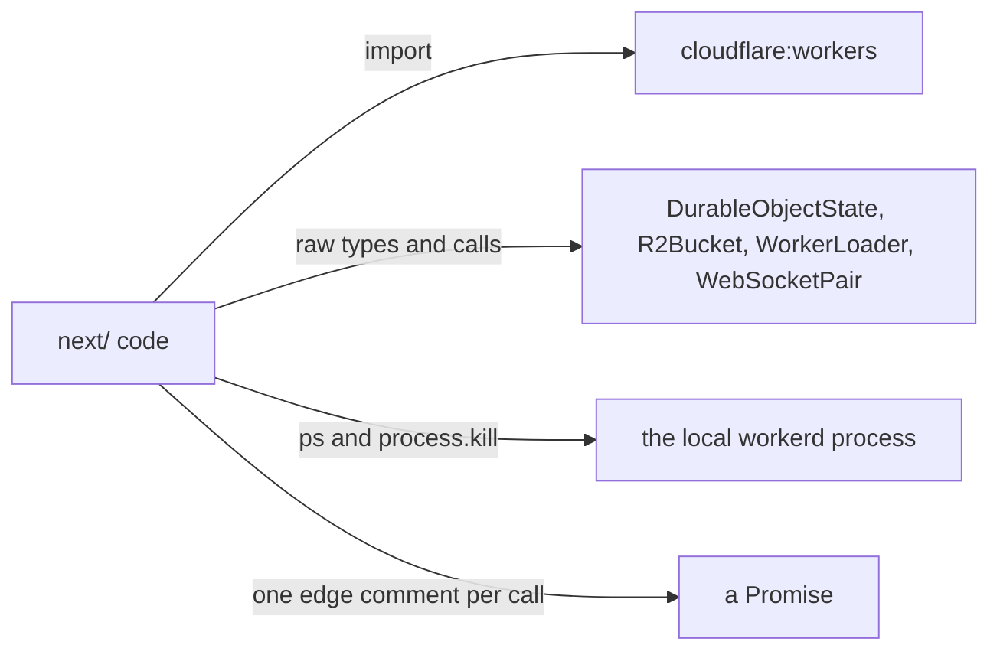
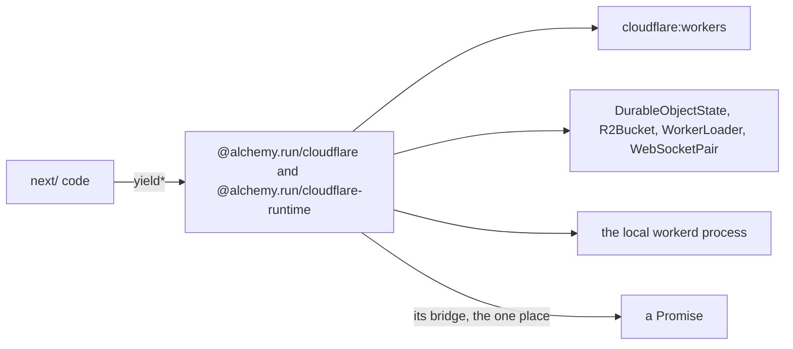

# 0042: In next/, everything from Cloudflare Workers and the local runtime (Miniflare, workerd, the local stage) is used through Alchemy, never directly

**What this decides:** `next/` code reaches a platform piece, in the cloud or on the laptop, only
through Alchemy's Effect form of it, so the code stays Effect and needs no "this line is a Promise
edge" comment there.

**Before:**



**After:**



```ts
// before: next/packages/libfabrika/src/workers/platform.ts, as on main
static make(bucket: R2Bucket): BucketClient["Service"] {
	return {
		head: (key) =>
			// oxlint-disable-next-line fabrika/no-promises -- edge: R2 head enters Effect
			Effect.tryPromise({try: () => bucket.head(key), catch: unreachable}),
	};
}

// after: a sketch, not built. The names are from @alchemy.run/cloudflare 2.0.0-beta.84.
const bucket = yield* Cloudflare.R2.ReadBucket(health);
const found = yield* bucket.head(key); // Effect<R2Object | null, R2Error, RuntimeContext>
```

The four right-hand boxes do not move. What changes is who touches them: Alchemy, not our code.

## Context

[0041](0041-object-classes-are-effect-objects.md) decided this for one platform piece, the Durable
Object class. On 2026-11-09 the owner widened it to every platform piece, and made the local side
explicit: by [local is the cloud](../docs/direction/local-is-the-cloud.md), the laptop is covered
just the same as Cloudflare.

**How this fits older texts.** The sweep found no decision this one contradicts.

- **0041 is extended, not amended.** Every rule in it stands. It left `Control`, the
  `WorkerEntrypoint` class and the Worker's default `fetch` undecided; this file decides that they
  go through Alchemy too. Its `status:` line does not change, and it gets a one-line pointer here.
- [No Promises](../docs/direction/no-promises.md) stands. Its "edge the platform demands" gets
  rarer: a platform call is no longer an edge we write.
- [An object class stays thin](../docs/direction/object-classes-stay-thin.md) stands. What a
  class holds from the platform now comes from Alchemy's services.
- [Local is the cloud](../docs/direction/local-is-the-cloud.md) stands, and now says in words what
  it implied: nothing in `next/` starts or talks to the local runtime except through Alchemy.
- [Patch upstream locally](../docs/direction/patch-upstream-locally.md) and
  [0040](0040-existing-tools-before-hand-written.md) are the rules for a gap, below.
- [0033](0033-agents-code-follows-next-rules.md) is the model for the ledger.
- [0034](0034-libfabrika-folders-are-bounded-contexts.md) says `node/` and `workers/` become
  platform packages later. This file does not touch that.

## Decision

**In `next/`, anything we use from Cloudflare Workers, Miniflare or workerd is used through
Alchemy, never directly. That covers the cloud and the laptop alike: Worker entrypoints, bindings
(Durable Object namespaces, R2, the worker loader, secrets), storage, alarms, WebSockets, and
everything that starts or talks to the local runtime (the local stage and any test helper that
boots one).**

- **New `next/` code never imports the platform directly.** No `cloudflare:*`, `miniflare`,
  `workerd`, `wrangler` or `@cloudflare/*` import, no raw platform type (`DurableObjectState`,
  `R2Bucket`, `WorkerLoader`, `WebSocketPair` and the like), and no direct handling of the workerd
  process.
- **Through Alchemy means** `alchemy`, `@alchemy.run/cloudflare`, `@alchemy.run/cloudflare-runtime`
  and their subpaths. A type that Alchemy re-exports is fine through Alchemy.
- **Existing direct uses move** with the port that 0041's plan does (tracker ticket 502), or with
  their own ticket. Until then they stay as they are, edge comments included.
- **A gap in Alchemy is patched locally** with `pnpm patch`, and the upstream issue is filed the
  same day on [alchemy-run/alchemy](https://github.com/alchemy-run/alchemy). A young library is a
  reason to file issues, not to hand-write the piece. The local stage already does this: its
  lifecycle hook is a patch, with
  [alchemy issue 3184](https://github.com/alchemy-run/alchemy/issues/3184).
- **The six gaps listed below are the exception: they are patched, and not reported as a batch**
  ([Amendments](#amendments), 2026-11-09). A gap found later keeps the rule above.
- **If a gap cannot be patched in reasonable size, the direct use stays,** marked as an edge with
  the reason and the issue link:
  `// oxlint-disable-next-line <rule> -- edge: <why>, <issue URL>`. For one of the six gaps
  below, which has no issue, the words `not reported, 0042 amendment 2026-11-09` stand where the
  URL would.
- **Tests follow the same rule.** A test that mocks `cloudflare:workers` or names a raw platform
  type moves when the code under it moves.
- **It becomes a lint rule:** oxlint's own `no-restricted-imports` for those module names in
  `next/`, with today's uses in a ledger that only shrinks, as 0033 did for `.agents/`. The rule
  is lead tooling and its own ticket, tracker ticket 506. An import rule cannot see a raw ambient
  type or a `ps` on a workerd pid; ticket 506 says what stays unchecked.
- **Today's version is not covered:** `packages/`, `programs/` and `apps/` keep their Miniflare
  and their plain classes until that code goes.

**Binding constraints**

- No new direct platform import, raw platform type or workerd process call in `next/`, tests
  included.
- No gap is answered by hand-writing the piece. It is a patch plus an issue, or a marked edge with
  the issue link. The six gaps below get the patch or the marked edge without the issue
  ([Amendments](#amendments)).
- A claim that a piece works through Alchemy comes from a run on the installed version, not from
  the tables below.

## Today's direct uses

Read on 2026-11-09, on `origin/main` at `d7484976`, against the installed
`@alchemy.run/cloudflare` and `@alchemy.run/cloudflare-runtime` 2.0.0-beta.84. Module paths are
under each package's `src/`. "Covered" means the name exists in that source. It does not mean it
works for our code: ticket 502's spike and each port say that. Counts are lines.

### On the Worker side

**105 lines, 99 covered, 6 in gaps.** Paths are under `next/`; `lib/` is
`packages/libfabrika/src/` and `app/` is `apps/fabrika/src/`.

| Use | Lines | Where | Alchemy form, or gap |
|---|---|---|---|
| `import ... from "cloudflare:workers"` | 2 | `app/brain.ts:23`, `lib/workers/box.ts:1` | **Gap**, while the entrypoint row below is one. The `DurableObject` half of `brain.ts:23` is covered |
| `class ... extends DurableObject` | 4 | `app/brain.ts:29`, `169`, `222`, `263` | `Workers/DurableObject.ts`: `Cloudflare.DurableObject<Self, Shape>()("Name")` and `.make()` (0041) |
| `class ... extends WorkerEntrypoint` (`Control`, `ProgramBox`) | 2 | `app/brain.ts:301`, `lib/workers/box.ts:57` | **Gap.** No Alchemy form found to define a named entrypoint class. `Workers/WorkerEntrypoint.ts` is only the `env` binding, and its own docs say to extend the native class. `Workers/Worker.ts`'s `entrypoints` holds settings only |
| The Worker's default `fetch` | 1 | `app/brain.ts:310` | `Workers/Worker.ts`: `Cloudflare.Worker<Self>()(...)` whose `fetch` is an Effect; `Workers/HttpServer.ts` |
| `DurableObjectState`, with its `id` and `abort` | 18 | `app/runtime.ts:19`, `24`; `lib/workers/gateway.ts:19`, `258`, `263`; `lib/workers/record.ts:10`, `28`, `38`, `48`, `58`; `lib/workers/runtime.ts:199`, `205`, `210`, `295`, `721`, `726`, `735`, `846` | `Workers/DurableObjectState.ts`: the `Cloudflare.DurableObjectState` service |
| `DurableObjectStorage` and its SQL | 4 | `lib/data/worker-sql.ts:3`, `4`, `6`; `lib/workers/platform.ts:187` | `Workers/DurableObjectStorage.ts`: `get`, `put`, `delete`, `sync`, `sql.exec`, `sql.databaseSize`, an Effect `transaction` |
| `storage.transactionSync` | 1 | `lib/data/worker-sql.ts:5` | **Gap.** Not in `Workers/DurableObjectStorage.ts`; only through `state.raw` (0041 found the same) |
| Alarms: `setAlarm`, `deleteAlarm`, the `alarm()` handler | 3 | `lib/workers/platform.ts:203`, `206`; `app/brain.ts:197` | `getAlarm`, `setAlarm`, `deleteAlarm` in `Workers/DurableObjectStorage.ts`; the `alarm` slot in `Workers/DurableObject.ts` |
| `DurableObjectNamespace` bindings and `getByName` | 11 | `lib/workers/runtime.ts:87` to `90`, `138`, `141`, `144`, `331`, `448`, `482`; `lib/workers/fetch.ts:23` | `Workers/DurableObject.ts`: the namespace has `getByName` and `idFromName`, and answers a `DurableObjectStub<Shape>` |
| `Rpc.DurableObjectBranded` and `Rpc.WorkerEntrypointBranded` | 9 | `lib/workers/index.ts:13`; `lib/workers/platform.ts:15`, `97`, `134`, `156`; `lib/workers/bindings.ts:87`, `131`, `141`, `149` | Not needed: Alchemy's stub is typed by `Shape`. No re-export of Cloudflare's `Rpc` types found (`Workers/Rpc.ts` re-exports `alchemy/Rpc`, a different thing) |
| `R2Bucket`, `R2Object` | 6 | `lib/workers/runtime.ts:92`, `224`, `242`, `247`; `lib/workers/platform.ts:219`, `222` | `R2/ReadBucket.ts` (`head`, `get`, `list`), `R2/WriteBucket.ts` (`put`, `delete`), `R2/BucketTypes.ts` (`R2Object`) |
| `WorkerLoader`, `loader.get`, `getEntrypoint` | 4 | `lib/workers/runtime.ts:91`; `lib/workers/index.ts:19`, `29`, `37` | `Workers/WorkerLoader.ts`: the `Cloudflare.WorkerLoader` service, `get` and `getEntrypoint<Shape>` |
| WebSockets: `WebSocketPair`, the 101 response, `acceptWebSocket`, `getWebSockets`, `getTags`, the auto-response timestamp, attachments, the three handlers | 19 | `lib/workers/gateway.ts:36`, `43`, `48`, `51`, `87`, `100`, `149`, `155`, `162`, `171`, `197`, `220`, `222`, `224`, `228`, `246`; `app/brain.ts:230`, `235`, `240` | `Workers/WebSocket.ts`: `Cloudflare.upgrade()` and the wrapped socket; the socket methods on `Workers/DurableObjectState.ts`; the three slots in `Workers/DurableObject.ts` |
| `new WebSocketRequestResponsePair(...)` | 1 | `lib/workers/gateway.ts:223` | **Gap.** `setWebSocketAutoResponse` takes the raw pair, and no Alchemy constructor for it was found in `Workers/WebSocket.ts` or `Workers/DurableObjectState.ts` |
| `@cloudflare/workers-types` as a tsconfig `types` entry | 2 | `apps/fabrika/tsconfig.json:3`, `packages/libfabrika/tsconfig.json:3` | Goes when the last raw type goes. Alchemy re-exports the ones it names, such as `DurableObjectId` and `AlarmInvocationInfo` |
| Tests: `vi.mock("cloudflare:workers")`, and raw type names | 18 | The mock: `lib/workers/runner-reply.laws.test.ts:26`, `lib/workers/supervision.laws.test.ts:36`, `lib/node/supervision-spans.test.ts:59`, `app/runtime-recovery.laws.test.ts:18`. Raw types: 14 lines in 5 test files | Each moves with the code under it. `Workers/cloudflare_workers.ts` already answers a stub outside workerd |
| Secrets | 0 | none today | `SecretsStore/ReadSecret.ts`, `Workers/SecretKey.ts` |

Not counted: `external: ["cloudflare:workers"]` in `lib/node/build.ts:18` and two tests. It is a
bundler setting, not a use, and whether our own bundle stays is ticket 502's spike.

### On the local side

**26 lines, 10 covered, 16 in gaps.** `next/` has no `miniflare`, `workerd` or
`wrangler` import today. The `miniflare` entry in `pnpm-workspace.yaml` is today's version's.

| Use | Lines | Where | Alchemy form, or gap |
|---|---|---|---|
| Starting the local stage | 0 direct | `app/stage.ts:2` to `6`, `lib/node/stage.ts:1` to `3`, `apps/fabrika/alchemy.run.ts:1` to `2` | Already through Alchemy: `alchemy/Deploy`, `alchemy/State/LocalState`, and the runtime's `core/Plugin`, `core/Runtime`, `core/RuntimeError` |
| workerd's pid, exit and restart events | 0 direct | `lib/node/stage.ts:2` | `RuntimeLifecycle` in `core/Runtime`, which exists only in our patch (`patches/@alchemy.run__cloudflare-runtime@2.0.0-beta.84.patch`, alchemy issue 3184). This is what closing a gap looks like |
| Memory sample of workerd by `ps`, and `process.kill` to replace it | 2 | `lib/node/stage.ts:35`, `351` | **Gap.** `core/Runtime.ts`'s service has `start` only, and `core/workerd/Workerd.ts` has `serve`: nothing to sample memory or ask for a replacement |
| Tests that find workerd with `ps` and kill it | 12 | `app/stage-records.test.ts:352`, `369`, `457`; `app/stage-wire.test.ts:668`, `684`, `688`; `app/brain-life.test.ts:62`, `192`, `213`, `281`, `299`, `314` | **Gap.** No Alchemy form found to crash the runtime from outside. Looked in `core/Runtime.ts` and `core/workerd/Workerd.ts` |
| Calls from Node into the brain over the control socket, by plain `fetch` | 2 | `lib/node/stage.ts:135`, `138` | **Open, counted as a gap.** The socket is declared through Alchemy's `core/Plugin`. `core/platform-proxy` (`getPlatformProxy`) exists and may replace the call; nobody has run it |
| Node doubles that copy a binding's Promise API | 10 | `lib/node/stage.ts:380`, `414`, `421`, `424`; `lib/node/stage-recording.ts:34`, `37`, `40`, `43`, `48`, `53` | They go when their callers take Alchemy's Effect clients (the namespace, R2 and loader rows above) |

### Totals

**131 direct uses, 109 covered, 22 in gaps of six kinds.**

**Edge comments on platform calls today: 130.** 64 are `fabrika/no-promises` (43 Durable Object
stub calls, 4 storage, 2 alarms, 3 R2, 8 worker loader, 2 request bodies, 2 control socket), out
of 84 in `next/` outside tests. 66 are `fabrika/no-effect-run-outside-edge` (46 in `brain.ts`, 8
in `box.ts`, 2 in `workers/runtime.ts`, 10 in the Node doubles). The other 20 `no-promises` edges
are not platform calls and stay: WebCrypto (9), HTTP in `grant.ts` (4), Rolldown (3) and late
imports (4).

## Consequences

- **Most edge comments go.** Up to 130 lines stop being edges we write, once the ports land.
  `platform.ts`'s hand-written clients, 49 of them, are the largest group.
- **The six gaps each need a patch or a marked edge, and no issue as a batch.** The port that
  reaches a gap that blocks it patches it that day and goes on
  ([Amendments](#amendments), 2026-11-09). No issue was filed with this decision.
- **A lint rule and a ledger come with ticket 506.** Until it lands, a reader at merge is the only
  check.
- **Cost:** more of `next/` rests on a beta. A breaking change in Alchemy can reach every
  platform call, not only the object classes. And one more library sits between a platform event
  and our code, on the laptop as well.
- **Doubt, about 75% sure on the table's "covered" column:** a name in the source is not a run.
  0041 lists six unknowns for the object classes alone. The spike settles those; each later port
  settles its own row.

**Not decided here:**

- The port's order. Ticket 502's spike is running as an experiment.
- Whether `libfabrika`'s `workers/` and `node/` become platform packages (0034 says later).
- Whether `Control` and `ProgramBox` stay named entrypoint classes or take another shape, such as
  a second Effect Worker. That is the port's plan to answer.
- Whether the rule's check covers raw ambient types and process calls. Ticket 506 says.

## Amendments

- 2026-11-09: the six gaps in [Today's direct uses](#todays-direct-uses) (22 direct uses) are not
  reported upstream as a batch. Where one blocks the port, it is patched locally with `pnpm patch`
  and the work goes on; no issue is filed on alchemy-run/alchemy for these six as a batch. This
  record first said the port files an issue for each gap the day it reaches it. The owner changed
  that part the same day: a burst of issues from one user at once is noise for a young project's
  maintainers. We file what we have proven by running, one at a time, and these six come from
  reading the source, not from a run. The text above now says the new rule (ticket 510).
  - Each such patch carries, at its `patchedDependencies` row in `pnpm-workspace.yaml`, a comment
    with the gap's name and `not reported, 0042 amendment 2026-11-09`, so a later bump still knows
    why the patch exists ([patch upstream locally](../docs/direction/patch-upstream-locally.md)).
  - [Patch upstream locally](../docs/direction/patch-upstream-locally.md)'s general rule, every
    patch has an upstream issue, does not change. A gap in Alchemy found after this list keeps it.
  - Not this batch: ticket 502's trial may find a real bug by running it. Whether that one is
    reported is decided when it comes.
