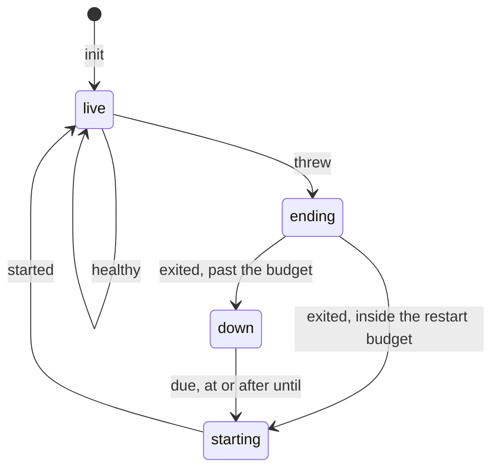

# 0043: In next/, a file exports at most one tea machine, with its Model, Msg and update in that file and no input or output code, never a machine spread over files or edited by hand from outside

**What this decides:** in `next/`, a tea machine has a file of its own that holds its Model, its Msg
and its update and nothing that does input or output, and code outside that file changes the
machine's state only by sending it a Msg.

The machine used as the example is the supervisor, a tea machine on main today. Its states are the
four cases of `Recovery`, and its Msgs move it:



```ts
// Today, on main (next/packages/libfabrika/src/). One machine, three files.

// coordination/recovery.ts:98-104: the Model, away from its machine.
export const Supervision = Schema.Struct({
	// ...
	recovery: Recovery,
	pending: Schema.NullOr(Action),

// app/supervisor.ts:69-71: the machine, with its Msg (:15-21) and its update (:93-178).
export const supervisor = Machine.make({
	model: Supervision,
	msg: Msg,

// app/runner.ts:374 and :429: two of nine hand edits of that Model, beside the service calls.
yield* saveRecovery({...s, pending: {...action, type: "exit"}});
yield* saveRecovery({...s, pending: null});
```

The diagram shows only the `recovery` half of the state. The other half, `pending`, is what the
runner edits by hand, so no picture of the machine drawn from its own file is whole.

## Context

[0037](0037-implicit-state-machines-made-explicit.md) says every state machine in `next/` is one
named type with its transitions in one place. It does not say where that place is, or how many
machines one file may hold. This record says both, for tea machines. It **extends** 0037 and changes
no rule in it, so 0037's status stays `accepted`: by
[the adr skill's table](../.agents/skills/adr/SKILL.md#4-supersede-or-amend), `amended-in-part` is
for a decision that changes part of an older one, and none of 0037's text stops holding. Tracker
ticket 508.

A tea machine is one made with `Machine.make` from `@demlik/tea/effect` (tea 0.25.0, the installed
version). `next/` has three outside its tests on main: `app/supervisor.ts:69`, `app/brain-life.ts:35`
and `next/programs/counter/src/program.ts:15`.

Why the owner decided it, on 2026-11-09:

- **The hand edits are real.**
  [Experiment 246](../experiments/246-implicit-state-machines-in-next.md#2-the-supervision-record)
  found the supervision record's `pending` edited by hand in nine places in `app/runner.ts` (`:374`,
  `:402-415`, `:429`, `:463-471`, `:516-520`, `:565-593`, `:662-667`, `:713-719`, `:1537-1550`; the
  lines were checked again on main for this record). Its type allows 24 pairs of `recovery` and
  `pending`, 8 are real, and five `bad_row` guards exist only to catch a wrong pair.
- **A machine alone in its file is what tea's property tests take as it is.** `propertyInvariant`
  from `@demlik/tea/pbt` takes the machine and drawn Msg lists
  (`app/brain-life.laws.test.ts:97-100`). It can only check the transitions the machine's own update
  makes. A hand edit in another file is a transition no property sees.
- **Elm builds a module around one type.** Elm's own guide says "all modules should be built around
  a central type", and that a page's module holds its `Model`, `update` and `view` together
  ([Structuring Web Apps](https://guide.elm-lang.org/webapps/structure.html), read at its source on
  2026-11-09). Two things about this source, said plainly:
  - The guide gives no count per file. "At most one" is our rule, taken from its "one central type".
  - The guide also warns against short files and against splitting early: a custom type moves to its
    own module once it has "a bunch of relevant helper functions". The talk it points to, The Life
    of a File, was not watched for this record; what is said of it here is secondary, from the
    guide's own summary.

It sits beside two layout records. [0034](0034-libfabrika-folders-are-bounded-contexts.md) gives
each bounded context an `internal/` folder and already places `internal/supervisor.ts` there. A
newer layout decision is in flight (tracker ticket 507) and may replace 0034; under either, the
runner's and the door's machines land as `internal/` files, as 0037's consequences say. This record
says what one such file holds. It does not say which folder.

## Decision

**In `next/`, a file exports at most one tea machine, and that file is the machine: its Model, its
Msg and its update, with no input or output code.**

- **What the file holds.** The Model's schema, the Msg's schema, the `Machine.make` call with its
  update, and the pure helpers the update uses. A Cmd definition (`Cmd.make`) stays too: it is a
  value that names a request, and it runs nothing.
- **What it never holds.** No service call, no storage, no clock, no handler that runs a Cmd. The
  code that drives the machine (reads the clock, saves the Model, runs the Cmds) lives in another
  file.
- **Nothing outside the file builds or edits the Model by hand.** Other code gets a new Model by
  sending a Msg through the machine. A spread that changes a control-state field, or a `make` of a
  state case, outside the machine's file is the thing this forbids. A change the machine has no Msg
  for gets a Msg.
- **A small private helper machine may share its parent's file.** Private means not exported and
  used only by the machine in that file. The day a second file needs it, it gets a file of its own.
- **Why the allowance.** The owner did not want a blanket one-per-file rule in the style of the old
  one-React-component-per-file lint rule. That rule scatters tiny helpers over many files, and a
  reader then opens five files to follow one. The rule here counts what a file exports, not what it
  contains.

**Before** is the block at the top. **After**, as a sketch (file and Msg names are not decided
here; the Msg names are experiment 246's proposal):

```ts
// A sketch. One file, for example the context's internal/supervisor.ts.
export const Supervision = Schema.Struct({/* the Model, with pending folded into the cases */});
const Msg = Schema.Union([/* threw, exited, due, started, healthy, exit_written, down_written */]);
export const supervisor = Machine.make({model: Supervision, msg: Msg, cmds: [exit, down, start], /* init, update */});

// The runner, in its own file: it sends a Msg and saves what comes back. No spread of the Model.
yield* saveRecovery(moved(s, {type: "exit_written"}));
```

What moves: the Model comes to the machine's file, and each of the runner's nine hand edits becomes
a Msg that the update handles.

**Binding constraints:**

- A new tea machine in `next/` lands in a file that exports no other machine and holds no input or
  output code.
- A plan that adds or changes a tea machine names its file, and says which file drives it.
- The existing machines are not moved by this record alone. The supervisor moves inside P34c
  (tracker ticket 404), as 0037 already says, and the rest move with the layout change.

## Consequences

- **It becomes a lint rule,** tracker ticket 509. The rule counts the `Machine.make` calls a file
  exports and fails on more than one. A machine that is not exported is a private helper, so the
  allowance needs no extra code: the day a second file needs the helper it must be exported, and the
  rule fires. Until the rule exists, the plan and the review are the check.
- **Two parts of this record may not fit a syntax rule:** "no input or output code in the file" and
  "no hand edit of the Model outside it". Ticket 509 says which it can check and what is left to
  review. Nobody has measured the rule's false alarms yet, and it blocks only at about 0%.
- **The cost** is one more file for a machine that today sits inside its driver, and a Msg for each
  change that is a hand edit today. For the supervisor, experiment 246 sizes it at about 3 files and
  200 lines, with saved rows to migrate.
- **Open, with no ruling: does 0037's plain form stay?** 0037 also allows a small in-memory machine
  to be a tagged union plus one transition function. This record does not cover that form, and the
  lint rule cannot see it: to lint it is a type and a function. Whether the plain form stays, or
  every machine in `next/` becomes a tea machine so that tea's property helpers and this rule cover
  all of them, is not decided. Until it is, 0037's forms hold as written.
- Not decided here: the folder a machine's file sits in (0034 and ticket 507), the names of the new
  Msgs, and today's version, which this record does not touch.
- No word is coined: `machine` in [the glossary](../.glossary/TERMS.md) already means a tea machine.
  AGENTS.md gets one line.
