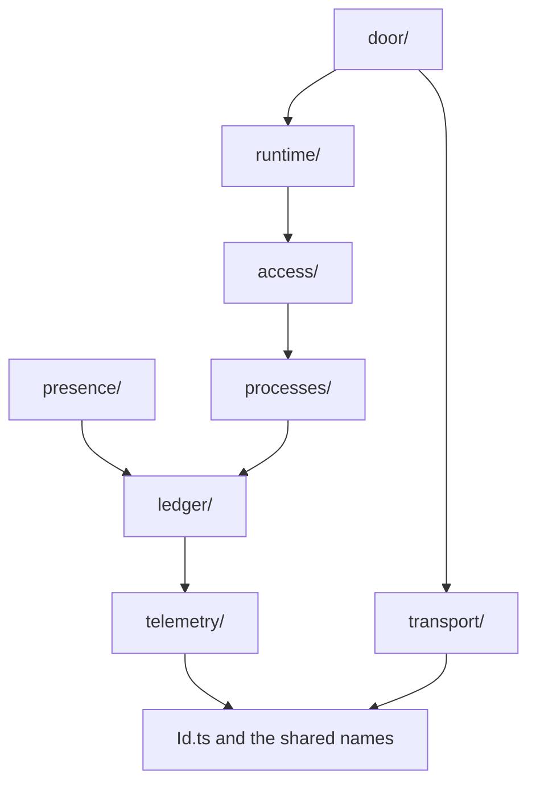

# 0043: libfabrika's src/ has one folder per subject, a room, and a layer is a floor, a line in the rule file that says who may import whom, never a folder, and each room offers Effect services in its own types and errors

**What this decides:** in `next/packages/libfabrika/src`, a folder holds one subject and is called a
room, and the order of imports between rooms is kept only in the rule file, where each room sits on
a floor.



An arrow points down a floor, from a room to one it imports today. A floor only forbids: no import
goes up, and none goes sideways. Which lower rooms a room may import is the exam's table
([Amendments](#amendments)). The door reaches every room, and it is the only room that imports
`transport/`. *That is today's imports: from 2026-11-10 the door imports no room two
floors down ([Amendments](#amendments)).*

```text
next/packages/libfabrika/src/
  door/        Door.ts + internal/
  runtime/     Runner.ts + internal/         access/
  processes/   (the mailbox lives inside)    presence/
  ledger/                                    telemetry/
  transport/
  Id.ts and the shared names (ProcessId, Sql, Rev, ParentText) beside it
```

All of this is about `next/`. Today's version is not touched.

The room `door/` is now `gateway/`, presence's `GatewayManager` is `Connections`, and `workers/` is
`cloudflare/`, later `@kampus/libfabrika-cloudflare`
([0051](0051-gateway-connection-and-node-by-job.md)); the rest of this record holds.

A room is now a module and a floor a layer, names only; every rule here holds
([0091](0091-modules-and-layers.md)).

## Context

Three records came before this one, all on 2026-11-09, and no file has moved for any of them:

- [0032](0032-libraries-take-effects-file-layout.md) gave libraries Effect's file layout: one flat
  `src/` of PascalCase modules.
- [0034](0034-libfabrika-folders-are-bounded-contexts.md) replaced the flat `src/` with three
  folders, `Clients/`, `Ledger/` and `Runtime/`, where the layer picked the folder.
- [Experiment 245](../experiments/245-are-libfabrikas-layers-right.md) then read the imports. The
  order of the layers is right. The folders are not: `coordination/` holds four subjects, `data/`
  holds two, and 0034's `Ledger/` would hold 27 files and five subjects.

The owner settled the layout the same day, "for now": a later tier may add rooms. This record
**replaces 0034** and **amends 0032 in part** (what still holds is listed under Consequences).
[0037](0037-implicit-state-machines-made-explicit.md) said the runner and the door are split first,
riding with this layout, and [0038](0038-span-sink-measurements-and-metrics.md) said the folder for
spans, measurements and metrics would be `telemetry/`. Tracker tickets 507 (this record) and 477
(the move).

The model is OTP's. An OTP application is a subject: "a component that can be started and stopped
as a unit" ([applications](https://www.erlang.org/doc/system/applications.html)). The order between
them is a separate fact. Parnas said the same in 1972: a clean order and a clean split are "two
desirable but independent properties" (quoted in experiment 245).

Every file name below was read on `origin/main` at `d7484976` for this record.

## Decision

**A folder in `libfabrika`'s `src/` is a room, one subject, and a layer is a floor: a line in the
rule file that says which rooms a room may import.**

**Before** (main today; 0034's three folders were never built):

```text
next/packages/libfabrika/src/
  index.ts  id.ts  testing.ts
  transport/     index.ts  answer.ts  binary.ts  gateway.ts  hello.ts  sshsig.ts  waiting.ts
                 webauthn.ts  wire.ts
  data/          index.ts  ledger.ts  ledger-store.ts  ledger-transaction.ts  log.ts  referee.ts
                 sqlite.ts  worker-sql.ts
                 archive.ts  health.ts  record-part.ts  records.ts  sink.ts  trace.ts
  coordination/  index.ts  mailbox.ts  process.ts  process-manager.ts  process-mail.ts
                 process-id.ts  gateway-manager.ts
                 members.ts  client-manager.ts  authorization.ts  session-manager.ts  text.ts
                 process-store.ts  recovery.ts  recovery-store.ts
  app/           brain-event.ts  brain-life.ts  entry.ts  execution.ts  patch.ts  program.ts
                 runner.ts  state.ts  supervisor.ts
  door/          index.ts  door.ts  nonce.ts  store.ts
  node/  workers/
```

**After** (this record; the move plan holds the row for every file):

```text
next/packages/libfabrika/src/
  index.ts  Id.ts  Testing.ts  and one file per shared name (ProcessId, Sql, Rev, ParentText)
  transport/   answer, gateway, hello, sshsig, webauthn, wire                internal/ binary
  telemetry/   archive, record-part, records, sink, trace                    internal/ health
  ledger/      ledger, ledger-transaction, log, referee, sqlite, worker-sql  internal/ ledger-store
  processes/   mailbox, process, process-manager, process-id                 internal/ process-mail
  presence/    gateway-manager
  access/      members, client-manager, authorization, session-manager, text
  runtime/     app/'s nine files, process-store, recovery-store              internal/ recovery, supervisor
  door/        door                                                          internal/ nonce, store, waiting
  node/  workers/                                                            open, see below
```

The after tree keeps today's file names so the two trees compare. 0032's PascalCase names apply to
each front file, and the plan picks them.

The rule file, before and after:

```json
[
  { "name": "next-door", "paths": ["next/packages/libfabrika/src/door"] },
  { "name": "next-app", "paths": ["next/packages/libfabrika/src/app", "next/packages/libfabrika/src/testing.ts"] },
  { "name": "next-coordination", "paths": ["next/packages/libfabrika/src/coordination"] },
  { "name": "next-data", "paths": ["next/packages/libfabrika/src/data"] },
  { "name": "next-transport", "paths": ["next/packages/libfabrika/src/transport"] }
]
```

```json
[
  { "name": "next-door", "floor": 6, "paths": ["next/packages/libfabrika/src/door"] },
  { "name": "next-runtime", "floor": 5, "paths": ["next/packages/libfabrika/src/runtime"] },
  { "name": "next-access", "floor": 4, "paths": ["next/packages/libfabrika/src/access"] },
  { "name": "next-processes", "floor": 3, "paths": ["next/packages/libfabrika/src/processes"] },
  { "name": "next-presence", "floor": 3, "paths": ["next/packages/libfabrika/src/presence"] },
  { "name": "next-ledger", "floor": 2, "paths": ["next/packages/libfabrika/src/ledger"] },
  { "name": "next-transport", "floor": 2, "paths": ["next/packages/libfabrika/src/transport"] },
  { "name": "next-telemetry", "floor": 1, "paths": ["next/packages/libfabrika/src/telemetry"] }
]
```

The first block is `layer-rules.json` on main, cut to the five libfabrika rows. The second is a
sketch: `floor` is not a key the installed `@demlik/code-graph@0.15.0` reads. Its row schema is
strict and has `name`, `paths` and an `imports` list. How the one line per room reaches the tool is
the plan's to build. What the reader should see move: a folder used to be a layer, and now a room
names its floor in one line.

The rules:

1. **A folder is a room, a floor is a rule.** A room holds one subject. A floor says who may import
   whom. Which floor a room is on is one line per room in the rule file, so moving a room to
   another floor changes one line and no path.
2. **The five layers stay the design's words.** Transport, data, coordination, app and desktop are
   still how [the five layers](../docs/direction/a-local-first-sync-engine.md) tell the design.
   They are no longer folder names, and "coordination" is no longer a folder at all.
3. **A room imports only from lower floors.** Never from a higher floor, and never from another
   room on its own floor (owner, 2026-11-09, the same day). If one room needs another on its
   floor, the needed room moves down a floor in the rule file, in the open. `pnpm lint` checks
   both: no upward import and no same-floor import.
   *Test files keep this rule too, with database laws as suites a higher room runs
   ([0062](0062-test-files-keep-the-floors.md)).*
4. **The floors, bottom up, as the rule file starts:**

   | Floor | Rooms |
   |---|---|
   | 6 | `door/` |
   | 5 | `runtime/` |
   | 4 | `access/` |
   | 3 | `processes/`, `presence/` |
   | 2 | `ledger/`, `transport/` |
   | 1 | `telemetry/` |

   `telemetry/` is the lowest floor, alone, and any room may import its front files openly (owner,
   2026-11-10, [Amendments](#amendments)).

   The owner listed five floors, with `ledger/` beside `telemetry/` and `runtime/` beside
   `access/`. Main's imports do not allow those two pairs under rule 3, so rule 3 was applied as
   written and each needed room sits one floor lower:
   - `data/ledger.ts` and `data/ledger-store.ts` import `short` and `errorClass` from
     `data/trace.ts`. The ledger needs telemetry, so `telemetry/` is below `ledger/`.
   - `app/runner.ts` and `app/entry.ts` read seven names of `coordination/session-manager.ts` and
     `coordination/members.ts` through `coordination/index.ts` (`SessionManager`, `SignRequest`,
     `Session`, `Writer`, `NotGranted`, `SigningRefused`, `MemberFact`). The runtime needs access,
     so `access/` is below `runtime/`. It cannot join floor 3, because it imports `processes/`
     (`mailbox.ts`, `process.ts`).
5. **There is no `coordination/` folder.** Its files go to four rooms:
   - `processes/`: `mailbox.ts`, `process.ts`, `process-manager.ts`, `process-mail.ts`,
     `process-id.ts`. `mailbox.ts` and `process.ts` import each other, so they are one room, as in
     OTP a process has a mailbox.
   - `presence/`: `gateway-manager.ts` (join, leave, online or away). The industry's word:
     [Phoenix Presence](https://hexdocs.pm/phoenix/Phoenix.Presence.html).
   - `access/`: `members.ts`, `client-manager.ts`, `authorization.ts`, `session-manager.ts`. The
     session manager records who an input is by and signs on their behalf.
   - `runtime/`: `process-store.ts`, `recovery.ts`, `recovery-store.ts`. Only the runner's files
     and the Workers wiring use them (experiment 245). Two of them read the ledger today, and
     `runtime/` may not: [Amendments](#amendments) says what is cut first.
   - `text.ts` imports only `members.ts`. The plan decides whether it moves to `access/` with it or
     the read is cut.
6. **"Members" becomes "access"** as the name of who is allowed in and what each key may do. It is
   the industry's word for grants (access control), and Tier 3 has a role named member
   ([tiers](../docs/plan/tiers.md#tier-3s-roles-owner-2026-11-07)), which would clash. `grant tree`,
   `device` and the key words keep their names. The rename in code rides with the move.
7. **`data/` splits in two.** `ledger/` holds the ledger only. `telemetry/` holds spans,
   measurements and metrics; [0038](0038-span-sink-measurements-and-metrics.md)'s rename rides with
   the move.
8. **Every room has front files and an `internal/`.** One front file, or a few, in PascalCase as
   0032 says. The rest is in the room's `internal/`.
   - Nobody imports another room's `internal/`. 0032 kept `internal/` private to the package; this
     makes it private to the room.
   - No room re-exports another room's names. Today `coordination/index.ts` re-exports 11 names
     that are not its own, 10 from `data/` and `InputId` from `id.ts`, so "the app layer never
     imports data" is true only by the path of the import (experiment 245).
   - `runtime/` does not import `ledger/`. It imports `telemetry/` openly. *It said: `runtime/`
     imports `ledger/` and `telemetry/` openly where it needs them. The owner ruled no on the
     ledger half on 2026-11-10 ([Amendments](#amendments)).*
9. **The runner and the door are split, move-only first.** `app/runner.ts` is 1,721 lines, 1,492 of
   them one function. `door/door.ts` is 1,776 lines and does four jobs. Each becomes a front file
   plus `internal/` files cut along its state machines
   ([0037](0037-implicit-state-machines-made-explicit.md)). A sketch: `runtime/Runner.ts` with
   `internal/supervision.ts`, `holder.ts`, `accept.ts` and `dispatch.ts`. The split moves lines and
   changes none. The machine fixes come after, each its own pull request.
   `transport/waiting.ts`, the door's waiting room, moves to `door/`: only `door/door.ts` uses it.
10. **A room that needs "and" to describe it splits.** Rooms we expect later, as guesses: a job
    queue (Tier 4), spend and limits (Tier 5), pipes between programs (Tier 2).

**The exam's layer row keeps its limit** (owner, 2026-11-10). Rule 8 changes what
`next/apps/fabrika/src/exam/layers.test.ts` reads, and loosens nothing in the ledger's row.

- The check reads real imports. A name passed through another room no longer counts, and another
  room's `internal/` is refused. These are new laws.
- The row `app: ["coordination", "id"]` becomes a runtime row with no `ledger` in it. The planted
  break "app may not import data" stays, now checked on a real import of `ledger/`.
- So no row waits on the owner. *It said: this row is a real loosening and the owner rules on it.
  He did: no.*

**Binding constraints:**

- A new file in `libfabrika` goes in its room from today, even before the move lands.
- The move is `git mv` with import lines rewritten. A pull request that moves files changes no
  line of logic.
- No room is added to a floor that holds a room it imports.
- The move still starts only after the Effect format sweep (0029, ticket 466) has merged.

## Consequences

- **0034 is superseded.** Its three folders are gone before they were built, and so is its rule
  that the layer picks the folder.
- **0032 is amended in part.** Replaced: "one flat `src/`", "no folders by area" for the rooms
  named here, and "`internal/` is private to the package" (now to the room). Still holding, inside
  each room: PascalCase front files, tests beside them, a variant as a prefixed sibling, a folder
  only for a concept's parts, `internal/` in camelCase with `@internal`, the namespace `index.ts`
  and no platform at the top level. No folders by kind stays too: no `services/`, `types/`,
  `utils/` or `helpers/`.
- **0034's binding constraint on the exam holds.** It said the exam's table keeps "the app layer
  imports coordination, not data". The runtime row still has no ledger in it, and after the
  pass-through is gone that is true of what the runtime knows, not only of an import's path.
- **The path shows the subject and not the order.** A reader learns a room's floor from the rule
  file or the lint error.
- **The move plan is rewritten** for this layout. It was written for 0034 and no file had moved.
- **The notes that cite a path keep it until the move.** `docs/direction/follows/otp.md`,
  `.patterns/` and the plan rows cite files as they are on main; the pull request that moves a
  file fixes its citations ([0017](0017-each-model-we-follow-has-one-table.md)).
- **The cost** is six floors where the notes say five layers, and eight small folders, two of them
  thin (`presence/` is one 144-line file).
- Not decided here:
  - **Whether `presence/` stays its own room.** It is one file today and could live in `door/`
    until Tier 3. The owner accepted its own room for now.
  - **Where the platform files go.** `workers/` and `node/` would move to platform packages
    (`@kampus/libfabrika-workers`, `@kampus/libfabrika-node`), as 0034 already leaned. Until then
    they stay where they are, above every room.
  - **Which way supervision is fixed.** Its parts now sit in one room, `runtime/`. Whether the
    supervisor learns of a death by letter, as OTP's does, is P34c's
    ([0016](0016-tier-1-supervision-is-otps-top-level-supervisor.md)).
  - **How lint checks rule 12,** that a room's exported signatures name no other room's types.
    See [Amendments](#amendments).
  - *Whether the door and `access/` come under "never two floors down".* Answered yes, 2026-11-10;
    see [Amendments](#amendments).
  - The app's layout (`next/apps/fabrika`), as in 0032.

## Amendments

- 2026-11-10: **a floor is a limit, not a grant.** Rule 3 forbids an import that goes up or
  sideways. It does not allow every import that goes down. The exam's table
  (`next/apps/fabrika/src/exam/layers.test.ts`) still says which lower rooms each room may import,
  written by room, and it keeps every limit it has today: only the door imports `transport/`, for
  example, though `transport/` is below every room. *It said: the one row that gets wider is the
  runtime row above, which the owner rules on. He ruled no, below.* Replacing the table with the
  floors alone would widen more rows. That is a further loosening and is not decided. This record
  first said a room may import every room below it; that sentence was wrong and is replaced.
- 2026-11-10: **the owner ruled on the open row: no. `runtime/` does not import `ledger/`** (rule
  11). The law stays and is made true for real. The principle he gave: each floor offers Effect
  services of its own that give the floor above higher-level functions, in its own words, and the
  floor above never sees what is two floors down. Nothing in the ledger's row is loosened.
  What main says, read at `9407cf46`:
  - `app/runner.ts` never uses the `Ledger` service. It names `LedgerError` 19 times: one import
    (`:31`), three types (`:159`, `:1189`, `:1691`) and 15 places where it builds one itself, such
    as `new LedgerError({why: "bad_row"})` for a bad supervision state at `app/runner.ts:379`.
  - It gets that error from below as the services' own: `Mailbox.send`, `receive` and `read`
    (`coordination/mailbox.ts:119-123`) and `ProcessManager` (`coordination/process-manager.ts:28`,
    `:44`, `:62`) fail with `LedgerError`.
  - Two files that rule 5 sends to `runtime/` read the ledger. `coordination/process-store.ts:5`
    takes the `Ledger` service and appends a runtime record with it (`:222`), and
    `coordination/recovery.ts:2` builds a field from the ledger's `Line` (`:62`). Each moves to
    `runtime/` as rule 5 says, and its ledger read is cut in the step that gives `processes/` a
    function for it, before the runtime row is checked by room.
- 2026-11-10: **rule 12, every room offers its functions as Effect services in its own words.** A
  service's signatures use only the room's own types and errors, plus the shared names beside
  `Id.ts`.
  - A lower room's error is translated at the service boundary into the room's own tagged error,
    with the original kept as its `cause`, so no detail is lost. This is Effect's own shape: in
    `node_modules/effect/AGENTS.md` (`effect@4.1.2`, "Services") the `Database` service's `query`
    fails with `DatabaseError`, a `Schema.TaggedError` of its own with `cause: Schema.Defect()`.
    Ours already asks for the cause
    ([an error keeps its cause](../.patterns/effect-errors-keep-their-cause.md)).
  - `processes/` gets an error of its own for a fault from below. `ProcessError`
    (`coordination/process.ts:160`), its refusal, stays.
    [0055](0055-errors-named-by-their-service.md) reads "an error of its own" as one per service:
    `Mailbox` fails with `MailboxError` and `ProcessManager` with `ProcessManagerError`.
  - No room builds another room's error. The runner's 15 `new LedgerError` become the runtime's
    own error.
  - `LedgerError` is the ledger's own and leaves the list of shared names. The first text of this
    record listed it there; under this rule a shared error would let every room go on returning
    it. `door/store.ts`, `door/nonce.ts` and `coordination/recovery-store.ts` use it today for
    their own SQLite faults and get their room's error.
- 2026-11-10: **rule 13, plain values that several rooms need are shared names** beside `Id.ts`.
  Read on main: `Sql` and `SqlValue` (`data/referee.ts:7-10`, the storage handle), `ProcessId`
  (`data/trace.ts:12`), `Rev` (`data/log.ts:12`, a place in the log) and `ParentText`
  (`data/log.ts:20`). The runtime reads them at `app/runner.ts:50`, `app/state.ts:5` and
  `app/program.ts:6`. These stay the ledger's own: its services (`Ledger`, `LedgerTransaction`,
  `Referee`, `Doorbell`), `LedgerError`, `Line`, `Entry` and `Waited`. `Appended`
  (`data/log.ts:90`), what `append` answers, stays the ledger's too: `app/entry.ts:151-162` and
  `app/runner.ts:1189` name it today, and by rule 12 the rooms between answer in their own words.
- 2026-11-10: **rule 14, `telemetry/` is the lowest floor and any room may import its front
  openly.** The runtime reads `SpanSink`, `SinkError`, `RecordManager` and `Archive`
  (`app/entry.ts:8-16`) and `sha256` (`app/runner.ts:46`) from it directly. `transport/` moves up
  beside `ledger/` on floor 2, so `telemetry/` is alone at the bottom; the floors are still six.
  Today's exam counts these files as data, which transport and the app layer may not import. So
  this rule widens those rows for telemetry's front, by the owner's own ruling.
- 2026-11-10, **open, with a lean and no ruling: how lint checks rule 12.** The import rules cover
  re-exports and `internal/`. A signature that names another room's type is not an import fact
  alone. Lean: an existing tool first
  ([0040](0040-existing-tools-before-hand-written.md)), 70% that code-graph can carry it. It reads imports
  and re-exports; its CLI reference says its API ledger "records names, never signatures", and
  [demlik issue 912](https://github.com/kamp-us/demlik/issues/912) asks for a signature rule.
  [Issue 913](https://github.com/kamp-us/demlik/issues/913) asks for the same-floor rule, since
  `--layers` allows imports inside one layer today. Until they ship, a local `pnpm patch` is the
  way forward. A type-level test per room is the fallback.
- 2026-11-10, **answered (owner): the door and `access/` never import `ledger/` either.** The
  principle of the runtime ruling holds for every room, with no exemption: each floor offers its
  own Effect services to the floor above, in its own words, and the floor above never sees what is
  two floors down. So `gateway/` (was `door/`) and `access/` import no `ledger/` file. Where a room
  needs something from two floors down, the floor between adds a service for it, and that service
  names none of the lower room's types. This answers the folder move plan's open question 3
  (ticket 477). *It said: open. Both import `ledger/` today, two floors down or more
  (`door/door.ts:37-52`, `coordination/session-manager.ts`). The ruling names `runtime/`. Their
  exam rows stay as they are. Lean: the door is where the rooms are put together and keeps its
  row; `access/` is asked next, 60%. The lean was wrong: the door gets no exemption.*

## Records

- 2026-11-10: no glossary row changes. `LedgerError` has no row; `Rev` and `ParentText` are named
  inside other rows and keep their meaning.

- [`.glossary/TERMS.md`](../.glossary/TERMS.md), new rows: `floor` and `room (library)` (Shared
  names), `access` (Clients), `presence` (Ledger), `telemetry` (Runtime). Changed: the `five layers`
  row's Not column says a layer is no longer a folder. One context map line for `room`.
- Not changed: `grant tree`, `device`, `person key`, `window key`, `recovery key` and `spent`.
  Their rows still cite `Members`, `foldMembers` and `door/members`, which are code names on main.
  They change with the code rename, in the move.
- [We follow DDD](../docs/direction/we-follow-ddd.md) and
  [the five layers](../docs/direction/a-local-first-sync-engine.md) each get a pointer here.
  AGENTS.md gets one line.
