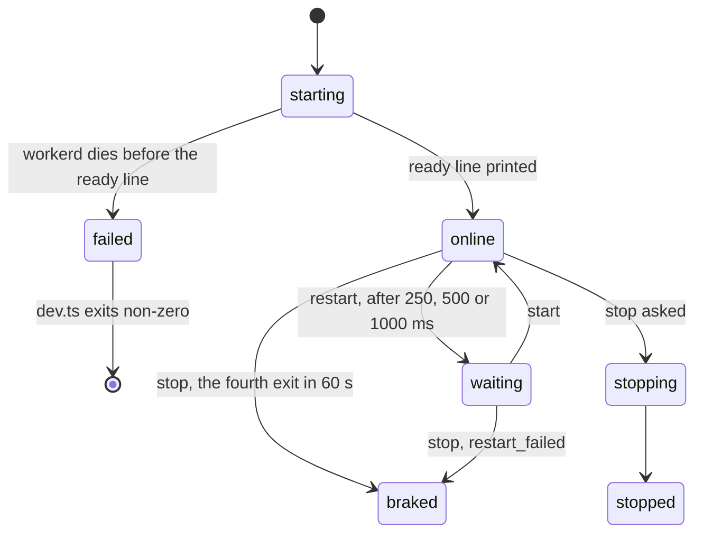

# 0044: In next/'s local stage, a brain that dies before the ready line fails the start, and no replacement is started

**What this decides:** in `next/`'s local stage, restarts with backoff and the brake belong only to
a brain that became ready; if the brain's process (workerd) dies while the stage is still starting,
the stage exits with an error and starts nothing in its place.



`starting`, `online`, `waiting`, `braked`, `stopping` and `stopped` are `BrainState`'s cases
(`next/packages/libfabrika/src/app/brain-life.ts:4-11`). `start`, `restart` and `stop` are the
runtime's events (`RuntimeEvent`, `patches/@alchemy.run__cloudflare-runtime@2.0.0-beta.84.patch:145-150`).
`failed` is not a case: it is `startStage` failing with a `ControlError`.

```ts
// next/packages/libfabrika/src/node/stage.ts:322-334, shortened. Any failure here fails the start.
const startRuntime = Effect.fn("brain.start")(function* () {
	yield* deploy(local, runtimeScope);
	yield* Deferred.await(listening).pipe(/* 30 seconds, else ControlError start_timeout */);
	yield* Deferred.await(started);
	yield* call("project", config.name, "", "info", []);
	yield* flush;
});
yield* recorded(startRuntime());

// next/apps/fabrika/dev.ts:81-84. The ready line comes only after startStage returned.
yield* localStage(built, {...config, home});
process.stdout.write(`${JSON.stringify({ready: `http://127.0.0.1:${config.port}`, build: built.build})}\n`);
```

## Context

[Pull request 703](https://github.com/usirin/tea-fabrika/pull/703) fixed a flaky law in
`next/apps/fabrika/src/brain-life.test.ts`. The test killed workerd before the stage was ready, the
stage exited 1, and the test waited for a replacement that never came. The fix made the test wait
for the ready line. It left one question open: should a crash during startup exit the stage, or
wait for a replacement? The owner answered on 2026-11-09. Tracker ticket 511 is this decision.

**The known way.** Erlang/OTP's supervisor does this. Its `start_link` documentation says: "If any
child process start function fails or returns an error tuple or an erroneous value, the supervisor
first terminates all already started child processes with reason `shutdown` and then terminate
itself and returns `{error, {shutdown, Reason}}`"
([`supervisor`, stdlib 8.1.1](https://www.erlang.org/doc/apps/stdlib/supervisor.html#start_link/2),
read 2026-11-10). Restart strategies and the restart intensity apply to children that started
([Supervisor Behaviour](https://www.erlang.org/doc/system/sup_princ.html), read 2026-11-10).

**What the code does today** (`next/`, `origin/main` at `58fe5ef0`):

- **The first workerd never listens.** Alchemy starts the first process before it starts its
  replacement loop (`@alchemy.run/cloudflare-runtime` 2.0.0-beta.84, `src/core/Runtime.ts:284`,
  then `:288-319`), so it starts nothing in its place. The stage waits 30 seconds and fails with
  `ControlError` `start_timeout` (`next/packages/libfabrika/src/node/stage.ts:324-329`).
- **workerd dies after it listens and before the ready line.** The startup call `info` or the
  outbox flush fails with `ControlError` `unreachable` (`node/stage.ts:122`, `:331-332`), so
  `startStage` fails. Its finalizer closes the runtime's scope (`node/stage.ts:221`, `:237`), which
  ends Alchemy's replacement loop while it still sleeps its first 250 ms.
- **The app exits non-zero.** `dev.ts`'s child fails before it prints the ready line
  (`next/apps/fabrika/dev.ts:81-84`), and its parent answers `child_failed` (`dev.ts:110-112`).
- **After the ready line,** Alchemy replaces a dead workerd after 250, 500 and 1000 ms, and stops
  at the fourth exit inside 60 seconds. The stage records `restarting` and `braked`
  (`node/stage.ts:286-318`).

**Which laws check it.** Half of it is checked, and half is not:

- Checked: the start fails with its exact reason. `stage unreachable exit has its exact
  ControlError reason` (`next/packages/libfabrika/src/node/stage-errors.laws.test.ts:48-49`, the
  check at `:90`) and `stage reports start_timeout when deployment never opens the control
  listener` (`:103`).
- Checked: a failed stage child makes `dev.ts` exit non-zero
  (`next/apps/fabrika/src/stage-wire.test.ts:608`, the check at `:648`).
- Checked: after the ready line, three replacements with their delays, then the brake, then no
  workerd (`next/apps/fabrika/src/brain-life.test.ts:268-318`).
- **Not checked:** that no replacement workerd is started, or left running, when the real workerd
  dies before the ready line. No law kills workerd in that gap. Tracker ticket 512 asks the tests
  step for it.

This sits beside [0016](0016-tier-1-supervision-is-otps-top-level-supervisor.md) and
[0018](0018-one-application-per-program.md), which follow OTP for a program's supervisor inside the
brain. This decision is about the brain's own process on a laptop. It changes neither.

## Decision

**A brain that dies before the stage's ready line fails the start: the stage exits with an error
and starts no replacement.**

- **Ready means the ready line.** The stage is ready when `startStage` has returned and `dev.ts`
  has printed its `{"ready": ...}` line. Before that, the stage is starting.
- **Starting: no retry.** A workerd that dies, never listens or cannot be reached while starting
  ends the stage with a typed error and a non-zero exit. No replacement workerd is started, and
  none is left running.
- **Ready: restart with backoff, then the brake.** Only a brain that became ready is replaced. The
  delays and the limit stay as they are today.
- **Why.** A crash before ready almost always means a broken build or bad settings. A retry would
  hide it behind a few seconds of backoff and then fail the same way.
- **What it costs.** A one-off failure during startup, such as a port taken for a moment, means
  running the command again by hand.
- **How sure.** About 90% that this is the right rule: it is OTP's, and it fails loudly. About 80%
  that today's code keeps it in every timing, because no law holds the second half yet (ticket 512
  settles that).

**Binding constraints:**

- No code path in the local stage starts or keeps a replacement workerd before the ready line.
- A start that fails exits non-zero and never prints the ready line.
- Nothing wraps the stage's start in a retry loop, in `dev.ts` or outside it.

## Consequences

- No product code changes. This writes down what `next/` does today.
- The OTP table gets a row, "A child that fails during start"
  ([follows/otp.md](../docs/direction/follows/otp.md),
  [0017](0017-each-model-we-follow-has-one-table.md)).
- Ticket 512 adds the missing law: kill the real workerd before the ready line, then no ready
  line, a non-zero exit, and no workerd after every backoff has passed.
- One place where the code's names and this rule do not line up yet: `brainLife` moves to `online`
  on the `started` Msg (`brain-life.ts:41-46`, sent at `node/stage.ts:283`), which is before the
  ready line, and it accepts a `waiting` Msg from `starting` (`brain-life.ts:47-52`). The rule
  holds because `startStage` fails, not because the machine refuses the move. Ticket 512's plan
  says whether the machine should hold it too
  ([0037](0037-implicit-state-machines-made-explicit.md)).
- Not decided here: the stage on Cloudflare, where the platform owns the brain's life; whether a
  person is told why the start failed in plainer words than the error's reason; and the delays and
  the limit after ready, which are Alchemy's.
