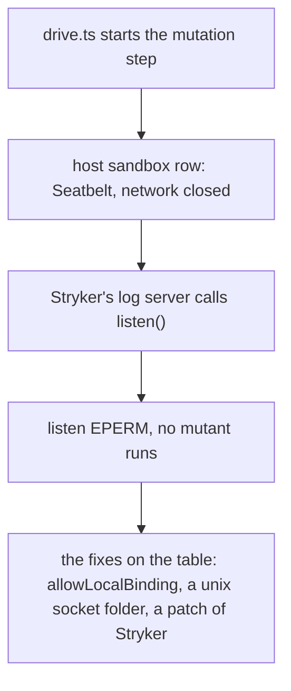
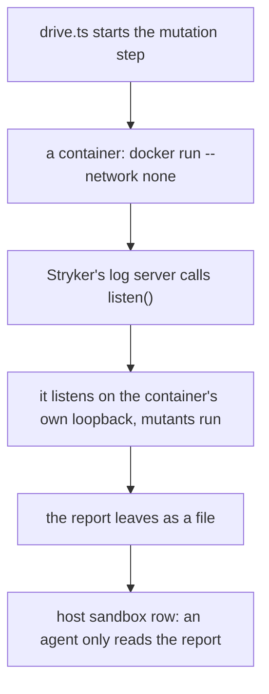

# 0045: A step that needs ports, sockets or its own processes runs in a container with its own network, never behind a hole in the laptop sandbox

**What this decides:** the fence around a step that runs tests or tools is a container with a
private network, where anything may listen and nothing crosses the edge except what we pass; the
laptop's own sandbox stays as it is, for steps that only read and edit files.

**Before:**



**After:**



```sh
# before: the same host network, with one more thing allowed
sandbox.network = { allowedDomains: [], strictAllowlist: true, allowLocalBinding: true }

# after: no host network at all, and nothing to allow
docker run --rm --network none --cap-drop ALL --user node <image> <the step's command>
```

The row no longer changes. What moves is where the listening happens: from the laptop's network
to a network only the container has.

## Context

Tracker ticket 483. Lane t411's mutation step died on 2026-11-10 with `listen EPERM`: StrykerJS
10.1.1 starts a log server on a TCP port, and the Claude row's Mac sandbox, with its network
closed, refuses `bind` as well as `connect`.

The first plan for the ticket measured the ways to open that sandbox and picked the narrowest: unix
sockets under one folder per box, plus a local patch of Stryker to log over a unix socket. Its
measurements stand. On a Mac, `allowLocalBinding` cannot be narrowed: it lets a sandboxed command
connect to every port on localhost. The shared temp folders hold other programs' sockets. That
plan turned a container down with this repo's rule that a design that needs Docker to start fails.
The owner rejected the pick on 2026-11-09. That rule is about the product's daily flow for a person
([Changing the product](../AGENTS.md#changing-the-product)). Lead tooling on our own laptop is not
that flow, and the plan itself said a private loopback on a Mac needs Docker or a VM.

Each hole asked for a second one. The unix socket folder needed a patch of Stryker. About 20 test
files that open a TCP listener would still not run. The next tool that listens would need its own
patch.

**The known way.** Every source below was read on 2026-11-10.

- **Linux sandboxes give the command its own network, and do not filter the shared one.**
  [bubblewrap](https://github.com/containers/bubblewrap), which both agent makers use on Linux: the
  sandbox "will have its own network namespace with only a loopback device".
- **Claude Code** ([sandboxing](https://code.claude.com/docs/en/sandboxing)): on Linux "the command
  runs in a separate network namespace that has no connection to your network", and a sandboxed
  command's `localhost` "is private to that command. The command can listen on a port and reach
  servers it started itself." On a Mac the only switch is `allowLocalBinding`, and the same page
  says what it opens: such a command can "connect to any port on localhost, which includes every
  other service listening there".
- **Codex** ([sandboxing](https://learn.chatgpt.com/docs/sandboxing)): Seatbelt on a Mac and
  `bubblewrap` on Linux. That page says nothing more about loopback.
- **Docker** ([the `none` network driver](https://docs.docker.com/engine/network/drivers/none/)):
  "Within the container, only the loopback device is created."
- **CI runners isolate a job by giving it a machine or a container of its own.** GitHub
  ([secure use](https://docs.github.com/en/actions/reference/security/secure-use)): hosted runners
  "execute code within ephemeral and clean isolated virtual machines". GitLab
  ([Docker executor](https://docs.gitlab.com/runner/executors/docker/)): it "uses Docker Engine to
  run each job in a separate and isolated container".

So a syscall filter with one more thing allowed is a Mac-only workaround. The known way is a
private network, and on a Mac that means a Linux container.

**Tried on 2026-11-10.** Lane t411's mutation sample (seed 119120, build `752eb65a`) ran whole in a
container with `--network none`: Stryker's log server, its workers and the four related test files
all ran on the container's loopback alone.

**How this fits older texts.** The sweep found no decision this one contradicts.

- [Programs run in a box](../docs/direction/programs-run-in-a-box.md) already says the box is the
  fence, names a fresh container for each job as its first form, says no real key goes into a box,
  and says code that comes out of a box runs only in a box. This decision gives the lead tooling
  the same kind of box, for the same reasons.
- [Tier 4](../docs/plan/tiers.md) gives each product job its own container. The lead tooling's
  box is now the same kind of thing, much smaller and built first.
- [0028](0028-the-parent-holds-every-right.md) stands: the parent holds every right. The container
  holds no key, and less than a box's agent does: no model login either.
- [0031](0031-lane-tooling-dogfoods-fabrikas-primitives.md) stands: every agent the lane tooling
  starts goes through the Agent interface. The container starts no agent.
- [0026](0026-fabrika-never-owns-the-agent-loop.md) stands: the harness runs unchanged.
- [0012](0012-twelve-agents-at-once.md) stands: one Docker box at a time.
- [0040](0040-existing-tools-before-hand-written.md) stands, and is followed: the fence is Docker's
  own flags, not a profile we write.
- [Experiment 211](../experiments/211-started-claude-sandbox.md) leaned toward opening
  `allowLocalBinding` and unix sockets under the temp folders. That lean is walked back.

## Decision

**A step that needs ports, sockets or its own processes runs inside a container with its own
private network; we stop opening the laptop sandbox for it.**

- **The fence is a container, not a filter.** Inside it anything may listen. Its network is its
  own: `--network none` while test code runs, so it reaches nothing on the laptop and nothing
  outside.
- **Nothing crosses the edge except what we pass.** The commit under test goes in read-only. The
  report comes out as a file. Nothing from the home folder is mounted.
- **Keys, the leak words and agent logins never enter it,** as programs run in a box says: the key
  stays outside. No step key, no git credential, no ssh agent, no Docker socket.
- **Network only while the image is built.** Dependencies are installed from the lockfile into an
  image, with exact versions and a base image pinned by digest. The image holds no secret and no
  file from outside the checkout.
- **What runs inside cannot change what the lead signs.** The container works on its own copy,
  which is thrown away with it.
- **The host sandbox stays** for a step that only reads and edits files. Its row gets no
  unix-socket allowance and no `allowLocalBinding`.
- **No patch of a tool to fit the sandbox.** Stryker runs as shipped.
- **The mutation step moves first,** to unblock it now. Its mechanical part runs in the container.
  An agent, where one is needed, reads the report afterwards and needs no socket.
- **A missing or stopped Docker ends the step `stuck`.** It never falls back to the host.
- **What a Linux container cannot run is named, not hidden:** a test left out is listed in the
  report with its reason.

**Binding constraints:**

- No sandbox row in the lead tooling or in today's agent rows sets `allowLocalBinding`,
  `allowUnixSockets`, `allowAllUnixSockets` or Codex's matching keys to let a step listen.
- No container that runs test code has a network other than its own loopback.
- No mount brings a key, a login, the home folder or the Docker socket into the container.
- No step runs outside the container because Docker was not there.

## Consequences

- The mutation step works again, on any lane, without a change to the Claude or Codex row.
- Lead tooling now needs Docker running on the laptop. The product does not: its daily flow for a
  person still starts with no Docker.
- The container needs its own `node_modules` for Linux, so there is an image to build when the
  lockfile changes, and to clean up. `box.sh gc` learns about it
  ([0019](0019-nothing-stale.md)).
- AGENTS.md gets one bullet under "Go easy on the machine", and
  [stage agents run on Codex](../docs/direction/agents-run-on-codex.md) and programs run in a box
  each get one dated line. The lead and mutation skills change with the script that builds this,
  in its own pull request.
- Not decided here: which other steps move to a container, and when. Tests and build steps still
  run on a host row, and a law that binds a port still cannot run there.
- Not decided here: Electron shots. They need macOS or a Linux display, so they stay on a Claude
  agent on the host.
- Not decided here: the load cap. One Docker box at a time stays (0012).
- Not decided here: the product's own `Sandbox.docker`. Tier 4 builds it; this is lead tooling.
