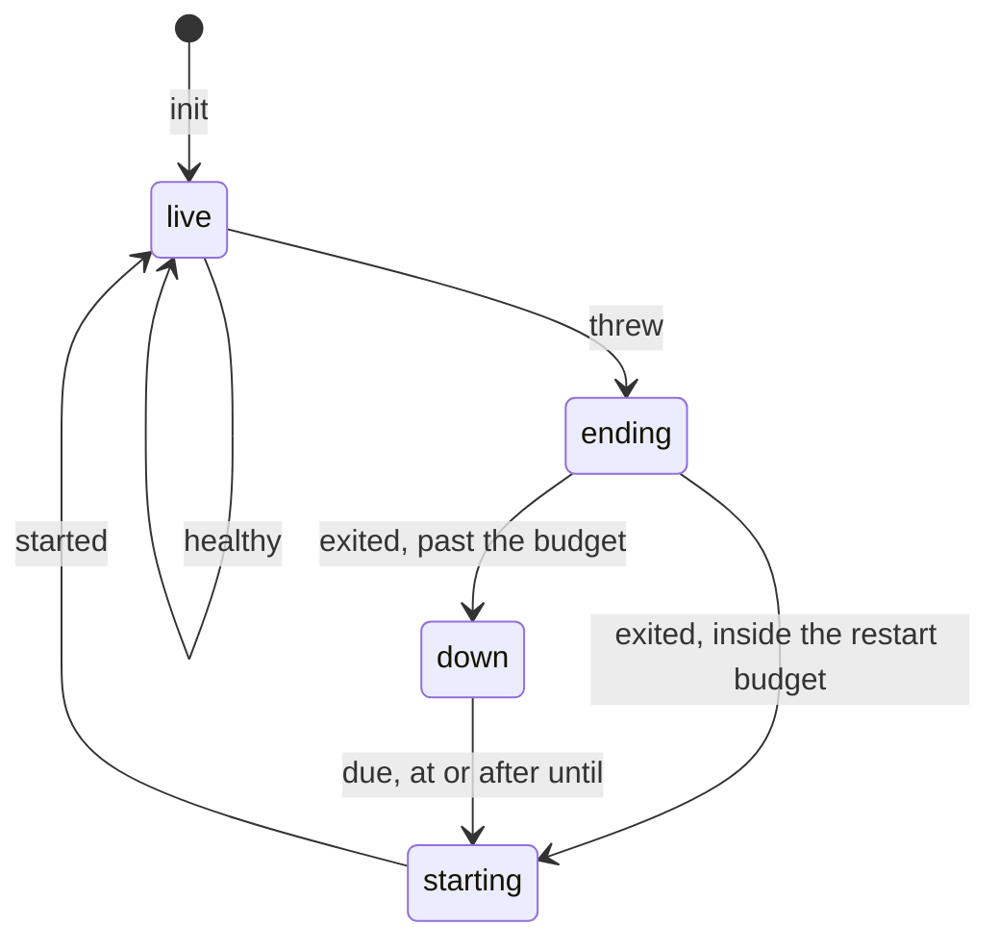

# 0046: In next/, every state machine is a tea machine and a file exports at most one, with its Model, Msg and update in that file and no input or output code, never a plain union with a function or a state edited by hand from outside

**What this decides:** in `next/`, every state machine is written as a tea machine, and each tea
machine has a file that holds its Model, its Msg and its update and nothing that does input or
output, so code outside that file changes the machine's state only by sending it a Msg.

The example is the supervision record. Its states are the four cases of `Recovery`, and these Msgs
move it:



```ts
// Before: main today (next/packages/libfabrika/src/). One machine, spread over three files.

// coordination/recovery.ts:98-104: the Model, away from its update.
export const Supervision = Schema.Struct({
	// ...
	recovery: Recovery,
	pending: Schema.NullOr(Action),

// app/supervisor.ts:69-71: a tea machine, but it moves only the `recovery` half.
export const supervisor = Machine.make({
	model: Supervision,
	msg: Msg,

// app/runner.ts:377-418: the `exit` move, built by hand between two service calls.
case "exit": {
	// ...
	yield* p.exit(action.process, why, meta);
	// ...
	yield* saveRecovery({
		...s,
		build: s.restart.build,
		recovery: Recovery.cases.starting.make({after: action.process, request}),
		pending: {type: "start", process: action.process, from: meta},
	});
```

So today the supervision record is half a tea machine. The diagram is the half the machine's own
file shows. The other half, the `pending` journal, and one `recovery` move with it, are built by
hand in the runner, in nine places.

## Context

[0037](0037-implicit-state-machines-made-explicit.md) says every state machine in `next/` is one
named type with its transitions in one place. It left two things open: which form a small machine
takes, and where "one place" is. The owner settled both on 2026-11-09. Tracker ticket 508.

**This record amends 0037 in part.** 0037 let a machine whose state need not survive a restart be
"a tagged union plus one transition function, in memory". That option is removed. The rest of 0037
holds as written: the two tests that say what a machine is, the three places one hides, the third
test, the plan's question and its binding constraints. By
[the adr skill's table](../.agents/skills/adr/SKILL.md#4-supersede-or-amend) that is
`amended-in-part`, and 0037's status line now says so.

A tea machine is one made with `Machine.make` from `@demlik/tea/effect` (tea 0.25.0, the installed
version). `next/` has three outside its tests on main: `app/supervisor.ts:69`, `app/brain-life.ts:35`
and `next/programs/counter/src/program.ts:15`.

Why:

- **The hand edits are real.**
  [Experiment 246](../experiments/246-implicit-state-machines-in-next.md#2-the-supervision-record)
  found the supervision record's `pending` edited by hand in nine places in `app/runner.ts` (`:374`,
  `:402-415`, `:429`, `:463-471`, `:516-520`, `:565-593`, `:662-667`, `:713-719`, `:1537-1550`; the
  lines were checked again on main for this record). Its type allows 24 pairs of `recovery` and
  `pending`, 8 are real, and five `bad_row` guards exist only to catch a wrong pair.
- **One form means one set of property tests for every machine.** `@demlik/tea/pbt` exports
  `arbMsgSequence`, `arbGuidedSequence`, `propertyTerminates`, `propertyInvariant` and
  `propertyTrace`, and each takes a tea machine as it is (`app/brain-life.laws.test.ts:97-100` calls
  `propertyInvariant(brainLife, ...)`). A plain union with a function needed its own wrapper each
  time. A property can only check the moves the machine's own update makes: a hand edit in another
  file is a move no property sees.
- **Elm builds a module around one type.** Elm's own guide says "all modules should be built around
  a central type", and that a page's module holds its `Model`, `update` and `view` together
  ([Structuring Web Apps](https://guide.elm-lang.org/webapps/structure.html), read at its source on
  2026-11-09). Two things about this source, said plainly:
  - The guide gives no count per file. "At most one" is our rule, taken from its "one central type".
  - The guide also warns against short files and against splitting early: a custom type moves to its
    own module once it has "a bunch of relevant helper functions". The talk it points to, The Life
    of a File, was not watched for this record; what is said of it here is secondary, from the
    guide's own summary.

It sits beside the layout record. [0043](0043-rooms-on-floors.md) gives every room of `libfabrika`
front files and an `internal/`, and splits the runner and the door into a front file plus
`internal/` files cut along their state machines (its rules 8 and 9). This record says what one
such file holds. It does not say which room or folder.

## Decision

**In `next/`, every state machine is a tea machine, and a file exports at most one: that file holds
the machine's Model, its Msg and its update, with no input or output code.**

Rule 1, the form:

- **Everything that passes 0037's two tests is written with `Machine.make`.** No machine is hidden,
  and none is a plain tagged union with one transition function. Small is no exception.
- **0037's third test stays.** State that must survive a restart, or be seen by another party, is
  stored data that recovery reads. What gets stored is the machine's Model, and the update decides
  every change to it. The code that saves it only saves.

Rule 2, the file:

- **What the file holds.** The Model's schema, the Msg's schema, the `Machine.make` call with its
  update, and the pure helpers the update uses. A Cmd definition (`Cmd.make`) stays too: it is a
  value that names a request, and it runs nothing.
- **What it never holds.** No service call, no storage, no clock, no handler that runs a Cmd. The
  code that drives the machine (reads the clock, saves the Model, runs the Cmds) lives in another
  file.
- **Nothing outside the file builds or edits the Model by hand.** Other code gets a new Model by
  sending a Msg through the machine. A spread that changes a control-state field, or a `make` of a
  state case, outside the machine's file is what this forbids. A change the machine has no Msg for
  gets a Msg.
- **A small private helper machine may share its parent's file.** Private means not exported and
  used only by the machine in that file. The day a second file needs it, it gets a file of its own.
- **Why the allowance.** The owner did not want a blanket one-per-file rule in the style of the old
  one-React-component-per-file lint rule. That rule scatters tiny helpers over many files, and a
  reader then opens five files to follow one. The rule here counts what a file exports, not what it
  contains.

**After**, as a sketch (the file's folder and the new names are not decided here; the Msg names are
experiment 246's proposal):

```ts
// A sketch. One file, for example runtime/internal/supervisor.ts: the whole machine.
export const Supervision = Schema.Struct({/* the Model, with `pending` folded into the cases */});
const Msg = Schema.Union([/* threw, exited, due, started, healthy, exit_written, down_written */]);
export const supervisor = Machine.make({model: Supervision, msg: Msg, cmds: [exit, down, start] /* init, update */});

// The runner, in its own file: it calls the service, sends a Msg and saves what comes back.
yield* p.exit(action.process, why, meta);
yield* saveRecovery(moved(s, {type: "exit_written", at: status.at}));
```

What moves: the Model comes to the machine's file, and each of the runner's nine hand-built moves
becomes a Msg that the update handles. `moved` is the runner's existing one-line step through the
machine (`app/runner.ts:271-272`).

**Binding constraints:**

- New code in `next/` that passes 0037's two tests lands as a tea machine, in a file that exports no
  other machine and holds no input or output code.
- A plan that adds or changes a machine names its file, and says which file drives it.
- The existing machines are not moved by this record alone. The supervisor moves inside P34c
  (tracker ticket 404), as 0037 already says, and the rest move with the layout change.

## Consequences

- **It becomes a lint rule,** tracker ticket 509. The rule counts the exported `Machine.make` calls
  in a file and fails on more than one. A machine that is not exported is a private helper, so the
  allowance needs no extra code: the day a second file needs the helper it must be exported, and the
  rule fires. Until the rule exists, the plan and the review are the check.
- **Two parts of rule 2 may not fit a syntax rule:** "no input or output code in the file" and "no
  hand edit of the Model outside it". Ticket 509 says which it can check and what is left to review.
  Nobody has measured the rule's false alarms yet, and it blocks only at about 0%.
- **Experiment 246's forms change.** Eight of its 13 rows name a tagged union as the form. Each is
  now a tea machine. Its findings and counts stand, and it carries a dated note.
- **The cost** is one more file for a machine that today sits inside its driver, a Msg for each
  change that is a hand edit today, and tea's schemas around machines of two states. For the
  supervisor, experiment 246 sizes it at about 3 files and 200 lines, with saved rows to migrate.
- **Not verified: a tea machine stepped inside a synchronous storage transaction.** Some small
  machines live there, such as the span sink's table latch (`data/sink.ts:268-277`), where nothing
  may be awaited and no runtime runs. What was read, in the installed tea 0.25.0:
  - `applyCell(machine, state, msg)` from `@demlik/tea` is a plain exported function. It finds the
    update cell and calls it, returns `[next, cmds]`, and starts no runtime, no Promise and no
    Effect.
  - `next/` already steps a `Machine.make` machine that way, in a plain function:
    `app/runner.ts:271-272`.
  - So the reading says it works. Nobody has run one inside `sql.transaction`, and nobody has
    checked that `data/` may import tea under the layer rules. The first small machine built this
    way settles both. This is about how such a machine is called, not whether it is a tea machine.
- Not decided here: the folder a machine's file sits in ([0043](0043-rooms-on-floors.md) does), the names of the new
  Msgs and cases, the order the 13 machines are done in, and today's version, which this record does
  not touch.

## Records

- [0037](0037-implicit-state-machines-made-explicit.md): status `amended-in-part`, and a one-line
  pointer.
- [`.glossary/TERMS.md`](../.glossary/TERMS.md): no word is coined. The rows `explicit machine` and
  `machine` (Runtime) lose the plain form.
- AGENTS.md: one line. [Experiment 246](../experiments/246-implicit-state-machines-in-next.md): one
  dated note.
