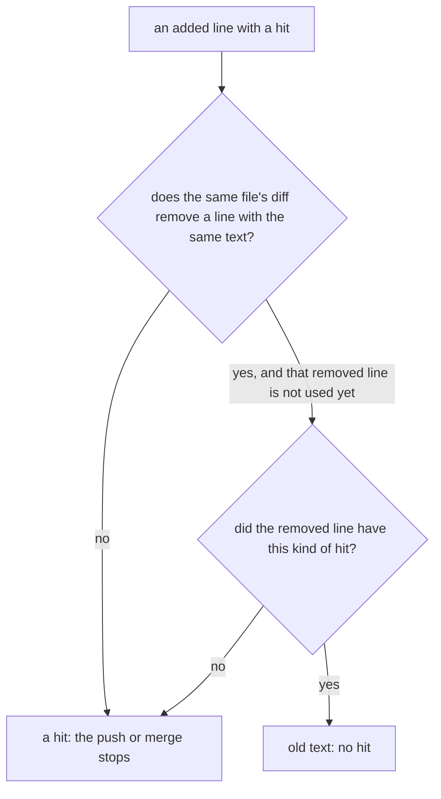

# 0047: To the leak check, an added line that only respaces a line its file's diff removes is old text, and no other added line is



```py
# .agents/skills/lead/scripts/leakgrep.sh, as pull request 709 built it.
# Two lines hold the same text when these are equal.
def same_text(line):
    text = re.sub(r'[ \t]+', ' ', line).strip(' ')                       # runs of spaces and tabs become one space
    return text[:-1].rstrip(' ') if text.endswith((';', ',')) else text  # one last ; or , is dropped

"\tkeep  this;"  ->  "keep this"
"  keep this"    ->  "keep this"    # the same text: the added line is old text
"keepthis"       ->  "keepthis"     # not the same: still new text
```

**What this decides:** the leak check reads an added line as old text only when the same diff
removes, from the same file, a line that differs from it in spacing or one last `;` or `,` alone;
every other added line is new text, and any wider rule is the owner's call.

## Context

The leak check (`.agents/skills/lead/scripts/leakgrep.sh`, today's tooling) reads the lines a diff
adds and stops a push or merge on any hit. It read every added line as new text. So a format-only
sweep was held: it changed only the spacing of lines that already had a hit, and each one counted
as a new hit. On ticket 466's sweep the check gave 72 hits on text that was already on main.

The owner said yes to one change on 2026-11-09. Pull request
[709](https://github.com/usirin/tea-fabrika/pull/709) built it under tracker ticket 500, with its
laws in `leakgrep.respaced.test.ts`. This file records the rules as that pull request built them.

It sits beside two other decisions and contradicts neither:

- [0011](0011-leak-check-allows-plain-tmp-paths.md) says which paths are a hit. This one says which
  added lines are read at all.
- [0040](0040-existing-tools-before-hand-written.md) says a hand-written check that stays lists
  its edge cases before its code, each with a test. Pull request 709 did that; the list is below.
  An experiment that compares this check with existing tools is still open
  ([pull request 708](https://github.com/usirin/tea-fabrika/pull/708)). If a tool replaces the
  check, these rules are what it must keep or the owner must drop.

## Decision

**An added line is old text when the same diff removes, from the same file, a line with the same
text, and only then.**

What "the same text" means:

- Two lines hold the same text when they are equal after each run of spaces and tabs becomes one
  space, both ends are trimmed, and one last `;` or `,` is dropped.
- A run is collapsed, never deleted. `a b` and `ab` are different text, so two words never join
  into a new one.
- Only the space and the tab count. A no-break space or any other character is text.
- Only one `;` or `,`, at the very end. One in the middle, or a second one at the end, makes the
  line new text.

What a removed line clears:

- **One removed line clears one added line.** Removed lines are counted as a multiset: two added
  copies against one removed copy leave one hit.
- **A removed line clears only the kinds of hit it had itself.** An old line with no hit clears
  nothing. An old line with a private word does not clear a new key on the same line.
- **Only its own file.** A removed line clears lines in its own file's section of the diff, the
  part under one `diff --git` header. Two diffs printed one after the other never clear each other.
- **A rename follows git.** When git pairs two paths as a rename they are one file. When git shows
  a delete and a new file, the new path is all new text.
- A flagged line that only moves inside its file is old text: the diff removes it and adds it back.
- **Only in a diff git wrote.** A removal counts only in a hunk (`@@`) under a `diff --git` header.
  A diff written by hand, one with no header, a merge's combined diff and a whole draft (`--text`)
  clear nothing.

What stays new text, on purpose:

- Spaces put inside braces, `{x}` to `{ x }`. No run of spaces was there before.
- A line wrapped another way: two lines joined, or one split.

What does not change:

- The check still fails closed: any hit left stops the push or merge for the lead's hand check.
- There is no override flag, and none is added.
- When the rule clears lines, the check prints how many, never their text.

**Binding constraints**

- Any further widening is the owner's call, one yes or no each: another character treated as
  spacing, brace spacing, wrapped lines, clearing across files or across diffs, or an override.

## Consequences

- A format-only sweep no longer re-flags lines it only respaced. On ticket 466's sweep the hits
  went from 72 to 28.
- It does not free such a sweep alone. Of the 28 left, 17 were lines whose only change was a space
  put inside braces, and 11 were lines wrapped another way. Those need a hand edit, or a wider rule
  the owner has not approved.
- The check now trusts git's rename pairing. A file renamed and mostly rewritten is a new file to
  git, and all of it is scanned.
- The cost: the check keeps a little state per file, and a reader has to know that a hit can be
  cleared. The count it prints is how a reader sees it happened.
- Not decided here: whether ignoring brace spacing is safe, and whether an existing tool replaces
  the check ([0040](0040-existing-tools-before-hand-written.md)).
