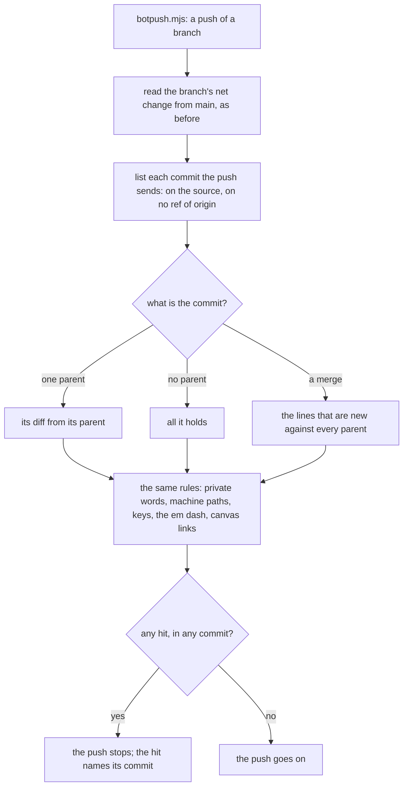

# 0048: The leak check reads each pushed commit on its own, beside the branch's net change



```sh
# .agents/skills/lead/scripts/botpush.mjs runs both, before it reads a key or opens a connection.
git diff --unified=0 origin/main...<source> | sh leakgrep.sh       # the net change, as before
sh leakgrep.sh --commits <source> --not --remotes=origin           # each commit the push sends

leakgrep: leak em_dash at added line 3 of commit 1f0c2a9b77d4      # a hit names its commit
leakgrep: 12 commits read, added text clean                        # or every commit was clean
```

**What this decides:** a push is checked commit by commit, since every commit of a pushed branch
is public, and a hit in any one of them stops the push.

## Context

The leak check (`.agents/skills/lead/scripts/leakgrep.sh`, today's lead tooling) stops a push on
any hit in the text the push adds. A push sends commits: each one is public from then on, and stays
readable on GitHub in its pull request after a squash merge too. So each one is read.

[Experiment 247](../experiments/247-leak-check-tools.md) compared the check with existing tools and
recommended reading each pushed commit. The owner decided it on 2026-11-10. Tracker ticket 548
built it.

**The known way.** A push hook is handed the pushed range, and scanners read it commit by commit:
[gitleaks](https://github.com/gitleaks/gitleaks/blob/v8.30.1/README.md) reads `git log -p` and
takes the commits from `--log-opts`, and
[git's own pre-push hook](https://git-scm.com/docs/githooks#_pre_push) gets the local and remote
commit of each ref for this purpose.

**Existing tools first ([0040](0040-existing-tools-before-hand-written.md)).** Looked at for
"read each commit of a push with our four kinds of rule":

| Tool | Reads a push commit by commit | Why it is not the reader here |
|---|---|---|
| [gitleaks 8.30.1](https://github.com/gitleaks/gitleaks/tree/v8.30.1) | Yes: `gitleaks git --log-opts="<range>"` | It knows key shapes. Private words, machine paths with [0011](0011-leak-check-allows-plain-tmp-paths.md)'s rule, the em dash and canvas links would be our own rules in its rule file, and it has no rule for [0047](0047-respaced-line-is-old-text.md): experiment 247 ran it on 3 re-indented lines and it flagged 3, with a baseline too |
| [TruffleHog 3.99.8](https://github.com/trufflesecurity/trufflehog) | Yes: `--since-commit`, `--branch` | Its custom rules are marked alpha and each needs a keyword ([its page](https://github.com/trufflesecurity/trufflehog/blob/main/pkg/custom_detectors/CUSTOM_DETECTORS.md)); AGPL-3.0; it calls providers unless told not to |
| [detect-secrets 1.5.0](https://github.com/Yelp/detect-secrets) | No: whole files, staged or tracked ("it avoids the overhead of digging through all git history", its README) | No commit reader at all |
| [git-secrets](https://github.com/awslabs/git-secrets) | `--scan-history` reads all of history, not a range ([its README](https://github.com/awslabs/git-secrets#options)) | Its patterns live in git config, and it has no rule for 0047 or 0011 |
| [pre-commit](https://pre-commit.com/#pre-push) at the `pre-push` stage | No: it hands a hook the files changed between two commits | The net change again |
| `git rev-list` and `git diff` | Yes | Used: they are the reader |

So the loop is ours, on git's own commands, and the rules stay in the one place they already are.
Keys through gitleaks beside our check is experiment 247's other recommendation, and its own work
(tracker ticket 547).

## Decision

**The leak check reads each commit a push sends, on its own, and still reads the branch's net
change.**

- **Which commits.** Every commit reachable from the pushed source that no ref of `origin` holds.
  A commit main or the remote branch already holds was sent before, and is not read again.
- **A commit with one parent** is read as its diff from that parent, with the flags the net read
  uses.
- **A first commit** (no parent) is read as all it holds.
- **A merge** is read as the lines that are new against every parent. A line one parent already
  holds came from that parent's commits: they are read on their own, or origin already holds them.
- **0047 holds inside one commit.** A line is old text only when the same commit's diff removes
  it, from the same file, with other spacing. A removal in another commit clears nothing, and a
  merge clears nothing, as 0047 already says of a merge.
- **A hit names its commit,** by the first 12 characters of its id, with the kind and the added
  line's number in that commit's diff. Never the text.
- **The net read stays.** The branch's net change from main is read as before.
- **It fails closed.** A hit in any commit stops the push. A range git cannot list, or a commit it
  cannot diff, is exit 2 and stops the push too. There is no override.
- **One reader.** The loop lives in `leakgrep.sh` (`--commits <rev>...`, the arguments
  `git rev-list` takes), so every caller gets the same rules.

**The edge cases, each with a law in `leakgrep.commits.test.ts` or `botpush.test.ts`:**

- a hit in any commit counts, whatever later commits do (a property over made-up histories);
- a merge that only brings main's lines in, and a merge with a line of its own;
- a commit origin already holds, on main or on the branch;
- an empty range: no commit read, exit 0;
- a new branch with no upstream, and a first commit;
- a commit that only removes;
- a rename, with and without a new line;
- a commit with a binary file beside text files;
- 0047 inside one commit, and not across two (a property);
- a push of 50 commits;
- a range git cannot read: exit 2;
- the bot's push refuses when an earlier commit has a hit.

**Binding constraints**

- No push path reads only the net change.
- No flag, comment or setting skips a commit or a hit.
- A change to which commits are read, or to how a merge is read, is the owner's call.

**Rejected:** reading every commit of the branch on every push, pushed before or not. A commit
origin already holds is public already, the check has no override, and history is never rewritten
here, so one such commit would stop every later push of its branch and protect nothing.

## Consequences

- A hit in a commit that is not the newest cannot be fixed by one more commit. The work moves to a
  fresh branch without that commit. That is the cost, and it is the point: the commit would have
  been public.
- A merge whose own lines only respace a flagged line is a hit. The respacing goes in a commit of
  its own, where 0047 reads it as old text.
- Time: 50 commits of a real lane, 9 of them merges, 201 files changed, read in about 1.8 seconds
  on the lead's laptop (three runs: 1.73, 1.92 and 1.85 s). The net read of the same branch took
  0.25 s.
- `leakgrep.sh` stays a shell script with Python inside for now.
  [0033](0033-agents-code-follows-next-rules.md) says it moves to TypeScript and Effect when next
  touched; that move is a rewrite of the whole rule set and its 57 laws, too large to ride with
  this change, and it has a finding row.
- `drive.ts` still has a reader of its own for a step's commits. It reads commit by commit
  already, with its own copy of the rules. Making it call `leakgrep.sh --commits` waits for the
  two open pull requests that rewrite those lines; experiment 247's finding row covers it.
- Not decided here: gitleaks for key shapes (ticket 547).
