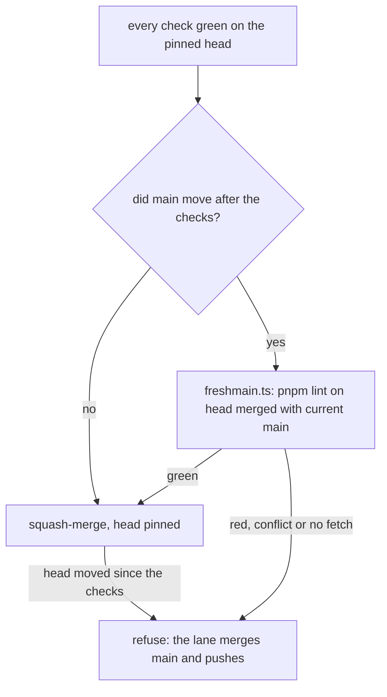

# 0049: The lead's merge script may land a green pull request that is behind main, once pnpm lint passes on its head merged with current main, with the head pinned and no override flag

**What this decides:** a pull request whose checks are green does not have to catch up with main
again before it lands; the lint on its true merge with current main is the check instead.



```text
checks green on <head> + freshmain.ts lint green on <head> merged with main  ->  merge pinned to <head>, even if BEHIND
```

## Context

Ticket 552. CI checks take about 13 minutes and main moves about every 6, so a pull request that
waits to be fully up to date keeps losing the race: PR 730 was refused 8 times by `gh`'s "not up to
date" before one clean run.

The only "up to date" guard today is on the client. `gh` 2.62.0 refuses when it reads merge state
`BEHIND` and never calls the merge. When it reads another state it calls the merge, and the
ruleset's up-to-date rule is bypassed for the admin role: the rule suites recorded `bypass`, and 12
of the last 20 merges landed behind main by that timing. So "up to date" is a race we lose by
waiting and skip by luck. GitHub's merge queue, the industry's answer, is not offered for repos
owned by a personal account.

The lint check on the true merge is on main since PR 750 (`.agents/skills/lead/scripts/freshmain.ts`).
Finding row `2026-11-10-f08` in `field/findings.jsonl` (PR 743) is the break it would have caught:
an unformatted file landed on main by a merge its checks never saw.

The ship stage note already says a branch behind main ships as it is, with the queue as the check
([ship stage rules](../docs/direction/ship-stage-rules.md)). This decision is the lead's version of
that rule for a repo with no queue.

This amends, in part, [0014](0014-the-lead-merges-when-every-step-passed.md): "CI green on the head"
now holds for a head behind main once the lint on its true merge passed. It sits beside
[0004](0004-squash-merges-and-native-stacks.md), which still holds: every pull request squash-merges,
and a single pull request catches up by merging main in, never by a rebase.

## Decision

**The lead's merge script may merge a pull request whose checks are green even when its branch is
behind main, on purpose, once `pnpm lint` passes on the true merge of its head with current main
(owner, 2026-11-10).**

- "Green" means every check on the exact head the merge is pinned to.
- When main moved after the checks, `freshmain.ts` runs `pnpm lint` on that head merged with the
  main it just fetched. Green lets the merge go on. Red, a conflict or a failed fetch refuses it.
- The tests and the type check are not run again on the true merge.

**Binding constraints**

- The head stays pinned. A head that moved since the checks is refused.
- The lint on the true merge runs and fails closed.
- No override flag skips either.

## Consequences

- A green pull request stops losing the race with main. It lands on the first try once its lint
  on the true merge is green.
- The cost: a break that only shows in tests or types between two pull requests can land red on
  main for about one CI run, about 13 minutes. The lead fixes it the same turn
  ([0036](0036-a-flaky-test-is-fixed.md) for tests).
- The ruleset and branch protection stay the owner's switch. This decision does not change them.
- Not decided here: how `catchup.sh` performs the merge when `gh` refuses as `BEHIND`. That is a
  lead tooling change that follows this decision. It must keep the head pinned, as
  `--match-head-commit` does today. `--admin` and `--auto` stay out unless that change's own
  reasoning shows one is the plain way.

## Amendments

- 2026-11-11: the owner turned off the ruleset's "require branches to be up to date" rule on main, so
  `gh` no longer refuses a pull request as `BEHIND`. The REST merge fallback left `catchup.sh`: a
  pull request behind main lands with the plain pinned `gh pr merge`.
