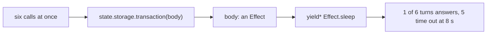
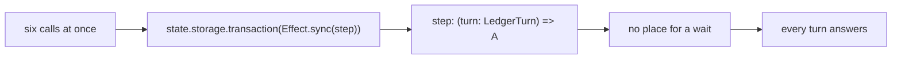

# 0050: In next/, a ledger step is a plain synchronous function run inside the storage transaction as Effect.sync(step), never an Effect that could wait

**What this decides:** in `next/`, the work done inside one storage transaction of the ledger is a
plain function that returns a value, so it has no way to wait, and the object hands it to the
platform's transaction wrapped in `Effect.sync`.

**Before:**



**After:**



```ts
// before: a sketch. An Effect body; nothing stops it from waiting, and a timer hangs the object.
yield* state.storage.transaction(
  Effect.gen(function* () {
    const head = yield* readHead(stream);
    yield* Effect.sleep("5 millis"); // compiles, and hangs the object under load
    yield* insert(stream, head + 1, line);
  }),
);

// after: a sketch. The step is (turn: LedgerTurn) => A, the shape `transact` already takes in
// next/packages/libfabrika/src/data/ledger-transaction.ts. A wait cannot be written.
const transact = <A>(step: (turn: LedgerTurn) => A) =>
  state.storage.transaction(Effect.sync(() => step(turnOn(storage.sql))));
```

What moves: the body stops being an Effect, so the line that waits has nowhere to go.

## Context

Ticket 502 ports the Durable Object classes to Alchemy's Effect objects
([0041](0041-object-classes-are-effect-objects.md)). Its PR 8 moves the object services onto
Alchemy's `state.storage`, whose `transaction` takes an Effect and runs the platform's Promise
`transaction` ([0042](0042-platform-pieces-go-through-alchemy.md)'s amendment of 2026-11-10). Both
records said the ledger's laws had not run on that `transaction`.

[Experiment 249](../experiments/249-ledger-on-effect-sql.md) (ticket 551, PR 745) ran them, on six
routes, in local workerd and on Node:

- **An Effect body on the Promise `storage.transaction` hangs under load when it waits on a
  timer.** Six turns sent at once: 1 answered, 5 turns and 5 reads timed out at 8 s. That held for
  Effect's own driver (`@effect/sql-sqlite-do`), for that driver with Alchemy's scheduler fix, and
  for Alchemy's wrapper. A quiet object passes the same case, so a law with one caller cannot see
  it.
- **A plain step in `state.storage.transaction(Effect.sync(step))` held every law that ran** (8 of
  8 object laws and the interleave law), let nothing land inside a turn, and needs no raw platform
  handle.
- **The cost:** a turn takes about 2.2 times as long, 76 to 171 microseconds (median of 5 runs of
  1,000, on a busy laptop), and one append in the object is no longer one synchronous call.
- The ledger slice also ran on `effect/sql`'s `SqlClient`, on Node and in the object, once the turn
  sat on a synchronous transaction, with `effect` 4.1.2 as installed.

The owner decided on 2026-11-10.

**How this fits older texts.** The sweep found no record that says the opposite.

- **0041 and 0042 are amended in part.** Their PR 8 bullet said the services move to the Effect
  `transaction`. That holds; this record adds what goes inside it. The rest of both stands.
- [No Promises](../docs/direction/no-promises.md) stands. The step is plain code, not a Promise,
  and the Promise stays inside Alchemy's `transaction`.
- [An object class stays thin](../docs/direction/object-classes-stay-thin.md) stands, and fits:
  the step is plain code that also runs on Node in tests.
- [0046](0046-one-tea-machine-per-file.md) stands. Its open point, a tea machine stepped inside a
  synchronous storage transaction, keeps its shape: a step that steps a machine stays a plain call.

## Decision

**In `next/`, a ledger step is a plain synchronous function, `(turn: LedgerTurn) => A`, and the
object runs it inside the storage transaction as `state.storage.transaction(Effect.sync(step))`.
It is never an Effect that could wait.**

- **The step's shape is the guard.** A function that returns a value has no place for a wait, so
  no run-time check is added for it.
- **PR 8 of ticket 502 builds this route.** The object services read storage through Alchemy's
  `state.storage`, as 0041 and 0042 say, with a plain step inside its `transaction`.
- **No Effect body goes into `storage.transaction`.** Not Effect's DO driver's turn, not Alchemy's
  wrapper with an Effect body, not either with a scheduler setting.
- **The edge comment on `next/packages/libfabrika/src/data/sqlite.ts:3` is wrong.** It says Effect
  SQL has no synchronous SQLite handle for the referee's transactions; on Node the whole turn ran
  under `Effect.runSync` on `@effect/sql-sqlite-node`. It goes when that file is next touched.

**Binding constraints**

- No step body yields: no `Effect`, `yield*`, Promise or callback that waits, inside a ledger
  transaction.
- A new storage transaction in `next/` takes `Effect.sync(step)` and nothing else.

## Consequences

- **What it costs:** about 95 microseconds more per turn for the Promise transaction, and an
  append that can no longer run under `Effect.runSync` inside the object.
- **A check is possible, and is follow-up, not built here.** Type: `transact` can refuse a step
  whose return type is an `Effect` (`A extends Effect.Effect<any, any, any> ? never : A`), which
  catches a step that hands back an Effect. Lint: a rule in `oxlint-plugins/` can flag a
  `storage.transaction(...)` call whose argument is not `Effect.sync(...)`. The type check catches
  the step, the lint rule catches the call site; neither is a test.
- **Not decided here: moving all of `data/` to `effect/sql` on the synchronous turn.** Experiment
  249 leans to it at about 65%. The doubts: the span sink would write about its own writes (1 span
  per append today, 9 on `SqlClient`), about 17 caller files would take `LedgerTurn` as an Effect
  API, and two of the modules are marked unstable. It is its own tracker ticket.
- **Not known:** the full 42 laws have not run on this route in workerd, only 8 and the interleave
  law, and nothing ran on Cloudflare itself. PR 8 runs the rest.
