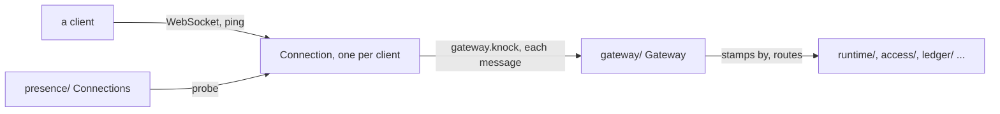

# 0051: In next/, the door is the gateway, one client's held socket is a connection, node/ splits by job into build/ and dev/, never stage, and workers/ is cloudflare/, named by where it runs

**What this decides:** three sets of names in `next/`'s libfabrika, all done in the folder move:
the room that admits and routes clients is `gateway/`, the object that holds one client's socket is
a `Connection`, `node/` holds its files in `node/build/` and `node/dev/`, and `workers/` is
`cloudflare/`.



```text
today (main)                              after the rename PR
door/                 Door                gateway/               Gateway
workers/gateway.ts    GatewayService      cloudflare/connection.ts  ConnectionService
                      GatewayBinding                             ConnectionBinding
                      gatewayRuntime                             connectionRuntime
reader                gateway:t1          reader                 connection:t1
transport/gateway.ts  export connection   transport/Connection.ts
coordination/gateway-manager.ts           presence/              Connections
                      GatewayManager
wire                  door.knock          wire                   gateway.knock
                      door.waiting                               gateway.waiting
node/build.ts, css.ts; src/build.ts,      node/build/
  compiler.ts, build-modules.d.ts
node/stage.ts, local-stage.ts,            node/dev/
  stage-recording.ts
startStage, stageRecording                startDev, devRecording
workers/              WorkersSql          cloudflare/            CloudflareSql
@kampus/libfabrika-workers (later)        @kampus/libfabrika-cloudflare (later)
```

All of this is about `next/`. Today's version keeps its words until that code goes.

## Context

The owner decided both on 2026-11-10, after the words were crossed against the industry's. Lead
ticket 570 records them. They ride in the libfabrika folder move (ticket 477), whose layout is
[0043](0043-rooms-on-floors.md). This record **amends 0043 in part**: its room list names `door/`,
and that room is now `gateway/`. The rest of 0043 holds.

- **The door does a gateway's job.** It admits a client (the challenge, sign-in, the waiting room),
  routes each message and stamps each entry's `by`. That is what an API gateway does: it
  authenticates and routes.
- **One held socket per client is a connection.** Today that object is called "gateway", in
  `workers/gateway.ts`. Phoenix names the same thing a socket; "connection" is the plain word.
- **`GatewayManager` takes the plural service name** that [0029](0029-format-and-names-follow-effect.md)
  asks for, as Effect has `Runners` and `Servers`: `Connections`.
- **"stage" was unclear** for running the brain on the laptop. `wrangler dev`, `alchemy dev` and
  `vite dev` all say `dev` for "run it locally". The build files sit at the top of `src/` and in
  `node/` today; ticket 520 asked where P16's build goes, and `node/build/` answers it.
- **A platform folder is named by where the code runs,** `node/` and `cloudflare/`, the way Effect
  splits `platform-node` and `platform-browser`. "Workers" names one Cloudflare product; the code
  also runs Durable Objects and R2. This **amends [0032](0032-libraries-take-effects-file-layout.md)
  in part**: its platform prefix for a platform's file, `WorkersGateway.ts`, becomes `Cloudflare`.
  [0042](0042-platform-pieces-go-through-alchemy.md) still holds whole.

## Decision

**In `next/`, the room that admits and routes clients is `gateway/`, the per-client object is a
`Connection`, `node/`'s files sit by job in `node/build/` and `node/dev/`, and `workers/` is
`cloudflare/`.**

- `door/` becomes `gateway/`, and its service `Door` becomes `Gateway`. The gateway admits a
  client, routes each message and stamps each entry's `by`.
- The per-client Durable Object that holds one client's WebSocket and answers its ping becomes
  `Connection`: `ConnectionService`, `ConnectionBinding`, `connectionRuntime`, and reader names such
  as `connection:t1`. `transport/gateway.ts`, which exports `connection`, becomes
  `transport/Connection.ts`.
- presence/'s `GatewayManager` becomes `Connections`.
- The wire methods follow: `door.knock` becomes `gateway.knock`, and `door.waiting` becomes
  `gateway.waiting`.
- `node/` stays the folder for code that needs Node. `node/build/` holds the build: `node/build.ts`,
  `node/css.ts`, and P16's top-level `build.ts`, `compiler.ts` and `build-modules.d.ts`, with their
  tests (`build-assets.test.ts`, `build-one-file.test.ts`, `css.test.ts`). `node/dev/` holds what
  runs the brain on the laptop: `stage.ts`, `local-stage.ts`, `stage-recording.ts` and their tests.
- The word "stage" goes in `next/`: `startStage` becomes `startDev`, and `stageRecording` becomes
  `devRecording`. A file's own name follows in the move.
- `workers/` becomes `cloudflare/`. Platform folders are named by where the code runs: `node/` and
  `cloudflare/`. The later package is `@kampus/libfabrika-cloudflare`, not `-workers`.
- 0032's platform prefix follows: `WorkersSql` becomes `CloudflareSql`, and every `Workers` prefix
  becomes `Cloudflare`.
- `cloudflare/` reaches the platform only through Alchemy, as 0042 says.

**Binding constraints:**

- The gateway and connection renames land in one rename PR inside the move (ticket 477), after the
  move-only PRs, as PR 15's members-to-access rename does. A move-only PR changes no name.
- That PR lands before anything real is stored in `next/`. Reader names and wire methods are saved
  data; after real data exists, the rename needs a data migration and a plan of its own.
- `node/` moves whole into `@kampus/libfabrika-node` later, and `cloudflare/` into
  `@kampus/libfabrika-cloudflare`, so naming and splitting them now costs no second move.
- No code is renamed by this record.

## Consequences

- A reader of `next/` meets "gateway" for the one place every client comes in, as the industry uses
  it, and "connection" for one socket.
- The doubt the owner accepted: "connection" is a common word, so it is harder to search for than
  "gateway" was.
- Today's version keeps `door`, its own `gateway` and `stage` until that code goes. A search finds
  both, so the path says which one a line means.
- Notes and plan rows that cite today's names keep them until the move, as 0043 says; the PR that
  renames a file fixes its citations.
- Not decided here: when the two platform packages are split out.

## Records

- [`.glossary/TERMS.md`](../.glossary/TERMS.md), changed rows: `door` (now `gateway`, Clients),
  `gateway` (now `connection`, Clients), `presence` (`Connections`, Ledger), `room (library)` (lists
  `gateway/`), `reader` (`connection:t1`), the `five layers` row (one WebSocket per client to its own
  connection), and `startStage, stageRecording` (Runtime, now `startDev, devRecording` with the
  `node/dev` paths). The `brainOutbox` row gets its `node/dev/` path.
- The Runtime rows that cite `workers/bindings`, `workers/runtime`, `workers/gateway`,
  `workers/record` and `workers/control` get a note that the folder becomes `cloudflare/`.
- Not changed: the code names in those rows, `GatewayBinding`, `GatewayService`, `gatewayRuntime`
  and `DoorCalls`. They are code names on main and change with the code rename.
- [0032](0032-libraries-take-effects-file-layout.md) and [0043](0043-rooms-on-floors.md) are
  amended in part, each with a one-line pointer here.
- [A local-first sync engine](../docs/direction/a-local-first-sync-engine.md),
  [brain, hands, window, agent](../docs/direction/brain-hands-window-agent.md) and
  [the ledger goes to Cloudflare](../docs/direction/the-ledger-goes-to-cloudflare.md) each get a
  one-line pointer here.
