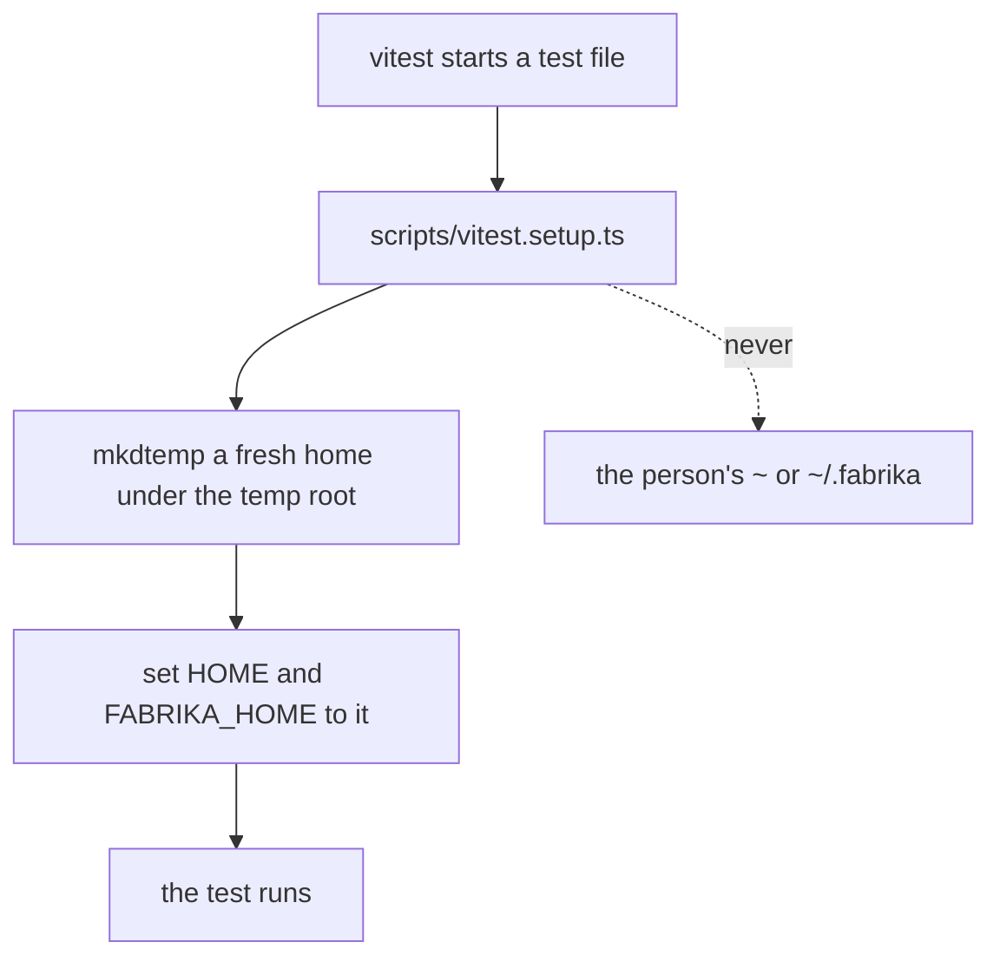

# 0052: A test never depends on the person's machine, and a break the machine causes is fixed by removing the dependency, never by catching the error

**What this decides:** a test never reads the person's home folder or app data, every test run gets
its own fresh, empty home under the temp root, and a test that breaks because of the machine it runs
on is a flaw in the test, fixed by removing what it leaned on.



A sketch of the setup's shape (ticket 574 builds the real one, in `scripts/testhome.ts`):

```ts
// sketch: one fresh home per test file, and no read of the person's home
const home = mkdtempSync(join(shortTempRoot(), "fh-"));
process.env.HOME = home;
process.env.FABRIKA_HOME = home;
```

## Context

In Codex boxes the home folder is closed on purpose. `scripts/vitest.setup.ts` looked at
`~/.fabrika` to make sure no test touched the person's real app data, and that look itself crashed
on `EPERM`, so every suite failed in a box. Catching `EPERM` was proposed and rejected: the guard
existed only because a test could reach the real home in the first place. Tracker ticket 574 builds
the fix; tracker ticket 575 is this decision.

**How this fits older texts.**

- [0036](0036-a-flaky-test-is-fixed.md) is amended in part. It lets a wait, a retry or a skip stay
  when a flaky test's cause is proven to be outside our code. The machine a test runs on is never
  that cause: a test that passes on one laptop and fails on another, or in a box, leans on
  something it should not, and the fix removes it. The rest of 0036 stands.
- [0011](0011-leak-check-allows-plain-tmp-paths.md) lets short test homes such as `fh.abc` under
  `/tmp` into laws and docs. This decision makes such a home the only one a test sees.
- [0045](0045-test-steps-run-in-containers.md) already mounts nothing from the home folder into a
  step's container. This decision says the same of every test run, in or out of a container.
- AGENTS.md's rule that a test window always sets its own `FABRIKA_HOME`, with a short path, agrees
  and is not changed.

## Decision

**A test never depends on the person's machine.** This holds for both versions, `next/` and
today's.

- A test never reads the person's home folder or app data: no `homedir()`, no `~`, no
  `~/.fabrika`, not even to guard against touching them.
- Every test run gets its own fresh, empty home under the temp root, set as both `HOME` and
  `FABRIKA_HOME`. The path stays short enough for a socket's 103-byte limit.
- A test that breaks because of the machine it runs on (a locked home, an odd home, another
  contributor's laptop) has a design flaw. The fix removes the dependency.

**Binding constraints:**

- No fix for a machine-caused break catches, ignores or skips the error.
- No test, setup file or helper reads the person's home folder, including to check that it is
  not being used.
- A machine-caused break is never the "outside our code" exception in 0036.

## Consequences

- Ticket 574 changes `scripts/vitest.setup.ts` and adds `scripts/testhome.ts`, and fixes any test
  that still reads the real home.
- A test that needs something from a home writes it into its own fresh home first.
- 0036's status becomes `amended-in-part by` this file, with a one-line pointer in its body.
- Not decided here: whether a lint rule bans `homedir()` and `os.homedir` in test files, and how
  an Electron test app's `userData` is pointed at the fresh home. Both belong to ticket 574's plan.
