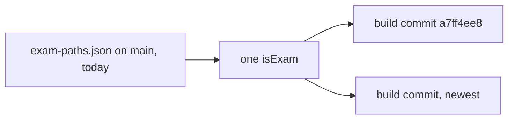
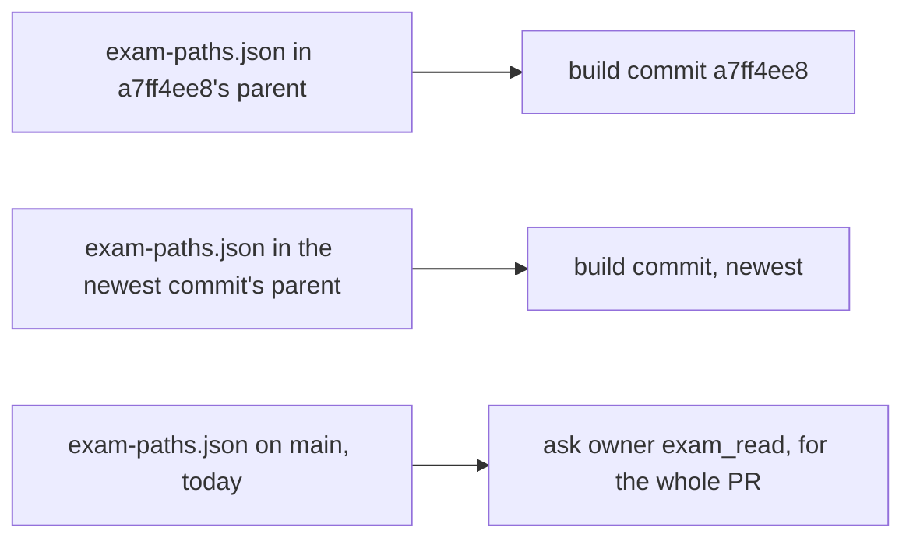

# 0053: The commits check judges each commit by the exam list in that commit's parent, never by today's list

**What this decides:** a `build` commit is `build_touched_exam` only if it touched a path that was
on `exam-paths.json` in its own parent commit, so a row added later never turns an old commit
wrong.

**Before:**



**After:**



```ts
// before: next/apps/fabrika/src/exam/commits.ts, one matcher for every commit
const touched = step === "build" ? c.paths.filter(isExam).sort() : [];

// after (sketch; ticket 576 builds it): the matcher of the list in the commit's parent
const touched = step === "build" ? c.paths.filter(examAt(c.parent)).sort() : [];
```

Each commit now has its own list, the one that stood right before it. The whole-PR owner read
still uses main's list.

## Context

The commits check in `next/apps/fabrika/src/exam/commits.ts` builds one `isExam` matcher in
`checkMain`, from `exam-paths.json` on main as CI checked it out, and `check` judges every `build`
commit in the PR with it. So the list as it stands today judges every commit, however old.

P14's build round 1 commit `a7ff4ee8` (2026-11-09) edited three `tsconfig.json` files. On
2026-11-10, [PR 687](https://github.com/usirin/tea-fabrika/pull/687) (P16) added
`next/**/tsconfig.json` to `exam-paths.json`. After that, the check answers `stuck:
build_touched_exam` on `a7ff4ee8`. That commit broke no rule when it was written, and the lane
cannot clear it without rewriting history, which the step-commit skill forbids.

Finding `2026-11-10-f45` records this; it is on the P14 branch, `fabrikalfa/p14-wip`, and not on
main yet. Finding `2026-11-10-f38`, on main, is from the same P16 work (PR 732), about where its new
files sit; it does not touch this check.

**How this fits older texts.** [a unit of work is a commit](../docs/direction/a-unit-of-work-is-a-commit.md)
says a `build` commit that touches an exam path is `stuck`, and that the PR asks the owner to read
any exam path from the one list. Both still hold. This decision only says which version of the list
judges each commit. [0010](0010-allow-pull-request-target-for-the-commit-check.md) keeps the check
running main's copy of its own code; that is not changed.

## Decision

**Each commit is judged against `exam-paths.json` as it stood in that commit's parent, not as it
stands at the head or on main.** A commit cannot break a rule that did not exist when it was
written. A new commit is still judged by the list right before it, so nothing slips past.

- `build_touched_exam` reads, per commit, the list in that commit's parent.
- The PR's `ask owner exam_read` keeps reading main's list, over the PR's whole change.
- A dropped row is still the owner's read: `exam-paths.json` names itself, so a change to it is on
  main's list and the whole-PR read catches it, whatever a parent's list says.

**Binding constraints**

- The parent's list never makes a PR need less of the owner than main's list does: the whole-PR
  read stays on main's list.
- No lane rewrites history to pass this check. A commit that was right when it was written stays
  as it is.

## Consequences

- Lanes open across an exam-list change, such as P14 across PR 687, pass the commits job again
  once ticket 576 lands.
- The check reads one more file per commit: `exam-paths.json` at each commit's parent.
- The build is an exam change with full steps (plan, tests, build, mutation, review), since
  `next/apps/fabrika/src/exam/**` is an exam path: tracker ticket 576. Tracker ticket 577 is this
  decision.
- Not decided here: what the check answers when a parent has no readable `exam-paths.json`.
  Ticket 576's plan names it, and it fails closed.
