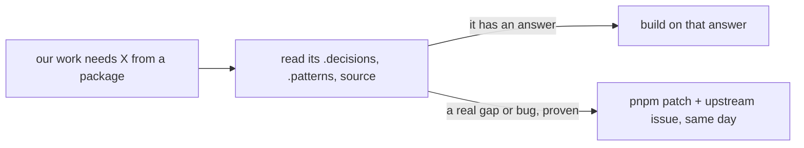

# 0054: Before we change a package we use or contribute to, we read its decisions, patterns and source and build on its answer, and patch only a gap or bug proven after that read

**What this decides:** a change to a package we depend on or contribute to starts with reading what
that package already decided, and a local patch is only for a real gap or bug that the read proved.

## Context

P14's window froze when one send hung. The cause is in tea: one transition's Cmds run one at a time.
A patch to make tea run a transition's Cmds side by side was proposed and rejected. demlik already
decided this on purpose: its `.decisions/0018-tool-overlap-inside-the-cmd-handler.md` keeps the
interpret loop serial, because replay folds Msgs in the order the Cmds were sent. tea's answer for
work that waits is a Sub (demlik issue 204, and `.patterns/tea/patterns/04-effects-as-data.md` in
demlik). P14's plan amendment A13 now builds the window's sends as a write Cmd, with the replies
coming back through the socket's Sub.

The patch would have worked around a design nobody had read. That is what this rule stops.

This amends in part [patch upstream locally](../docs/direction/patch-upstream-locally.md): "never
wait on upstream" still holds, but the read comes before any patch. It amends in part
[0041](0041-object-classes-are-effect-objects.md) and
[0042](0042-platform-pieces-go-through-alchemy.md) too, which each say a gap in Alchemy is patched
locally.

## Decision

**Before any change to a package we contribute to or depend on, read its decisions, patterns and
source for the answer it already has, and build on that answer.**

- tea and demlik come first. The rule also covers Manti, Effect, Alchemy and any other package.
- Read the installed version: its `.decisions/`, its `.patterns/` or docs, and the source the
  change touches.
- A local patch is only for a real gap or a bug, proven after that read. Its pull request names
  what was read and why the package's own answer does not cover the need.
- The upstream issue is filed the same day, as before. 0042's six unreported Alchemy gaps stay the
  one exception to filing.
- Never patch to work around a design we have not read.

**Binding constraints:**

- No `pnpm patch` lands without the read written down in its pull request.
- A plan that proposes a change to a package's behavior names that package's decision or pattern
  for the topic, or says it found none.

## Consequences

- A patch takes longer to start: the read comes first. That is the cost.
- Some patches will not happen at all, because the package already had a way. P14's frozen window
  is fixed with a Sub, not with a change to tea.
- Not decided here: how a lint or a check could prove the read happened. For now the pull request
  says it in words.
