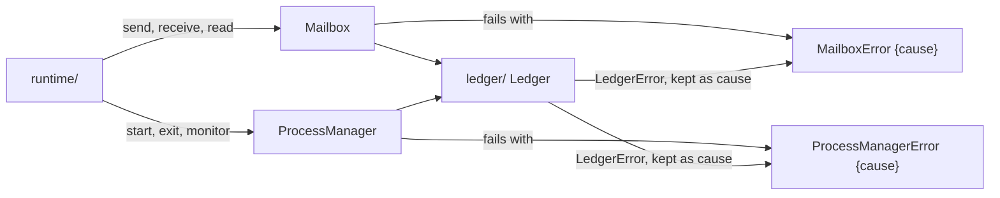

# 0055: A room's own error is named by the service that fails, one per service, so processes/ has MailboxError and ProcessManagerError and keeps ProcessError as its refusal

**What this decides:** in `next/`, each service fails with an error named after it, so one room may
hold several error types, one per service.



```ts
// sketch: processes/, after the move
export class MailboxError extends Schema.TaggedError<MailboxError>()("MailboxError", {
  reason: Schema.Literals(["ledger"]),
  cause: Schema.Defect(),
}) {}

export class ProcessManagerError extends Schema.TaggedError<ProcessManagerError>()("ProcessManagerError", {
  reason: Schema.Literals(["ledger"]),
  cause: Schema.Defect(),
}) {}

// ProcessError stays: the room's refusal, as it is today in coordination/process.ts:150.
```

The fields are a sketch. The names and the `cause` are the decision.

## Context

The folder move (ticket 477) gives `processes/` its own error for a fault from below, by
[0043](0043-rooms-on-floors.md)'s rule 12. Its text says "`processes/` gets an error of its own",
in the singular. The move plan's open question 4, for PR 10 onward, asked what that error is called
and whether one error covers the whole room. Today `Mailbox.send`, `receive` and `read`
(`coordination/mailbox.ts`) and `ProcessManager` (`coordination/process-manager.ts`) both fail with
`LedgerError`, the ledger's own error (`data/ledger.ts:11`).

Effect names an error by the service that fails: in `node_modules/effect/AGENTS.md`
(`effect@4.1.2`, "Services"), the `Database` service's `query` fails with `DatabaseError`, a
`Schema.TaggedError` with `cause: Schema.Defect()`. This record follows that.

This amends [0043](0043-rooms-on-floors.md) in part: rule 12's "an error of its own" reads as one
per service, not one per room. The rest of rule 12 holds.

## Decision

**A room's own error is named by the service that fails: a service called `X` fails with `XError`.**

- In `processes/`, `Mailbox` fails with `MailboxError` and `ProcessManager` fails with
  `ProcessManagerError`.
- `ProcessError` stays. It is the room's refusal, not a fault from below.
- Each service translates a lower room's fault where it calls that room, and keeps the original as
  `cause` (0043's rule 12, [an error keeps its cause](../.patterns/effect-errors-keep-their-cause.md)).
- So a room may hold more than one error type, one per service it offers.

**Binding constraints:**

- No service's signature names `LedgerError` once its room has moved: it names its own error.
- A new service in any room gets its own `<Service>Error`, not a shared room-wide error.
- The rename rides with the move pull request that moves the service (ticket 477, PR 10 onward).

## Consequences

- The move plan's open question 4 is answered. The plan names the two errors in its rows.
- The runner's 15 `new LedgerError` (0043's amendments) become the runtime's own errors, named by the
  runtime service that fails, by this same rule.
- `door/store.ts`, `door/nonce.ts` and `coordination/recovery-store.ts`, which use `LedgerError` for
  their own SQLite faults today, get the error of the service they serve.
- The cost: more error classes, one per service. A caller that handles a whole room's faults
  matches more than one `_tag`.
- Not decided here: the `reason` values of each error. Each build plan picks them.

## Records

- [`.glossary/TERMS.md`](../.glossary/TERMS.md), Ledger section, new rows: `MailboxError` and
  `ProcessManagerError`.
- [0043](0043-rooms-on-floors.md): status line, and one pointer under rule 12.
- Same pull request, not part of this decision: 0043's open amendment line on the door and
  `access/` is answered by the owner on 2026-11-10 (no room imports two floors down, no exemption),
  which answers the move plan's open question 3.
