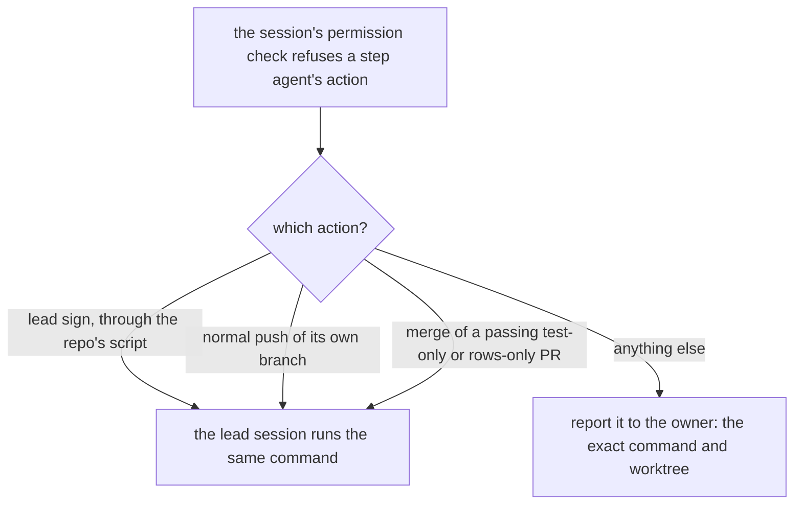

# 0056: When the permission check refuses a step agent's lead sign, its normal push or its merge of a passing test-only or rows-only PR, the lead session runs that same step itself, and every other refusal goes to the owner

**What this decides:** which refused actions the lead session may run itself without asking the
owner again, and that every other refused action is reported, never routed around.



```sh
# the three the lead runs itself, the same commands the step agent ran
pnpm commits sign --step lead            # through the repo's scripts, which read the key themselves
node .agents/skills/lead/scripts/botpush.mjs <tree> fabrikalfa/<branch>   # or a plain non-force git push of its own branch
sh .agents/skills/lead/scripts/catchup.sh <pr> <ticket>
```

## Context

Step agents run under the session's permission check. On 2026-11-10 it refused some of them the
lead sign and the push of their own branch, steps the lead skill gives them, and the work sat until
the owner was asked again. The owner ruled that these few steps are already allowed: the lead
session runs them itself. Tracker ticket 584 records this decision.

**How this fits older texts.**

- [0014](0014-the-lead-merges-when-every-step-passed.md) already lets the lead merge any PR once
  every step passed. A test-only fix is covered by it, so this file adds only that a step agent's
  refused merge attempt does not change that. A PR that only adds `field/*.jsonl` rows had no
  written merge rule; this file gives it one. 0014 is not changed.
- [0028](0028-the-parent-holds-every-right.md) says the parent loop holds every right. This is the
  same idea for today's lead session: the right sits with the lead, not with the step agent.

## Decision

**When the session's permission check refuses one of these three actions to a step agent, the
lead session runs that same action itself, without asking the owner again (owner, 2026-11-10).**

- The lead sign: `pnpm commits sign --step lead`, run through the repo's own scripts.
- The normal push: `botpush.mjs`, or a plain `git push` of the agent's own branch that is not a
  force push.
- The merge, with `catchup.sh`, of a passing test-only fix, or of a PR that only adds
  `field/*.jsonl` rows. A rows-only PR merges on green CI with a clean leak grep.

**Binding constraints:**

- The key file is only ever read by the repo's script. Nobody prints, copies or opens it.
- Every other refused action is reported to the owner with the exact command and worktree. It is
  never run another way, by another agent, or with a changed command.
- Nobody's steps change. A test-only fix still runs every step AGENTS.md and the lead skill
  require before it merges. No force push, no `--admin`.

## Consequences

- A refused sign or push no longer stops a lane until the owner answers.
- The cost: the lead session holds more of the work. A mistake there is fixed forward.
- Not decided here: changing the permission check so step agents are not refused these steps in
  the first place.

## Amendments

- 2026-11-10: **the permanent fix landed** (tracker ticket 652). A lane agent is no longer handed
  a lead-only step: its last act is `land.ts ready`, which records "ready to land" in the lane's
  state file with the PR body, the loosening output and the mutation comparison, and it stops
  there. The lead session runs `land.ts run <lane> <ticket>`, which merges main in, signs as lead
  through main's own signer, leak-greps, pushes with `botpush.mjs`, opens or updates the PR and
  runs `catchup.sh`. `skillscheck.sh` fails a brief template in the lead skill that names a lead
  sign, a step key, `botpush`, `catchup.sh` or `land.ts run`. This decision still covers any other
  step agent the check refuses. The permission check itself is unchanged.
