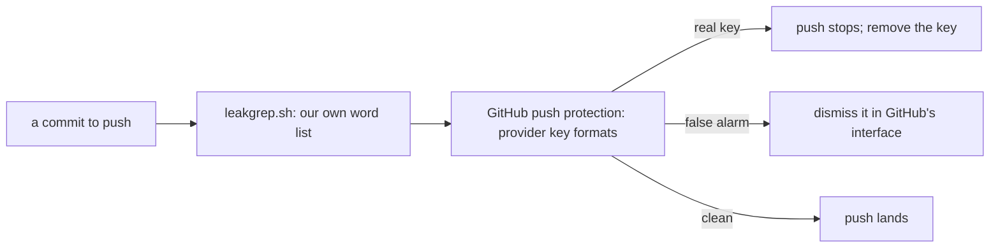

# 0057: GitHub's secret scanning and push protection stay on beside the leak grep, and a false alarm is dismissed, never switched off

**What this decides:** this public repo keeps GitHub's free secret scanning and push protection on,
as a second check next to our own leak grep.



```sh
# what the repo's settings read now
gh api repos/usirin/tea-fabrika --jq .security_and_analysis
# secret_scanning: enabled, secret_scanning_push_protection: enabled
```

## Context

The repo is public, and its only check for leaked text was our own leak grep
([0048](0048-leak-check-reads-each-commit.md)). That grep reads our own list of private words. It
does not know the key formats of the many providers whose keys could end up in a commit. GitHub
offers that check for free on public repos. Trying a widely used tool before writing our own is
already the rule ([0040](0040-existing-tools-before-hand-written.md)). On 2026-11-10 the owner
decided to turn it on, and the lead did, with `gh api -X PATCH repos/usirin/tea-fabrika`, the same
turn. Tracker ticket 588 records this decision.

## Decision

**Secret scanning and push protection are on for this repo and stay on (owner, 2026-11-10).**

- They add to the leak grep and do not replace it. GitHub knows the key formats of many providers;
  the leak grep checks our own word list. Both run.
- A push that GitHub refuses as a false alarm is dismissed in GitHub's interface, with its reason.
- Nobody turns the setting off to get a push through, not for one push and not for a minute.

**Binding constraints:**

- No script, agent or skill switches `secret_scanning` or `secret_scanning_push_protection` off.
- Only a false alarm is dismissed. A real key is taken out of the commit, never waved through.

## Consequences

- A leaked provider key is caught at the push even when no word on our list matches it.
- The cost: a push can now stop on GitHub's word as well as ours, and a false alarm needs a person
  to dismiss it in the browser.
- Not decided here: GitHub's other settings (validity checks, non-provider patterns, Dependabot),
  which stay as they are.
