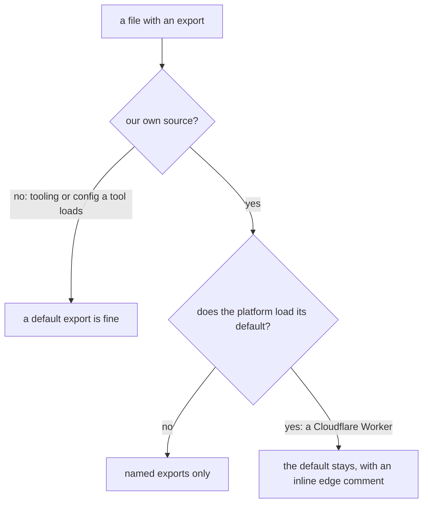

# 0058: Our own source code uses named exports only, never a default export, except a default the platform loads, kept as an inline marked edge

**What this decides:** every module in our own source exports by name; `export default` stays only
in tooling and config files a tool loads by its default, and on the one line where the platform
itself loads a module's default.



```ts
// Before: each importer picks its own name for the same thing.
export default { fetch };

// After: one name, the same at every import, and a search finds them all.
export const Brain = { fetch };

// A default the platform loads stays, marked on its own line.
// oxlint-disable-next-line import/no-default-export -- edge: Cloudflare loads a Worker from its default export
export default { fetch };
```

## Context

A default export has no name of its own: each importer picks one, so the same module can be read
under several names, and a search for the name misses some of them. A named export reads the same
at every import and can be searched for. The known way agrees:
[Google's TypeScript style guide](https://google.github.io/styleguide/tsguide.html#exports) bans
default exports, and Effect's own source uses named exports, which `next/` follows
([0023](0023-next-follows-effects-code-style.md)). oxlint has a built-in rule for it,
`import/no-default-export`, so no hand-written check is needed
([0040](0040-existing-tools-before-hand-written.md)). The owner decided this on 2026-11-10. Tracker
ticket 612 records the decision, and ticket 613 turns the rule on.

The platform is the one place a default is not ours to choose. Cloudflare loads a Worker from its
default export, as [0041](0041-object-classes-are-effect-objects.md) and
[0042](0042-platform-pieces-go-through-alchemy.md) say: a binding with no entrypoint name targets
the Worker's default export.

## Decision

**Our own source code has no default exports; it uses named exports only (owner, 2026-11-10).**

- **In scope:** `next/` (its apps and packages) and today's `packages/`, `programs/` and `apps/`
  source.
- **Out of scope:** tooling and config, and anything a tool loads by its default:
  `vitest.config.ts`, `rslib.config.ts`, `stylelint.config.ts`, `alchemy.run.ts`, `fixtures/`,
  `scripts/` and `oxlint-plugins/`. `.oxlintrc.json` turns the rule off for these by glob.
- **A default the platform loads is an inline, marked edge.** Today that is the Worker entry in
  `next/apps/fabrika/src/brain.ts` and in `packages/fabrika/src/host/durable-object.ts`. Each keeps
  its `export default` with
  `// oxlint-disable-next-line import/no-default-export -- edge: <why>` on the line above it, and
  nothing else in the file is excused.
- The check is oxlint's own `import/no-default-export`, set to `error` in `.oxlintrc.json`.

**Binding constraints:**

- No glob override and no file-level disable for a platform edge: overrides in `.oxlintrc.json`
  are only for the tooling and config folders and files above.
- A new default export in our source is changed to a named one, with its importers; it is never
  excused for being easier to import.

## Consequences

- A module's name is the same in every file that imports it, so a rename or a search covers every
  use.
- The cost: the few default exports in our source today move to named exports, and their
  importers change with them. A file that a new tool loads by its default needs its own line in
  the overrides.
- Not decided here: re-exports (`export * from`) and barrel files, which stay as the room rules
  ([0043](0043-rooms-on-floors.md)) have them.
