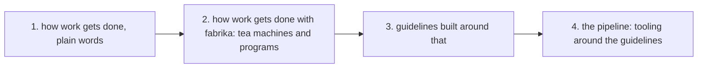

# 0059: next/'s pipeline design starts from how work gets done, then fabrika's way of doing it, then guidelines, and only then the pipeline, never from deep in the stack

**What this decides:** the design of `next/`'s pipeline starts with how work gets done, and the
pipeline comes last, as the tooling around the guidelines.

## Context

The notes on the pipeline so far start from the pipeline itself: steps, verbs, stops and retries. The owner asked for the other way around on 2026-11-10. Tracker ticket 616 records this
decision. How it sits with the notes and decisions that touch the pipeline:

- [Pipeline guidelines](../docs/direction/pipeline-guidelines.md) and
  [jidoka and andon](../docs/direction/jidoka-and-andon.md) start from the pipeline. They stay
  decided, and they are not superseded. They become input to the study below. One line in the
  pipeline guidelines says whoever designs `next/`'s lane "starts from this note". This decision
  puts the work first, and the note is read in step 3, as input.
- [Sweep the core; rebuild the pipeline small](../docs/direction/sweep-the-core-rebuild-the-pipeline.md)
  says the pipeline is rebuilt in `next/`. This decision says in what order it is designed. No
  conflict.
- [Every pull request goes through the pipeline's steps](../docs/direction/next-is-a-pipeline-pre-run.md)
  already says the pipeline is "rebuilt top down from what `next/` teaches". This decision names
  the top. The hand-run steps every pull request goes through today are not changed.
- [0007](0007-drive-is-the-pipeline-lab.md) keeps `drive.ts` as the lab whose lessons go into
  `next/`. Those lessons feed steps 2 and 3. No conflict.

The known way, each checked against the source named:

- **Map the work before you change it.** Lean's value-stream mapping is "diagraming every step
  involved in the material and information flows", and it "typically begins with a team creating a
  current state map" ([Lean Enterprise Institute](https://www.lean.org/lexicon-terms/value-stream-mapping/)).
- **Do it by hand before a machine does it.** Toyota's own page on its production system says,
  "rather than starting with a machine from the beginning, you must first try doing it thoroughly
  by hand" ([Toyota](https://global.toyota/en/company/vision-and-philosophy/production-system/)).
- **A standard comes before improvement.** Standardized work, "once established", "is the object of
  continuous improvement through kaizen" ([Lean Enterprise Institute](https://www.lean.org/lexicon-terms/standardized-work/)).

## Decision

**`next/`'s pipeline is designed in four steps, in this order, and the pipeline is only the last
one (owner, 2026-11-10).**

1. The basic idea of how work gets done, in plain words, with no fabrika terms.
2. How work gets done with fabrika, on the primitives already settled: tea machines and fabrika
   programs.
3. Guidelines built around that.
4. The pipeline, which is only the tooling built around those guidelines.

- A guidelines study named "How we get work done" comes first, run with
  [the guidelines skill](../.claude/skills/guidelines/SKILL.md).
- The existing pipeline notes are its input. They are read, not thrown away.

**Binding constraints:**

- A plan, note or code that sets `next/`'s pipeline steps builds on decided answers to steps 1 to
  3, and does not start before them.
- Step 1 uses no fabrika words. A word from `.glossary/` shows up first in step 2.

## Consequences

- The pipeline in `next/` waits for the study. Today's hand-run steps, `drive.ts` and `chain.ts`
  keep running as they are.
- The cost: the pipeline's design starts later, and the study has to be run first.
- Not decided here: the study's plan, which is not approved yet, and anything the study will
  conclude.

## Amendments

- 2026-11-10 (ticket 616): the owner approved the study's plan, in five parts: the basic loop in
  plain words; how the best do it, from fetched sources; what really happens here, from `field/`;
  the translation into fabrika's programs, tea machines and ledger facts; and about six
  principles. Ticket 574 is the running example, and the loop starts at "decide what to work on
  next". Those two were the lead's leans, and the owner did not object to them.
- 2026-11-10 (ticket 645): the owner read the study's first draft (draft PR 797) and turned down
  its lens, because it answered from how human teams work. The study's sources are the people and
  companies at the front of agent-run software work today: teams where agents do most of the work
  and people direct and check it. How human teams work is background only, used where one of those
  teams says it kept or dropped a practice. The draft's principles are not decided. The study is
  redone on these sources before any walk, and PR 797 stays a draft until then.
- 2026-11-11 (ticket 616): steps 1 to 3 are answered. The study was redone on the teams where
  agents do most of the work, the owner walked it on 2026-11-10, and on 2026-11-11 approved its
  seven principles in [how we get work done](../docs/direction/how-we-get-work-done.md) as the
  starting point, recorded as [0127](0127-how-we-get-work-done-seven-principles.md). Step 4, the
  pipeline, may now build on them. No rule above changes.
