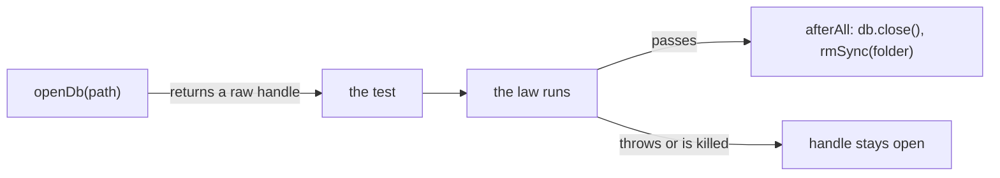
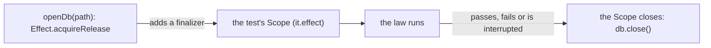

# 0061: Anything that holds a resource is acquired through Effect's scoped primitives, so the scope guarantees its release, never the caller's memory

**What this decides:** a resource is opened with `Effect.acquireRelease` inside a `Scope`, so it is
given back when the scope closes, whether the work passed, failed or was interrupted, and no caller
has to remember to close it.

**Before:**



**After:**



```ts
// before: next/packages/libfabrika/src/data/ledger.test.ts:38-58, cut
const opened: Array<DatabaseSync> = [];

const openDb = (path: string): DatabaseSync => {
  const db = new DatabaseSync(path);
  opened.push(db);
  return db;
};

afterAll(() => {
  for (const db of opened.splice(0)) {
    if (db.isOpen) {
      db.close();
    }
  }

  rmSync(folder, { recursive: true, force: true });
});

// after: a sketch, not built. The names are from effect 4.1.2
// and @effect/vitest 4.1.2.
const openDb = (path: string) =>
  Effect.acquireRelease(
    Effect.sync(() => new DatabaseSync(path)),
    (db) => Effect.sync(() => db.close()),
  );

it.effect("appends in order", () =>
  Effect.gen(function* () {
    const fs = yield* FileSystem.FileSystem;
    const folder = yield* fs.makeTempDirectoryScoped();
    const db = yield* openDb(`${folder}/ledger.db`);
    // ... the law. The scope closes db, then removes folder.
  }),
);
```

The helper no longer hands back a bare handle. It hands back an Effect that needs a `Scope`, so the
type says where the release lives, and the test's own scope runs it.

## Context

The owner decided this on 2026-11-10. Tracker ticket 620.

Test windows, child processes and SQLite files have been left behind after failed or killed test
runs, and each leak was found by hand. Tracker ticket 362 is one: tests leave SQLite files open, so
Windows cannot remove their folder. A read of `next/` the same day found 166 places, in 61 files,
that open a resource with no scope or close one by hand (tracker ticket 639 lists them). All but
one are in test files; the product code already uses `Effect.acquireRelease` where it holds a
handle, as in `next/packages/libfabrika/src/node/stage-recording.ts:20-28`.

This follows Effect's own guidance. Its `AGENTS.md`, in `effect` 4.1.2, sends a reader to
`Effect.acquireRelease` under "Managing resources and `Scope`s"
([0023](0023-next-follows-effects-code-style.md) is the rule that we follow Effect's style). It is
the same reason as [no Promises](../docs/direction/no-promises.md): a Promise loses "clean stopping
when a fiber is interrupted", and a `try/finally` or an `afterEach` is how Promise code fakes it.
It does not change [0052](0052-tests-never-depend-on-the-machine.md): a test's fresh home is one
more resource, and this says how it is given back. Neither conflicts, so no `status:` line changes.

## Decision

**A resource is acquired with Effect's acquire-and-release primitive in a `Scope`, and offered as a
`Layer` or a scoped Effect, so the scope guarantees its release.**

- **What a resource is.** Anything that must be given back: a child process, a test window, a
  database connection, a file handle, a socket, a temp folder, a timer or a subscription.
- **Acquire** with `Effect.acquireRelease(acquire, release)`. Its type needs a `Scope`, and the
  release runs when that scope closes, on success, failure or interruption. Where the handle already
  has JavaScript's disposal protocol, `Effect.acquireDisposable` does the same.
- **Offer it** as a `Layer` built with `Layer.effect` (in `effect` 4.1.2 a Layer's own scope holds
  what it acquires; there is no `Layer.scoped`), or as a scoped Effect that the caller runs inside
  `Effect.scoped`.
- **Use what Effect already scopes** before writing one: `ChildProcessSpawner`'s `spawn` from
  `effect/process` needs a `Scope` and stops the child when it closes,
  `FileSystem`'s `makeTempDirectoryScoped` and `makeTempFileScoped` remove what they made,
  `PubSub.subscribe` needs a `Scope`, and `Effect.forkScoped` ties a fiber, a timer loop included,
  to the scope.
- **In tests,** `it.effect` from `@effect/vitest` runs each test in a `Scope` that closes when the
  test ends, and `layer(...)` shares a Layer across a file and releases it after.
- **A platform edge that hands us a raw handle is wrapped once, at the edge,** in
  `Effect.acquireRelease`, and nothing past that edge sees the raw handle. A `node:` import there
  keeps its edge comment as before.

**Binding constraints:**

- No bare `try/finally` that releases a resource.
- No `afterEach` or `afterAll` cleanup that a thrown error or a killed test can skip.
- No "remember to close" in a prompt, a skill or a doc. A rule that code can hold is code.
- **Where it applies:** `next/` everywhere. Lead tooling under `.agents/` as each file is next
  touched ([0033](0033-agents-code-follows-next-rules.md)). Today's version only in code that is
  being changed anyway.

## Consequences

- **What it does not decide: a process killed with SIGKILL runs no finalizer.** A scope closes only
  while its process is alive to close it. A resource that must not outlive its parent, such as a
  test window or a child process tree, also needs a guard outside the process. The test-window plan
  now in flight covers that case; this decision does not.
- The 166 places in `next/` move in a later sweep, tracker ticket 639. Nothing is fixed here.
- Whether a lint rule can hold the shape is ticket 639's to answer, with its false alarms measured
  first.
- Cost: a test that opens a resource is written as an Effect test, which changes how about 61 test
  files read.
- No table under `docs/direction/follows/` covers Effect, so none changes.
