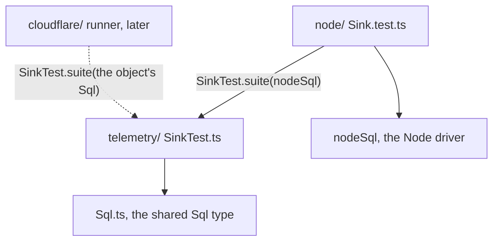

# 0062: Test files keep to the floors too, and a lower room tests against a real database through a suite that a higher room runs

**What this decides:** in `next/`'s libfabrika, a test file imports only from lower floors, as
product code does, and a room whose laws need a real database writes them as a suite that the room
holding the driver runs.

A room is now a module and a floor a layer, names only; every rule here holds
([0091](0091-modules-and-layers.md)).



Every arrow points down a floor. `telemetry/` holds the laws and names only the `Sql` type; the
room that owns a driver runs them. The dotted runner is not built and not decided here.

## Context

The folder move (ticket 477, PR 2) put the rooms on their floors and found six test sites that
break the floor rule, all in `next/packages/libfabrika/src`, read on the move's branch at
`d8ffd5496`:

- Five telemetry tests import `nodeSql` from `ledger/NodeSqlite.ts`, one floor up:
  `telemetry/P12Readers.laws.test.ts`, `RecordPart.test.ts`, `Records.test.ts`, `Sink.test.ts`
  and `internal/measurements.test.ts`.
- `presence/Connections.test.ts` imports `processes/Process.test-support.ts`, on its own floor.

`NodeSqlite.ts` imports only `../Sql.ts` and a type from `node:sqlite`. It sits in `ledger/` only
because it lived in `data/`. [0051](0051-gateway-connection-and-node-by-job.md) sends platform code
to `node/`, the top floor and later its own package. Then 25 test files below `node/` that import
it today would import upward, plus `Process.test-support.ts`, which about 18 more use (grep).

What the industry does, each read for this record:

- **Layer tools check tests by default.**
  [dependency-cruiser](https://github.com/sverweij/dependency-cruiser/blob/main/doc/rules-reference.md)
  matches every module when a rule's `from` is empty; its
  [starter config](https://github.com/sverweij/dependency-cruiser/blob/main/src/cli/init-config/config-template.mjs)
  lets tests use dev-only packages (`not-to-dev-dep`'s `pathNot`) and nothing more.
  [ArchUnit](https://github.com/TNG/ArchUnit/blob/main/archunit-junit/junit5/api/src/main/java/com/tngtech/archunit/junit/AnalyzeClasses.java)'s
  `importOptions()` defaults to `{}`: `DoNotIncludeTests` is something you add.
  [eslint-plugin-boundaries](https://www.jsboundaries.dev/docs/setup/settings/): "All files
  included", "No files ignored". Nx's
  [`enforce-module-boundaries`](https://github.com/nrwl/nx/blob/master/packages/eslint-plugin/src/rules/enforce-module-boundaries.ts)
  has `allow: []` by default and no test carve-out.
- **Effect writes a suite in the lower package and runs it from the platform package.**
  `packages/effect/test/unstable/eventlog/SqlEventLogServerUnencryptedStorageTest.ts` exports
  `suite = (name, layer: Layer.Layer<SqlClient.SqlClient, unknown>) => ...`, and
  `packages/sql/sqlite-node`, `pg` and `mysql2` each run it with their own client
  ([effect-smol](https://github.com/Effect-TS/effect-smol)). `packages/effect/package.json` does
  not depend on `@effect/platform-node`. Effect reaches the suite through a path alias its root
  `tsconfig.json` marks "We should try to get rid of it"; inside one package we need no alias.
- **phoenix's lint rules bite tests too.** "The rule should bite everywhere, production *and*
  tests", and a justified test line is suppressed one by one
  ([`.patterns/biome-custom-gritql-rules.md`](https://github.com/kamp-us/phoenix/blob/main/.patterns/biome-custom-gritql-rules.md)).
- **Our own records already lean this way.** [0042](0042-platform-pieces-go-through-alchemy.md)
  says "Tests follow the same rule". [An object class stays thin](../docs/direction/object-classes-stay-thin.md)
  says "the ledger suite runs one set of laws with a driver per runtime".

Node's SQLite misses real differences from the Durable Object's. The object's `sql.exec()`
"cannot execute transaction-related statements like `BEGIN TRANSACTION` or `SAVEPOINT`"
([Cloudflare docs](https://developers.cloudflare.com/durable-objects/api/sqlite-storage-api/)), so
its transactions go through `transactionSync`, while `nodeSql` sends `BEGIN IMMEDIATE`, `COMMIT`
and `ROLLBACK`. A suite that takes the driver is the shape that can later run on both.

**How this fits older records.** It applies [0043](0043-rooms-on-floors.md)'s rule 3 ("a room
imports only from lower floors") to test files, a case 0043 did not name, and keeps the "no
exemption" of its amendments and of [0055](0055-errors-named-by-their-service.md). Neither changes,
so neither status line does; 0043 gets a one-line pointer under rule 3.
[0032](0032-libraries-take-effects-file-layout.md)'s "the test sits beside it" still holds for the
laws: the suite sits beside its module, and only the runner lives in the driver's room. Tracker
ticket 642 is this record; ticket 641 builds the first part.

## Decision

**Test files keep to the floors, with no exemption, and a lower room's database laws are a suite
that the room owning the driver runs.**

**Before** (on the move's branch):

```ts
// telemetry/Sink.test.ts: imports a floor up
import { DatabaseSync } from "node:sqlite";
import { nodeSql } from "../ledger/NodeSqlite.ts";

const sql = nodeSql(new DatabaseSync(":memory:"));
it("drops a deleted record's bytes", () => ...);
```

**After** (a sketch; the maker's exact shape is the plan's):

```ts
// telemetry/SinkTest.ts: the laws, and no driver
import type { Sql } from "../Sql.ts";

export const suite = (open: () => Sql) =>
  describe("SpanSink", () => {
    it("drops a deleted record's bytes", () => ...);
  });

// node/Sink.test.ts: runs the laws with the real driver
import * as SinkTest from "../telemetry/SinkTest.ts";

SinkTest.suite(nodeSql);
```

What moved: the import of the driver left `telemetry/`, and the laws stayed beside `Sink.ts`.

- **No exemption for tests.** A test file, a `*.test-support.ts` and a suite import only from lower
  floors, exactly as product code does (0043, 0055). This is the layer tools' default and what
  Effect and phoenix do.
- **A room whose laws need a real database writes them as a suite:** a function that takes a `Sql`
  maker and registers the laws. The file is `<Module>Test.ts` beside its module, so vitest does not
  run it alone, and it exports `suite`, read through its module per
  [0029](0029-format-and-names-follow-effect.md): `SinkTest.suite(nodeSql)`.
- **The room that owns the driver runs the suite,** in a `*.test.ts` of its own. The same suite can
  later run on the Durable Object's SQLite, the "one set of laws with a driver per runtime" that
  [an object class stays thin](../docs/direction/object-classes-stay-thin.md) asks for.
- **A test helper two rooms share lives on a floor both may import.** For presence, the part of
  `Process.test-support.ts` it uses moves down to a floor below both rooms.
- **Sequencing.** The five telemetry tests and presence's helper are fixed in their own pull
  request right after the move's PR 2 (ticket 641). Until then the six sites are six `allowed`
  entries in `layer-rules.json`, each dated, with a guard that fails if that pull request lands
  with any of them still present.
- **The end state** is `nodeSql` in `node/`, with the other test files that import it turned into
  suites. That is a later ticket (644), and its details are not decided here.

**Binding constraints:**

- No rule, glob or `allowed` entry exempts test files from the floors, except the six dated entries
  above, which leave with ticket 641.
- A suite that no runner calls is a failure: the plan that adds the first suites adds a check that
  each one is run.

## Consequences

- Ticket 641 turns the five telemetry tests into suites run from `node/`, moves presence's helper
  down, and removes the six entries. It starts with one mutation dry run on `Sink`, to confirm
  StrykerJS still kills mutants through a suite.
- Ticket 644 moves `nodeSql` to `node/`; the test files below it become suites.
- Ticket 643, apart from this rule: SQLite tests that never reopen use an in-memory database.
- The cost: a room's database laws now span two files, the suite and its runner, and runners
  gather in `node/`. A wrong import fails lint early; a suite nobody runs is the risk the check
  above closes.
- Not decided here: whether tests also run inside the real runtime as a second runner, and when.

## Records

- No glossary row: "suite" keeps its everyday testing meaning.
- [0043](0043-rooms-on-floors.md): one pointer under rule 3, no status change.
- AGENTS.md: one clause in the rooms-on-floors bullet.
- [`docs/direction/follows/`](../docs/direction/follows/README.md) has no Effect table, so no row
  is added.
