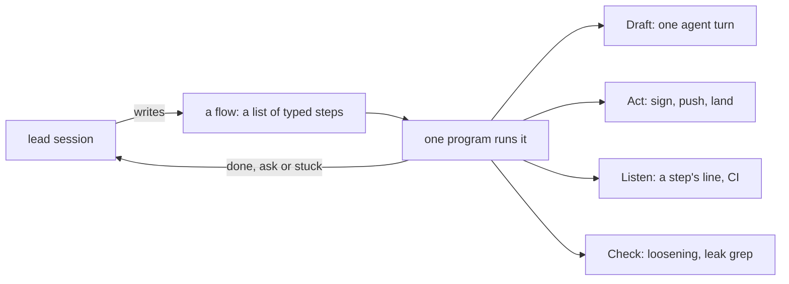

# 0064: The lead drives lanes and its own chores by writing a flow, a list of typed steps that one program runs, and no agent ever holds a loop

**What this decides:** how the lead session gets multi-step work done: it writes a short flow from
fabrika's own primitives and runs it as code, and it never starts an agent whose job is to start
steps, wait and read their answers.



```ts
// Sketch. Names settle in the build (tracker ticket 656). A flow is data, saved before it starts.
const relandAskDesk = Flow.make("askdesk7", [
  Step.draft("tests", { brief: "tests" }),
  Step.act("lockfile"),
  Step.draft("build", { brief: "build" }),
  Step.check("tree-equals", { ref: "refs/keep/askdesk6-final" }),
  Step.draft("review", { brief: "review" }),
  Step.act("land"),
]);
```

## Context

[0031](0031-lane-tooling-dogfoods-fabrikas-primitives.md) put the lane runner on fabrika's own
pieces, and `chain.ts` runs one fixed lane in code. On 2026-11-10 the lead session still ran fifteen
lane agents that each started a step, waited and read the answer, at 100,000 to 360,000 tokens
apiece. The fixed lane did not fit the day's other shapes (a lane re-landed on fresh commits, a
lead commit between two steps, a branch that only needed landing), so each of those went to an
agent. AGENTS.md already says one fresh agent per step and no long driver.

## Decision

**The lead writes a flow for each piece of multi-step work and runs it as code; an agent runs one
bounded turn inside a flow and never carries one (owner, 2026-11-10).**

- A flow is data: an ordered list of typed steps, saved before it starts. One program runs it. Its
  position is stored state, so a resume needs nothing in memory
  ([0037](0037-implicit-state-machines-made-explicit.md)).
- The steps are the six pipeline primitives: Gather, Act, Listen, Draft, Check, Judge. The lead's
  own actions (the lead sign, a lockfile commit, the push, the pull request, the merge) are Act
  steps the runner performs in the lead session's name.
- A flow ends with one line: `done`, `ask` with one question, or `stuck`. Answering an ask is the
  lead session's part of a lane.
- The flows run on fabrika's primitives as a library, outside fabrika's app. They do not wait for
  the app. `chain.ts`'s fixed lane becomes one named flow.
- An agent started outside a flow does one bounded piece of work that is not a loop: a study, a
  plan, one tooling change.

**Binding constraints**

- No agent is briefed to start steps and wait for them.
- A flow that needs a shape the steps cannot express is a missing step to build, never a reason to
  hand the loop to an agent.
- Every flow run records dollars and tokens per step.

## Consequences

- The lead session's agent count drops to the steps running plus bounded jobs. The cost of a lane
  is its steps, not its steps plus a driver.
- The cost: a new situation needs a flow written, and sometimes a step built first. That work is
  lead tooling, fast-tracked ([0033](0033-agents-code-follows-next-rules.md)).
- Tracker ticket 656 builds it. Ticket 652 (the landing tail) and ticket 341 (the drive script)
  become steps in it.
- Not decided here: whether flows later run inside fabrika's app as programs a person can watch.
  For now the runner stays a tea machine, not a `Program.make` ([0070](0070-flow-runner-stays-a-machine.md)).
- Any agent, not only the lead, composes work by handing fabrika a flow as data
  ([0074](0074-agent-hands-over-a-flow.md)). The rules above still hold as written.
