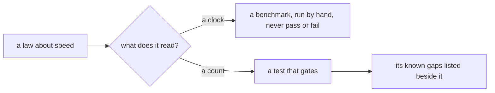

# 0065: A speed law gates on a count of work, never on a clock, and a count's known gaps are written down and accepted



```ts
// Today's version, programs/trace: the law that replaces a timing compare (ticket 649).
const once = counted(() => childrenOf(big), cap).work;
const four = counted(() => quarters.forEach((r) => childrenOf(r)), cap).work;
expect(once).toBeLessThan(2 * four); // linear: about 1.0x on every machine
```

**What this decides:** a test that guards how much work code does counts that work and never reads
a clock, and the owner accepts that a count does not see everything.

## Context

Ticket 649: a law in `programs/trace` compared two `performance.now()` timings and went red on a
correct change, on a noisy CI runner (PR 763, a ratio of 3.06 against a bar of 3). Its fix counts
the work done through the array, Map and Set built-ins. That count cannot see a hand-written
`while` loop, and the plan asked whether to ban such loops by lint.

Effect's own repo (read 2026-11-10) does the same split. Its runtime benchmarks sit in
`packages/effect/benchmark` on tinybench and no CI job runs them. What gates is exact counts: the
`typeperf` harness fails on type instantiations past a saved limit, and the bundle job compares
sizes. Its README calls the counts "regression gates" and the rest informational.

This builds on [0036](0036-a-flaky-test-is-fixed.md): a flaky test is fixed by removing its
cause, and here the cause is the clock.

## Decision

**A law about speed gates only on a number that is the same on every machine.**

- A test never passes or fails on elapsed time. Timings belong in a benchmark or an experiment,
  run by hand, with the numbers in its write-up.
- A count comes from the tool where one exists (a compiler's own numbers, a bundle's size, a
  query count). A hand-made counter is allowed where none exists, with its edge cases listed and
  a test each ([0040](0040-existing-tools-before-hand-written.md)).
- A count's known gaps are written beside the law, with the plant that slips through. The gap in
  ticket 649, slow code in a hand-written `while` loop, is accepted. No lint rule bans a language
  feature only to close a counter's gap.
- A fake clock (Effect's `TestClock`) is for code that waits: timeouts, retries, schedules. It
  is not a speed law.

## Consequences

- Ticket 649's plan goes ahead as written, without the lint ban.
- A slow hand-written loop in `programs/trace` would pass its law. No such loop exists today.
- Other tests that compare timings are flaky tests waiting to happen; each is moved to a count
  or to a benchmark when it is next touched or first goes red.
- Not decided here: where benchmarks live and who runs them.
