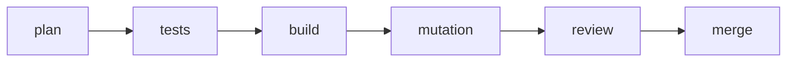
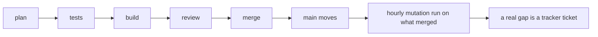

# 0066: Mutation testing leaves the pull request's steps and runs hourly against main, with its findings filed as tickets

**Before:**



**After:**



```text
# before: one step in every lane, waiting on the one Docker box
tests, build, mutation, review
# after: the lane has no mutation step; one run an hour covers what merged
tests, build, review          then, each hour: mutbox run --base <last> --build <main>
```

The mutation box moves from inside every lane to one run after the merge.

**What this decides:** a pull request no longer has a mutation step; one scheduled run an hour
mutates what merged to main and files each real gap as a ticket.

## Context

[A fast check per pull request, a mutation queue for the rest](../docs/direction/fast-and-daily-mutation.md)
(decided 2026-11-01) kept a fast mutation check on every pull request, as advice, and sent the
rest to a scheduled queue that was not built. On 2026-11-10 seven lanes ran as code at once and
the step was the largest wait in each: the laptop runs one Docker box at a time
([0045](0045-test-steps-run-in-containers.md)), so one lane's 37.6 minute step was mostly a
queue, and three lanes ended stuck on a busy box.

What the step found, from 42 logged runs: 8 had nothing to mutate, a handful led to a new law
(ticket 554 closed five real gaps), and its arm a against arm b comparison, the "did a law get
narrower" answer, was missing in 21 of 33 runs (ticket 655).

This amends [0014](0014-the-lead-merges-when-every-step-passed.md) in part: its "every step" list
and its narrowing list change. The rest of 0014 holds.

## Decision

**Mutation runs on a schedule against main, never as a step of a pull request.**

- "Every step" of a pull request is plan, tests, build and one review. A lane has no mutation
  step and no lane waits on the Docker box for one.
- Each hour, one run mutates the changed lines of what merged since the last run, in the
  container, with the tests beside the changed files. No new merge, no run.
- A survivor judged a real gap becomes one tracker ticket per file, at most three a day. Noise is
  counted and not filed. Before the tickets are trusted, their false alarms are counted, as the
  note above says.
- The run also compares the range's base tests with its own (arm a against arm b). A law that got
  narrower is found within the hour and filed as a ticket marked as loosening.
- At merge, `loosening.sh` stays, on every pull request, with the lead's hand check of each hit.
  It alone, with zero real loosening, now means no owner read is needed.
- This is a trial. Every hourly run is logged with its counts (sampled, killed, survived, real,
  noise, tickets, minutes). After a week of runs the owner reads them and keeps the schedule,
  changes it, or brings a fast step back to the pull request.
- For now the hourly run is a second agent session on the owner's laptop that runs the container
  as code and judges only the survivors. Running it in CI was considered and put off.
- Changed by [0067](0067-hourly-mutation-runs-in-ci.md): the hourly run now runs in GitHub CI,
  started by hand each hour. The rest of this list holds.
- Changed by [0077](0077-mutation-gaps-carry-a-category.md): each real gap's ticket carries a
  category, and a second gap of one category files one ticket against the tests step.
- Changed by [0089](0089-mutation-covers-lane-code.md): of the lead tooling, the run tests only
  the code that runs lanes (`chain.ts`, `drive.ts` and the flow runner).

**Binding constraints:**

- A lane brief names no mutation step, and a merge never waits on a mutation result.
- The hourly run changes nothing in the repo: it reads, runs the container and files tickets.
- One Docker box at a time still holds; the hourly run waits its turn behind a lane's test step.

## Consequences

- A gap the step would have caught reaches main and is found up to an hour later, as a ticket.
  A survivor is a missing test, not a bug; every merge can be reverted.
- A narrowed law is no longer caught before the merge by mutation. `loosening.sh` is the check at
  merge, and it reads the test text, not behavior: a law narrowed without a removed or changed
  `expect` is seen only by the hourly run.
- Lanes get shorter by the step and its queue.
- Lanes already inside a mutation step finish it. `chain.ts`, the lane brief template, the
  mutation and lead skills and the plan docs drop the step in their own pull request.
- Not decided here: moving the run to CI, and the `next/` mutation queue program (Tier 6), which
  the note still describes.
